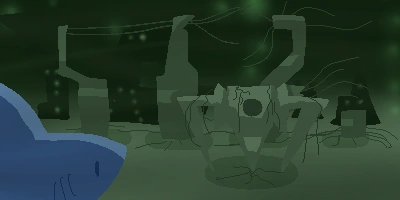
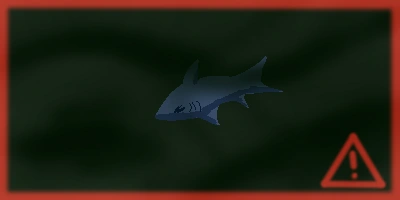
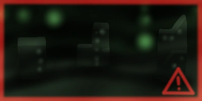

# Abandoned World

*A dying world filled with machinery.*

> **You are a shark in a murky dark green sea.**

> The tar clogs the gills of everyone here. This dying world drags everyone down with it.

## Summary

Abandoned worlds have plenty of resources and plenty of [Frenzy](stuff.md#frenzy) animals, but it can all disappear quickly if you aren't careful. Progress is fast at first, but it's difficult to maintain any kind of living workforce until you obtain a [purifier](stuff.md#purifier). Fortunately the presence of [tar](stuff.md#tar) doesn't keep you from opening the [Strange Gate](strange-gate.md) and leaving these worlds behind. Hints are made that you've visited these worlds before, but your machines don't always produce so much tar, do they?

## Resources

### Frenzy

|                            |                                     |
|----------------------------|-------------------------------------|
| • Shark • Ray • Crab | • Lobster • Dolphin • Octopus |

### Basic Materials

|                                |                                   |                    |
|--------------------------------|-----------------------------------|--------------------|
| • Fish • Sand • Crystals | • Coral • Sea Apples • Clam | • Sponge • Kelp |

### Advanced Materials

|                                              |                        |
|----------------------------------------------|------------------------|
| • Sharkonium • Delphinium • Coralglass | • Residue • Spronge |

### Other

- [Tar](stuff.md#tar) (-0.0001 Frenzy Animals /s)
  - NOTE: This includes breeders and animals with jobs
- [Purifier](stuff.md#purifier) (-1 Tar /s)
- [Sea Scourer](stuff.md#sea-scourer) (-1 Tar /s, +10 Residue /s)
- All machines besides [crustacean](lobster.md) machines produce Tar
- The [Recycler](recycler.md) produces 1 Tar for every 100,000 Residue it creates

### Multipliers

- Planetary Income - Tar (0.1)
  - Tar is produced at a rate of Climate Level×0.1/s
- Planetary Starting Resources - Crystal Miners (1)
  - You begin with 1 Crystal Miner
- Planetary Starting Resources - Sand Diggers (1)
  - You begin with 1 Sand Digger
- Planetary Starting Resources - Fish Machines (1)
  - You begin with 1 Fish Machine
- Planetary Starting Resources - Silent Archivists (1)
  - You begin with 1 Silent Archivist

## Special Events

 The tar is killing everything! Maybe a machine can save us? (Get 20 Tar)

 Only machines will remain. All is lost. All is lost. (Get 200 Tar)

## Ending messages

"Do your previous worlds resemble this?"  
"Was that your first or second visit to that world?"  
"Do you wonder who abandoned the machines?"  
"What thoughts lie within your mind?"  
"Did you ever know this world before its death?"

## Trivia

- Not all tar in the Earth's ocean comes from human pollution. Naturally occuring oil deposits can sometimes leak through the sea floor, accounting for roughly half of all the oil in the ocean. These oil seeps are usually very old, and move slowly enough that some of the nearby wildlife is able to adapt to it. Natural ocean tar is slightly different than that left by human pollution, but both kinds are highly toxic and damaging to the environment. [1]

<!-- -->

- It is implied (although, not yet confirmed) that Abandoned World once was [Marine World](marine-world.md) at some point.
  - this can also be backed up due to one of the scene images being named "marine-abandoned.png"

[1] [Natural Oil Seeps](https://www.whoi.edu/know-your-ocean/ocean-topics/seafloor-below/natural-oil-seeps/)

---

*Originally from the [Shark Game Wiki on Fandom](https://shark-game.fandom.com/wiki/Abandoned_World), licensed under [CC BY-SA 3.0](https://creativecommons.org/licenses/by-sa/3.0/).*
