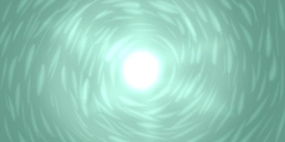

# Artifacts

 After entering the [Gateway](gateway.md) you have the option to purchase any of 5 randomly chosen Artifacts in exchange for Essence. You may purchase as many as you can afford, and once an Artifact has been purchased at one level the next level will immediately become available. The maximum level of each Artifact is 10, with the exception of Time Anemone (which maxes out at level 5) and Distant Foresight (which maxes out at level 15).

There are three types of Artifacts, each with its own scaling cost and effect:

- [Migrators](artifacts.md#migrator-artifacts) - Bring a set number of one [Frenzy](stuff.md#frenzy) species with you to the next world
- [Totems](artifacts.md#totem-artifacts) - Applies a multiplier to one group of items
- [Miscellaneous](artifacts.md#miscellaneous-artifacts) - Various other helpful bonuses

## Migrator Artifacts

The cost and effect of these Artifacts scale exponentially with level.

- Cost = 2^(Level+1) (e.g. Level 1 costs 2 Essence, Level 2 costs 4 Essence)
- Effect = 5^Level creatures transferred (e.g. Level 1 transfers 5 sharks, Level 2 transfers 25 sharks)

| \|Artifact        | \|Description                                                                                                                            |
|-------------------|------------------------------------------------------------------------------------------------------------------------------------------|
| Shark Migrator    | Essence forges a barrier. Sharks are fragile between worlds. (Bring some [sharks](shark.md) with you to the next world.)              |
| Ray Migrator      | The gateway has no sand to hide in. (Bring some [rays](ray.md) with you to the next world)                                            |
| Crab Migrator     | Essence-refined shells to keep the crabs alive. (Bring some [crabs](crab.md) with you to the next world)                              |
| Shrimp Migrator   | The hive produces a new hive. (Bring some [shrimp](shrimp.md) with you to the next world.)                                            |
| Lobster Migrator  | Relaxing in the astral seas. (Bring some [lobsters](lobster.md) with you to the next world.)                                          |
| Dolphin Migrator  | They will find this transportation strangely familiar. (Bring some [dolphins](dolphin.md) with you to the next world.)                |
| Whale Migrator    | They need no protection, only persuasion. (Bring some [whales](whale.md) with you to the next world)                                  |
| Eel Migrator      | Essence tunnels for them to slide into a new domain. (Bring some [eels](eel.md) with you to the next world.)                          |
| Chimaera Migrator | The light is unbearable. Essence dulls the brightness. (Bring some [chimaeras](chimaera.md) with you to the next world.)              |
| Octopus Migrator  | The gateway defies reason. It is uncomfortable to the rational mind. (Bring some [octopuses](octopus.md) with you to the next world.) |

## Totem Artifacts

The cost and effect of these Artifacts scale exponentially with level.

- Cost = 2.5^(Level+1), rounded down (e.g. Level 1 costs 2 Essence, Level 2 costs 6 Essence)
- Effect is linear and applies to all income from the items named.

| \|Artifact           | \|Description                                                                                                                                | Multiplier           |
|----------------------|----------------------------------------------------------------------------------------------------------------------------------------------|----------------------|
| Totem of Shark       | To hunt. To catch. To win. (Increase the effectiveness of sharks and their roles.)                                                        | Artifact Level+1     |
| Totem of Ray         | Flying across the ocean in grace and serenity. (Increase the effectiveness of rays and their roles.)                                      | Artifact Level+1     |
| Totem of Crab        | No stone left unturned. (Increase the effectiveness of crabs and their roles)                                                             | Artifact Level+1     |
| Totem of Shrimp      | The hive mind awakens. (Increase the effectiveness of shrimp and their roles.)                                                            | Artifact Level+1     |
| Totem of Lobster     | The seabed is a priceless treasure. (Increase the effectiveness of lobster and their roles.)                                              | Artifact Level+1     |
| Totem of Dolphin     | Exiles of a greater threat. (Increase the effectiveness of dolphins and their roles.)                                                     | Artifact Level+1     |
| Totem of Whale       | Keepers of song and mystery. (Increase the effectiveness of whales)                                                                       | Artifact Level+1     |
| Totem of Eel         | Snaking elegance, talented attendants. (Increase the effectiveness of eels and their roles.)                                              | Artifact Level+1     |
| Totem of Chimaera    | The prodigal descendants return. (Increase the effectiveness of chimaeras and their roles.)                                               | Artifact Level+1     |
| Totem of Octopus     | The cold, rational response is to maximise rewards. (Increase the effectiveness of octopuses and their roles.)                            | Artifact Level+1     |
| Totem of Progress    | Progress can be slowed, but it can never be stopped. (Increase the effectiveness of [shark machines](stuff.md#shark-machines).)           | Artifact Level+1     |
| Totem of Carapace    | The shelled machines are slow but clean. (Increase the efectiveness of [crustacean machines](stuff.md#other-machines))                    | Artifact Level+1     |
| Totem of Inspiration | Dreams of a former glory. (Increase the effectiveness of [cetacean machines](stuff.md#other-machines).)                                   | Artifact Level+1     |
| Totem of Industry    | Find unity in efficiency. Seek octal rationalities. (Increase the effectiveness of [cephalopod machines](stuff.md#other-machines).)       | Artifact Level+1     |
| Totem of Warding     | The end is inevitable, but the wait can be lengthened. (Reduce the adverse effects of [harmful](stuff.md#ice) [materials](stuff.md#tar).) | 1÷(Artifact Level+1) |

## Miscellaneous Artifacts

The cost of these Artifacts scales exponentially, but each at different rates. The effects scale in various manners.

| \|Artifact        | \|Description                                                                                                                             | \|Cost                      | \|Effect                                                                                                                                                             |
|-------------------|-------------------------------------------------------------------------------------------------------------------------------------------|-----------------------------|----------------------------------------------------------------------------------------------------------------------------------------------------------------------|
| Time Anemone      | As creatures dwell within the sea, so too do creature dwell within causality. (Applies a multiplier to all income)                     | 10^(Level+1), rounded down  | All income is multipilied by 2×Artifact Level                                                                                                                        |
| World Shaper      | Intelligence is not changing to fit an environment, but changing the environment to fit you. (Reduces the severity of planet climates) | 4^(Level+1), rounded down   | For calculating [climate effects](worlds.md), Climate Level is multiplied by 0.9^(Artifact Level)                                                                    |
| Gate Controller   | Power over the unknown can only reach so far. (Reduces the cost requirements of gates.)                                                | 3^(Level+1), rounded down   | Each [gate requirement](strange-gate.md) is multiplied by 0.9^(Artifact Level)                                                                                       |
| Distant Foresight | Knowledge may not change destiny, but it may divert it. (Reveals properties of worlds before travelling to them.)                      | 1.5^(Level+1), rounded down | Shows attrtibutes equal to the Artifact Level beginning with [modifiers](worlds.md), then [gate requirements](strange-gate.md), then [missing resources](worlds.md). |

## Trivia

The word "totem" comes from the Algonquian *odoodeman*, meaning one's family or family mark.[1] Since the term's introduction to the English language a variety of meanings and beliefs have been ascribed to totems. There are differing opinions on the use of this and similar terms outside of their original religious meanings. Some people find it offensive in every context, while some feel it is used in good faith.[2] Certain corporate advice cautions specifically against the use of "bottom of the totem pole" as a negative.[3] No one can speak for anyone else as to what is and isn't offensive to any given person, so it's best to err on the side of caution when you aren't able to ask directly what is most appropriate for your audience.

[1] [Online Etymology Dictionary: Totem](https://www.etymonline.com/word/totem)

[2] [Is It Offensive To Use The Term "Totem Pole" Informally?](https://jessesingal.substack.com/p/is-it-offensive-to-use-the-term-totem)

[3] [Use these culturally offensive phrases, questions at your own risk](https://www.ictinc.ca/blog/culturally-offensive-phrases-you-should-use-at)

---

*Originally from the [Shark Game Wiki on Fandom](https://shark-game.fandom.com/wiki/Artifacts), licensed under [CC BY-SA 3.0](https://creativecommons.org/licenses/by-sa/3.0/).*
