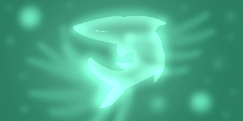
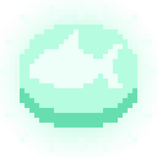

# Aspects

> **New Frontiers Exclusive!** The following content is only available in the *New Frontiers* version.

  

In the *New Frontiers* version of Shark Game, [Artifacts](artifacts.md) are entirely removed from the game. Instead, they are replaced with *aspects.* Aspects work similarly to Artifacts and require essence to obtain. Aspects cannot be obtained within worlds and must be obtained after a world is completed (or skipped).

## Aspect Tree

In *New Frontiers,* Aspects can be found in a location called the *Aspect Tree* after entering the *[Strange Gate.](strange-gate.md)* As its name suggests, the Aspect Tree functions as a skill tree, allowing the player to spend their essence on permanent skills to enhance their next run.

There are two types of Aspects that can be purchased: *Core Aspects* and *Non-Core Aspects.*  
  
Non-Core Aspects *do not activate when visiting worlds for the first time* (aka, scouting). **The world MUST be completed in order for the Non-Core Aspects to work on that specific world.** *Skipping the world does <u>not</u> count as completion.*

Below are a list of all Aspects, as well as the requirements and costs for each one. <tabber> \|-\|Core=

| Icon                                   | Name                    | Description | Caption | Cost | Other Requirement     |
|----------------------------------------|-------------------------|-------------|---------|------|-----------------------|
|              | Apotheosis              |             |         |      | none                  |
|         | Token of Industry       |             |         |      | Apotheosis            |
|  | Coordinated Cooperation |             |         |      | Token of Industry     |
|             | The Hour Hand           |             |         |      | Token of Industry     |
|     | Path of Enlightenment   |             |         |      | Apotheosis            |
|        | Distant Foresight       |             |         |      | Path of Enlightenment |
|           | Destiny Gamble          |             |         |      | Distant Foresight     |
|          | Infinity Vision         |             |         |      | Distant Foresight     |
|              | Clean Slate             |             |         |      | Distant Foresight     |
|              | Meditation              |             |         |      | Path of Enlightenment |
|                | Patience                |             |         |      | Meditation            |
|                | Gumption                |             |         |      | Meditation            |
|                 | The Dial                |             |         |      | Patience              |

\|-\|Non-Core=

| Icon                                    | Name                     | Description | Caption | Cost | Other Requirement       |
|-----------------------------------------|--------------------------|-------------|---------|------|-------------------------|
|                 | Overtime                 |             |         |      | The Hour Hand           |
|               | Double Time              |             |         |      | The Hour Hand           |
|               | Path of Time             |             |         |      | Apotheosis              |
|       | Internal Calculator      |             |         |      | Path of Time            |
|    | Extensive Organization   |             |         |      | Internal Calculator     |
|          | Crystalline Skin         |             |         |      | Path of Time            |
|           | Path of Industry         |             |         |      | Apotheosis              |
|                  | The Plan                 |             |         |      | Path of Industry        |
|    | Constructed Conception   |             |         |      | The Plan                |
|    | Collective Cooperation   |             |         |      | The Plan                |
|   | Synthetic Transmutation  |             |         |      | Path of Industry        |
|  | Mechanical Manifestation |             |         |      | Synthetic Transmutation |
|        | Amorphous Assembly       |             |         |      | Synthetic Transmutation |

</tabber>

---

*Originally from the [Shark Game Wiki on Fandom](https://shark-game.fandom.com/wiki/Aspects), licensed under [CC BY-SA 3.0](https://creativecommons.org/licenses/by-sa/3.0/).*
