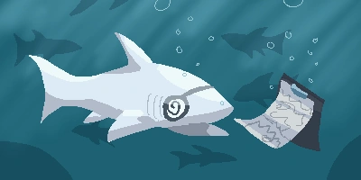

# Bibliography

Intrigued by the trivia you've seen here? Here is a full bibliography for all trivia used on this wiki!

## Books

Haywood, M., Sue W. (1989). *The Manual of Marine Invertebrates*. Morris Plains, NJ: Tetra Press:Salamander Books Ltd. [<https://archive.org/details/manualofmarinein0000hayw/page/208/mode/2up>](https://archive.org/details/manualofmarinein0000hayw/page/208/mode/2up).

Mylroie, J. E., Lace, M. J. (2013). *Coastal Karst Landforms*. Netherlands: Springer Netherlands. \[<https://www.google.com/books/edition/Coastal_Karst_Landforms/tjKfWG1NxnAC?hl=en&gbpv=1&bsq=Littoral%20Caves>. <https://www.google.com/books/edition/Coastal_Karst_Landforms/tjKfWG1NxnAC?hl=en&gbpv=1&bsq=Littoral%20Caves>\].

Rudloe, A., Rudloe, J. (2009). *Shrimp: The Endless Quest for Pink Gold.*Upper Saddle River, NJ: FT Press. [<https://books.google.com/books?id=rpRq7CoXQo0C&printsec=frontcover>](https://books.google.com/books?id=rpRq7CoXQo0C&printsec=frontcover).

## News Articles

Bait Ball. (2018). *Smithsonian: Ocean*. Retrieved from [ocean.si.edu/ocean-life/fish/bait-ball](http://ocean.si.edu/ocean-life/fish/bait-ball).

Black, R. (2017). Did Scientists Just Unveil the Biggest Dinosaur of All Time? *Smithsonian Magazine.* Retrieved from [www.smithsonianmag.com/science-nature/did-scientists-just-unveil-biggest-dinosaur-all-time-180964443/](http://www.smithsonianmag.com/science-nature/did-scientists-just-unveil-biggest-dinosaur-all-time-180964443/).

Blue Whale. (2020). *National Geographic.* Retrieved from [www.nationalgeographic.com/animals/mammals/b/blue-whale/](http://www.nationalgeographic.com/animals/mammals/b/blue-whale/).

Bradford, A. (2016) Facts About Whale Sharks. *LiveScience*. Retrieved from [www.livescience.com/55412-whale-sharks.html](http://www.livescience.com/55412-whale-sharks.html).

Currin, G. (2019). Why Do Lobsters Turn Red When They're Cooked? *LiveScience*. Retrieved from [www.livescience.com/66093-why-cooked-lobsters-turn-red.html](http://www.livescience.com/66093-why-cooked-lobsters-turn-red.html).

DeCosta-Klipa, N. (2017). Orange, Yellow, Blue, and Even 'Halloween': The Rarest Lobster Colors, Explained. *The Boston Globe*. Retrieved from [www.boston.com/news/animals/2017/09/13/the-rarest-lobster-colors-explained](http://www.boston.com/news/animals/2017/09/13/the-rarest-lobster-colors-explained).

Fraser, G.J. (2020). How Sharks Could Help Us Regrow Our Own Human Teeth. *The Conversation*. Retrieved from [theconversation.com/how-sharks-could-help-us-regrow-our-own-human-teeth-63531](http://theconversation.com/how-sharks-could-help-us-regrow-our-own-human-teeth-63531).

Hydrothermal Vent Creatures. (2018). *Smithsonian: Ocean*. Retrieved from [ocean.si.edu/ocean-life/invertebrates/hydrothermal-vent-creatures](http://ocean.si.edu/ocean-life/invertebrates/hydrothermal-vent-creatures).

Joseph, B. (2015). Use These Culturally Offensive Phrases, Questions at Your Own Risk. *Indigenous Corporate Training*. Retrieved from [www.ictinc.ca/blog/culturally-offensive-phrases-you-should-use-at](http://www.ictinc.ca/blog/culturally-offensive-phrases-you-should-use-at).

Schmid, R.E. (2006). Scientists Find Seafloor Storms in Ocean. *ABC News*. Retrieved from [abcnews.go.com/Technology/story?id=119828](http://abcnews.go.com/Technology/story?id=119828).

Singal, J. (2019). Is It Offensive To Use The Term ‘Totem Pole’ Informally? *Singal-Minded*. Retrieved from [jessesingal.substack.com/p/is-it-offensive-to-use-the-term-totem](http://jessesingal.substack.com/p/is-it-offensive-to-use-the-term-totem).

Stingrays. (2018). *National Geographic*. Retrieved from [www.nationalgeographic.com/animals/fish/group/stingrays/](http://www.nationalgeographic.com/animals/fish/group/stingrays/).

Whelk. (2014). Seamergency 2014: A Speedrunning Marathon to Benefit Cute, Cuddly Sharks. *Nintendo Enthusiast*. Retrieved from [www.nintendoenthusiast.com/seamergency-2014-a-speedrunning-marathon/](http://www.nintendoenthusiast.com/seamergency-2014-a-speedrunning-marathon/).

## Dictionaries and Encyclopedias

Dolphin. (2020). In *Encyclopædia Britannica*. Retrieved from <https://www.britannica.com/animal/dolphin-mammal#ref267666>.

Campbell, A., et al. (2020). Electrical Outlet. In *Energy Education*. Retrieved from [energyeducation.ca/encyclopedia/Electrical_outlet](http://energyeducation.ca/encyclopedia/Electrical_outlet).

Friedman, H. (n.d). Aquamarine Beryl: The Gemstone Aquamarine Information and Pictures. In *Minerals.net*. Retrieved from [www.minerals.net/gemstone/aquamarine_gemstone.aspx](http://www.minerals.net/gemstone/aquamarine_gemstone.aspx).

Friedman, H. (n.d). Fluorescence and Phosphorescence: Mineral Properties - The Mineral and Gemstone Kingdom. In *Minerals.net*. Retrieved from [www.minerals.net/resource/property/fluorescence_phosphoresence.aspx](http://www.minerals.net/resource/property/fluorescence_phosphoresence.aspx).

Gilgamesh~enwiktionary. (2008). Ὀκτώπους. In *Wiktionary*. Retrieved from [en.wiktionary.org/wiki/%E1%BD%80%CE%BA%CF%84%CF%8E%CF%80%CE%BF%CF%85%CF%82](http://en.wiktionary.org/wiki/%E1%BD%80%CE%BA%CF%84%CF%8E%CF%80%CE%BF%CF%85%CF%82).

Harper, D. (n.d). Aquamarine (n.). In *Online Etymology Dictionary*. Retrieved from [www.etymonline.com/word/aquamarine](http://www.etymonline.com/word/aquamarine).

Harper, D. (n.d). Octopus (n.). In *Online Etymology Dictionary*. Retrieved from [www.etymonline.com/word/octopus](http://www.etymonline.com/word/octopus).

Harper, D. (n.d). Totem (n.). In *Online Etymology Dictionary*. Retrieved from [www.etymonline.com/word/totem](http://www.etymonline.com/word/totem).

Chaos. (n.d). In Math Vault, *The Definitive Glossary of Higher Mathematical Jargon.* Retrieved from \[mathvault.ca/math-glossary/#chaos mathvault.ca/math-glossary/#chaos\].

Sarà, M. (2020). Sponge. In *Encyclopædia Britannica*. Retrieved from [www.britannica.com/animal/sponge-animal](http://www.britannica.com/animal/sponge-animal).

## Education Websites

Davis, J. (2018). *Megalodon: the Truth about the Largest Shark That Ever Lived*. Natural History Museum. Retrieved from [www.nhm.ac.uk/discover/megalodon--the-truth-about-the-largest-shark-that-ever-lived.html](http://www.nhm.ac.uk/discover/megalodon--the-truth-about-the-largest-shark-that-ever-lived.html).

Dip N' Dive. (2019). *Scuba Essentials: Underwater Writing Devices*. Retrieved from [dipndive.com/blog/scuba-essentials-underwater-writing-devices/](http://dipndive.com/blog/scuba-essentials-underwater-writing-devices/).

Mahoney, K.D. (n.d). *Latin Nouns: Second Declension ŏ-Stem.* Retrieved from [latin-dictionary.net/grammar/nouns/declensions/second-declension](http://latin-dictionary.net/grammar/nouns/declensions/second-declension).

National Snow and Ice Data Center. (2020). *All About Sea Ice*. Retrieved from [nsidc.org/cryosphere/seaice/index.html](http://nsidc.org/cryosphere/seaice/index.html).

Planet Green Recycle. (2019). *Recycling Facts: Does Recycling Cause Pollution?* Retrieved from [planetgreenrecycle.com/fundraising/green-living/recycling-facts-does-recycling-cause-pollution](http://planetgreenrecycle.com/fundraising/green-living/recycling-facts-does-recycling-cause-pollution).

Smithsonian's National Zoo & Conservation Biology Institute. (2018). *Electric Eel*. Retrieved from [nationalzoo.si.edu/animals/electric-eel](https://nationalzoo.si.edu/animals/electric-eel).

Woods Hole Oceanographic Institution. (2019). *Natural Oil Seeps.* Retrieved from [www.whoi.edu/know-your-ocean/ocean-topics/seafloor-below/natural-oil-seeps/](http://www.whoi.edu/know-your-ocean/ocean-topics/seafloor-below/natural-oil-seeps/).

## Wikis

Void Between the Worlds. (2020). In *TV Tropes*. Retrieved August 12, 2020 from [tvtropes.org/pmwiki/pmwiki.php/Main/VoidBetweenTheWorlds](http://tvtropes.org/pmwiki/pmwiki.php/Main/VoidBetweenTheWorlds).

Cthulhu. (2020). In *The H.P. Lovecraft Wiki*. Retrieved August 12, 2020 from [lovecraft.fandom.com/wiki/Cthulhu](http://lovecraft.fandom.com/wiki/Cthulhu).

Elder Thing. (2009). In *The H.P. Lovecraft Wiki*. Retrieved August 12, 2020 from [lovecraft.fandom.com/wiki/Elder_Thing](http://lovecraft.fandom.com/wiki/Elder_Thing).

## Scientific Journals

Duffy, J.E. (1998). On the frequency of eusociality in snapping shrimps (Decapoda: Alpheidae), with description of a second eusocial species. *Bulletin of Marine Science. 63*(2). Retrieved from <https://www.researchgate.net/publication/233627100_On_the_Frequency_of_Eusociality_in_Snapping_Shrimps_Decapoda_Alpheidae_with_Description_of_a_Second_Eusocial_Species>

Inoue, J.G., et al. (2010). Deep-Ocean Origin of the Freshwater Eels. *Biology Letters, 6(3),* 363–366., <doi:%5Bhttps://www.ncbi.nlm.nih.gov/pmc/articles/PMC2880065/> 10.1098/rsbl.2009.0989\].

Seltenrich, N. (2016). Emerging Waste-to-Energy Technologies: Solid Waste Solution or Dead End? *Environmental Health Perspectives, 124*(6), 124–130., <doi:%5Bhttps://pw.lacounty.gov/epd/socalconversion/pdfs/CT_Comparative_GHG_Analysis_Feb_2016.pdf>. 10.1289/ehp.124-a106\].

---

*Originally from the [Shark Game Wiki on Fandom](https://shark-game.fandom.com/wiki/Bibliography), licensed under [CC BY-SA 3.0](https://creativecommons.org/licenses/by-sa/3.0/).*
