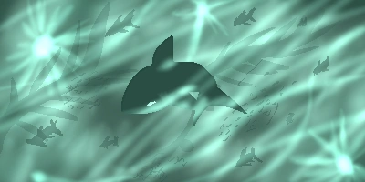

# Chaotic World

*A frenetic world, torn by immaterial force.*

> **You are a shark in a swirling teal sea.**

> Overwhelming reinforcements. Overwhelming everything. So hard to focus.

## Summary

Chaotic worlds have a fairly small set of resources, many of which are lost over time. It is also the only world where the [Strange Gate](strange-gate.md) requests [Frenzy](stuff.md#frenzy) animals (sharks) in order to open. It's unclear what "chaotic" really means here, and not many hints about what makes these worlds so strange. The introductory message mentions "overwhelming reinforcements", which refers to the world income of Frenzy animals and perhaps suggests that these creatures mysteriously appear and add to the chaos.

## Resources

### Frenzy

|                            |                        |
|----------------------------|------------------------|
| • Shark • Ray • Crab | • Lobster • Dolphin |

### Basic Materials

|                                |                                   |                                   |         |
|--------------------------------|-----------------------------------|-----------------------------------|---------|
| • Fish • Sand • Crystals | • Coral • Sea Apples • Clam | • Kelp • Jellyfish • Sponge | • Algae |

### Advanced Materials

|                                              |                        |
|----------------------------------------------|------------------------|
| • Sharkonium • Delphinium • Coralglass | • Residue • Spronge |

### Multipliers

- Planetary Income - Frenzy (0.0001)
  - Animals obtainable in the Frenzy tab (see above) are gained at a rate of Climate Level×0.0001/s
- Planetary Income - Animals (-0.0001)
  - Animal materials (i.e. fish, clam, jellyfish, sponge and sea apples) are lost at a rate of Climate Level×0.0001/s
- Planetary Income - Materials (-0.001)
  - Non-animal basic materials (i.e. sand, crystals, coral, kelp and algae) are lost at a rate of Climate Level×0.001/s

## Ending Messages

"You have survived the stranger world."  
"A world on the brink of existence. Halfway between here and oblivion."  
"You were given allies, yes, but at what cost?"  
"What a strange demand for the gate to possess."  
"You are relieved the chaos is over, correct?"

## Trivia

"Chaos theory" is a term for the mathematical study of chaos on the premise that what appears to be random is actually determined by specific conditions. It means that there's a deeper, invisible system at work creating the appearance that there is no system. This is a fitting theme for a fundamentally mysterious game, especially when you consider that frenzy animals and animal materials are multiplied differently even though they are all sea animals. We can tell the difference, but something within the chaos might not be able to.[1]

[1] [The Definitive Glossary of Higher Mathematical Jargon](https://mathvault.ca/math-glossary/#chaos)

---

*Originally from the [Shark Game Wiki on Fandom](https://shark-game.fandom.com/wiki/Chaotic_World), licensed under [CC BY-SA 3.0](https://creativecommons.org/licenses/by-sa/3.0/).*
