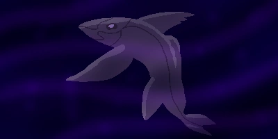

# Chimaera

| Chimaera     |                                                                                                              |
|--------------|--------------------------------------------------------------------------------------------------------------|
| Home worlds  | [Shrouded World](shrouded-world.md)                                                                          |
| Base cost    | 20 Jellyfish                                                                                                 |
| Base income  | +1.5 Jellyfish  +0.1 Fish                                                                              |
| Breeder      | none                                                                                                         |
| Career paths | [Chimaera Transmuter](chimaera.md#chimaera-transmuter) [Chimaera Explorer](chimaera.md#chimaera-explorer) |

**Chimaeras** are only available in [Shrouded](shrouded-world.md) worlds, and along with [whales](whale.md) are one of the only frenzy animals that cannot be automatically [produced](stuff.md#producers). They become available for purchase after researching [Exploration](laboratory.md#exploration) provided you have at least 20 jellyfish. Their description is "Convince a chimaera to hunt in the darker depths for us."

## Career Paths

Chimaera jobs become available after researching [Chimaera Mysticism](laboratory.md#chimaera-mysticism). The positions are Chimaera Transmuter and Chimaera Explorer. Transmuters serve the same role as the [auto-transmuter](stuff.md#auto-transmuter) shark machine, but the machine produces as much as 20 chimaera transmuters while consuming half the sand and crystals. Explorer is a [research](laboratory.md) position.

| Job                                                 | Base Cost                                | Base Income                              |
|-----------------------------------------------------|------------------------------------------|------------------------------------------|
| [Chimaera Transmuter](stuff.md#chimaera-transmuter) | 1 Chimaera 10 Jellyfish 10 Sharkonium | +1 Sharkonium -5 Sand -15 Crystals |
| [Chimaera Explorer](stuff.md#chimaera-explorer)     | 1 Chimaera 30 Jellyfish 30 Crystals   | +5 Science +0.5 Jellyfish             |

## Laboratory Research

There are 2 chimaera-specific upgrades that can be [researched](laboratory.md), and 2 generic upgrades that affect chimaera income. The research listed below is available in every world and has an effect on chimaeras and their jobs:

| Upgrade                                                                                                                                                                                         | Description                                                                                                                              | Result                                                                          | Cost                  |
|-------------------------------------------------------------------------------------------------------------------------------------------------------------------------------------------------|------------------------------------------------------------------------------------------------------------------------------------------|---------------------------------------------------------------------------------|-----------------------|
| **[Exploration](laboratory.md#exploration)** Swim beyond the home seas to see what can be found!                                                                                             | Sharks and rays are twice as effective. Did you know oceans are big? Fascinating!                                                        | Unlocks Procure chimaera                                                        | 5K Science 5K Fish |
| **[Ancestral Recall](laboratory.md#ancestral-recall)** The sharks and rays know we share some features among ourselves. Using the vague glimpses of dreams, let's piece together the puzzle. | Sharks, rays and chimaeras, and their roles, are all four times as effective. We have had a glorious past. Now, on to a glorious future. | Chimaera power x4 Chimaera transmuter power x4 Chimaera explorer power x4 | 10B Science           |

The following research is available only in Shrouded worlds:

| Upgrade                                                                                                                                                                                    | Description                                                                                                                                                                 | Result                                                                                      | Cost                         |
|--------------------------------------------------------------------------------------------------------------------------------------------------------------------------------------------|-----------------------------------------------------------------------------------------------------------------------------------------------------------------------------|---------------------------------------------------------------------------------------------|------------------------------|
| **[Chimaera Mysticism](laboratory.md#chimaera-mysticism)** We know the chimaeras, but we don't them very well. We need to adjust our thinking to understand their riddles.              | Chimaeras can now become dedicated transmuters or explorers, using our knowledge to assist our industry or sharing their knowledge as they journey through the deeper seas. | Unlocks • Induct chimaera transmuter • Prepare chimaera explorer • Abyssal Enigmas | 12K Science 700 Jellyfish |
| **[Abyssal Enigmas](laboratory.md#abyssal-enigmas)** The chimaeras have returned from the deeper oceans with artifacts they can't explain. We need to work together to understand them. | Chimaeras and their specialists are twice as effective thanks to stronger trust and friendship. Also we still don't know what these things they found do.                   | Chimaera power x2 Chimaera transmuter power x2 Chimaera explorer power x2                | 40K Science 2K Jellyfish  |
|                                                                                                                                                                                            |                                                                                                                                                                             |                                                                                             |                              |

## Story

Warning: This section includes speculation, as canon answers don't yet exist.

    The chimaeras are ancient kin of the shark kind, reunited through wild coincidence.
    What peerless wonders have they found in the dark?

The chimaeras live in the deep ocean, well below the seabed that's explored first. They're adapted for those dark waters, and aren't big fans of especially bright lights.[1] They don't know everything about the depths of their world, though, and the explorers find entirely new regions and objects they'd never seen before.[2] Of course, the sharks aren't any better off, whether they've been through the Gateway or not. You can only expect so much from sea creatures.

The unseen voice in the Gateway hints that you've met the chimaera before, and that the Shrouded world may in fact be your home world, changed since you left it.[3] This suggests the possibility that the chimaeras may be an evolutionary offshoot of your own (shark) species.

It isn't clear what could have happened to transform the clear blue waters of your home into the dark mysterious sea of the Shrouded world. However, both Shrouded and [Abandoned](abandoned-world.md) worlds are described as "murky" and "dark".[4][5] It may be that after you build purifiers and sea scourers in the Abandoned world it becomes the Shrouded world, able to support more life but still murky from chemicals you aren't able to clean up.

## Species List

The following is a list of every species mentioned in the log when single chimaeras are purchased:

|                                                                                                                                                                                                                                           |                                                                                                                                                                                                                                |                                                                                                                                                                                                                                                                        |
|-------------------------------------------------------------------------------------------------------------------------------------------------------------------------------------------------------------------------------------------|--------------------------------------------------------------------------------------------------------------------------------------------------------------------------------------------------------------------------------|------------------------------------------------------------------------------------------------------------------------------------------------------------------------------------------------------------------------------------------------------------------------|
| • ploughnose chimaera • cape elephantfish • australian ghost shark • whitefin chimaera • bahamas ghost shark • southern chimaera • longspine chimaera • cape chimaera • shortspine chimaera • leopard chimaera | • silver chimaera • pale ghost shark • spotted ratfish • philippine chimaera • black ghostshark • blackfin ghostshark • marbled ghostshark • striped rabbitfish • large-eyed rabbitfish • spookfish | • dark ghostshark • purple chimaera • pointy-nosed blue chimaera • giant black chimaera • smallspine spookfish • pacific longnose chimaera • dwarf sicklefin chimaera • sicklefin chimaera • paddle-nose chimaera • straightnose rabbitfish |

## Trivia

While the term "chimaera" may be better known to mean the fire-breathing hybrid monster of greek mythology, it is in fact a variety of fish as well. They are also known as ghost sharks, rat fish, spookfish or rabbitfish, and sharks really are their closest living relatives. Both animals belong to the Chondrichthyes class, which also contains rays, skates and sawfish. The chimaera shown on the main game tab once 5 chimaera have been purchased is likely a *Chimaera monstrosa*, or rabbit fish.[6]

[1] [Artifacts: Chimaera Migrator](artifacts.md#chimaera-migrator)

[2] [Laboratory: Abyssal Enigmas](laboratory.md#abyssal-enigmas)

[3] [Shrouded World: Ending messages](shrouded-world.md#ending-messages)

[4] [Shrouded World](shrouded-world.md)

[5] [Abandoned World](abandoned-world.md)

[6] [Wikipedia: Chimaera](https://en.wikipedia.org/wiki/Chimaera)

---

*Originally from the [Shark Game Wiki on Fandom](https://shark-game.fandom.com/wiki/Chimaera), licensed under [CC BY-SA 3.0](https://creativecommons.org/licenses/by-sa/3.0/).*
