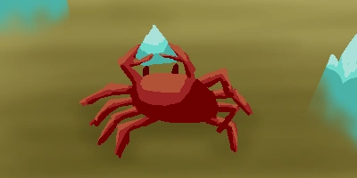

# Crab

| Crab         |                                                      |
|--------------|------------------------------------------------------|
| Home worlds  | All but Shrouded                                     |
| Base cost    | 10 Fish                                              |
| Base income  | +0.01 Crystals  +0.02 Coral                    |
| Breeder      | [Crab Brood](stuff.md#crab-brood)                    |
| Career paths | [Planter Crab](crab.md#planter-crab)                 |

**Crabs** are available in almost every world, but are replaced by [Diver Sharks](stuff.md#diver-shark) in [Shrouded](shrouded-world.md) worlds. They become available for purchase once you have 4 [sharks](shark.md) and 4 [rays](ray.md). Their description is "Hire a crab to find things that sharks and rays overlook."

## Career Path

Crabs have the option of becoming Planter Crabs after researching [Kelp Horticulture](laboratory.md#kelp-horticulture). In most worlds this is the first available method for gathering [kelp](stuff.md#kelp).

| Job                                   | Base Cost          | Base Income |
|---------------------------------------|--------------------|-------------|
| [Planter Crab](stuff.md#planter-crab) | 1 Crab 200 Sand | +0.3 Kelp   |

## Laboratory Research

There are 3 upgrades that can be [researched](laboratory.md) that are specific to only crabs, 1 generic upgrade that affects crab income, and 1 upgrade specific to all crustaceans. The research listed below is available in every world and has an effect on crabs and their jobs:

| Upgrade                                                                                                                             | Description                                                                                                                                                                   | Result                                        | Cost                |
|-------------------------------------------------------------------------------------------------------------------------------------|-------------------------------------------------------------------------------------------------------------------------------------------------------------------------------|-----------------------------------------------|---------------------|
| **[Sun Observation](laboratory.md#sun-observation)** We must determine what is with the weird glare on the surface of the water. | Planter crabs are twice as effective, and shrimp are four times as effective. Is a suns worth many fish? We can see a sun, but where is it really? And by what is it made of? | Planter crab power x2 Unlocks Crab Biology | 5K Science          |
| **[Far Explorations](laboratory.md#far-explorations)** Explore the vast reaches beyond the home ocean.                           | Crabs are four times as effective. Did you know oceans are actually even bigger than big? Remarkable!                                                                         | Crab power x4                                 | 8K Science 15K Fish |

The following research is available in every world besides Shrouded:

| Upgrade                                                                                                                                                                            | Description                                                                                                                                     | Result                                                            | Cost                    |
|------------------------------------------------------------------------------------------------------------------------------------------------------------------------------------|-------------------------------------------------------------------------------------------------------------------------------------------------|-------------------------------------------------------------------|-------------------------|
| **[Kelp Horticulture](laboratory.md#kelp-horticulture)** Determine what it takes to plant kelp all over the seabed. Maybe this is useful.                                       | Crabs can become kelp farmers and grow a living carpet across the bottom of the sea.                                                            | Unlocks Gear up planter crab                                      | 1K Science 2K Sand      |
| **[Crab Biology](laboratory.md#crab-biology)** Crabs are a mystery. They keep to themselves and dig up crystals or put down plants. What is even up with that? What ARE crabs?? | Crabs and planter crabs are twice as effective. Crabs are alright but they are also sort of terrifying and weird. Good job they're on our side! | Crab power x4 Planter crab power x2 Unlocks Form crab brood | 500 Science 100 Kelp |
| **[Utility Carapace](laboratory.md#utility-carapace)** The exoskeleton is good enough, but with some adjustments, perhaps coralglass can improve it.                            | Crabs, shrimp and lobsters, and their roles, are all four times as effective. A shell protects, and a shell interfaces.                         | Crab power x4 Crab brood power x4 Planter crab power x4     | 10B Science             |

## Story

Warning: This section includes speculation, as canon answers don't yet exist.

    Dutiful, loyal crustaceans.

There isn't much known about the crabs, but they seem to be fairly simple creatures. Unlike [shrimp](shrimp.md) and [lobsters](lobster.md), they aren't advanced enough to have developed their own technology. They seem happy just farming and digging for crystals. A few of their kind are curious enough to investigate the teamwork of sharks and rays, leading to their employment in the first place.[1] All indications are that they are hard workers who ask very little in return.

It's implied that crab broods are unusual, as mentioned in the [log](log-entries.md): "The crab brood is a rarely witnessed phenomenon, due to being some strange behaviour of crabs that have been driven to seek crystals for reasons only they understand." From this message it also seems as though digging for crystals isn't normal crab behavior either, but it's unclear how many crabs have really been observed by the narrator shark before the game began.

The crabs are concluded to be "sort of terrifying and weird", but are generally trusted by the sharks no matter how much their numbers grow.[2]

## Species List

|                                                                                                                                                                                                                  |                                                                                                                                                                             |                                                                                                                                                                                     |
|------------------------------------------------------------------------------------------------------------------------------------------------------------------------------------------------------------------|-----------------------------------------------------------------------------------------------------------------------------------------------------------------------------|-------------------------------------------------------------------------------------------------------------------------------------------------------------------------------------|
| • bering hermit • blackeye hermit • butterfly crab • dungeness crab • flattop crab • greenmark hermit • golf-ball crab • graceful crab • graceful decorator crab • graceful kelp crab | • green shore crab • heart crab • helmet crab • longhorn decorator crab • maroon hermit • northern kelp crab • orange hairy hermit • purple shore crab | • moss crab • pygmy rock crab • puget sound king crab • red rock crab • scaled crab • sharpnose crab • spiny lithoid crab • widehand hermit • umbrella crab |

## Trivia

Aside from being used to purchase [ray makers](stuff.md#ray-maker), the main purpose of kelp is to aqcuire [sea apples](stuff.md#study-sea-apples) which can then be studied to gain science. It isn't immediately obvious what sea apples are if you aren't already familiar with the term. If you pay attention to your log, you may notice that they're said to *squirm*. This is because '[sea apple](https://en.wikipedia.org/wiki/Sea_apple)' is the common name for a variety of sea cucumber, an invertebrate marine animal with leathery skin. They are filter feeders like clams and sponges, and while they aren't generally associated with kelp they have been known to eat plant-like microorganisms.[3]

[1] [Story: Home World](story.md#home-world)

[2] [Laboratory: Crab Biology](laboratory.md#crab-biology)

[3] Haywood, M., Sue W. (1989). *The Manual of Marine Invertebrates* (p. 208). via [Wikipedia: Sea apple](https://en.wikipedia.org/wiki/Sea_apple)

---

*Originally from the [Shark Game Wiki on Fandom](https://shark-game.fandom.com/wiki/Crab), licensed under [CC BY-SA 3.0](https://creativecommons.org/licenses/by-sa/3.0/).*
