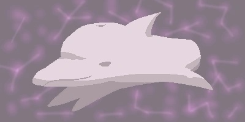

# Dolphin

| Dolphin      |                                                                                                            |
|--------------|------------------------------------------------------------------------------------------------------------|
| Home worlds  | All but [Starter](starter-world.md) and Frigid                                                             |
| Base cost    | 10 Fish                                                                                                    |
| Base income  | +1 Fish  +0.1 Sponge  +0.05 Jellyfish                                                          |
| Breeder      | [Dolphin Biologist](stuff.md#dolphin-biologist)                                                            |
| Career paths | [Dolphin Philosopher](dolphin.md#dolphin-philosopher) [Dolphin Treasurer](dolphin.md#dolphin-treasurer) |

**Dolphins** are available in almost every world after the first, but can't be found in [Frigid](frigid-world.md) worlds. They become available for purchase after researching [Cetacean Awareness](laboratory.md#cetacean-awareness) provided you have at least 10 fish and 50 [sharks](shark.md). Their description is "Pay a dolphin to help us catch fish. Prepare to put up with whining."

## Career Path

Dolphin jobs become available after researching [Delphine Philosophy](laboratory.md#delphine-philosophy). The positions are Dolphin Philosopher and Dolphin Treasurer. Treasurers produce crystal faster than any other position in the game, topped only by [crystal miners](stuff.md#crystal-miner). Philosopher is a [research](laboratory.md) position.

| Job                                                 | Base Cost                           | Base Income             |
|-----------------------------------------------------|-------------------------------------|-------------------------|
| [Dolphin Philosopher](stuff.md#dolphin-philosopher) | 1 Dolphin 30 Fish 10 Coral    | +1 Science              |
| [Dolphin Treasurer](stuff.md#dolphin-treasurer)     | 1 Dolphin 20 Fish 20 Crystals | +2 Crystals +2 Coral |

## Laboratory Research

There are 3 upgrades that can be researched that are specific to only dolphins, 1 generic upgrade that affects dolphin income, 3 upgrades to dolphin technology and 2 upgrades specific to all cetaceans. The research listed below is available in every world and has an effect on dolphins and their jobs:

| Upgrade                                                                                                                                                                           | Description                                                                          | Result                     | Cost                |
|-----------------------------------------------------------------------------------------------------------------------------------------------------------------------------------|--------------------------------------------------------------------------------------|----------------------------|---------------------|
| **[Agriculture](laboratory.md#agriculture)** The hunter-gatherer lifestyle will only work so well for us. Maybe we should gather these animals in one place and let them grow. | Various roles are twice as effective thanks to farming regions for coral and sponge. | Dolphin treasurer power x2 | 500 Science 1K Sand |

The following research is available in every world besides Starter and Frigid:

| Upgrade                                                                                                                                                                                                                       | Description                                                                                                                                                                | Result                                                                                                                                                                    | Cost                                  |
|-------------------------------------------------------------------------------------------------------------------------------------------------------------------------------------------------------------------------------|----------------------------------------------------------------------------------------------------------------------------------------------------------------------------|---------------------------------------------------------------------------------------------------------------------------------------------------------------------------|---------------------------------------|
| **[Aquamarine Fusion](laboratory.md#aquamarine-fusion)** Those uppity dolphins think they're the only ones who can make their special delphinium. We'll show them.                                                         | Enables transmutation of a different bunch of junk into delphinium, a substance inherently inferior to sharkonium.                                                         | Unlocks • Fuse stuff into delphinium • Dolphin Technology (also requires [Automation](laboratory.md#automation))                                                    | 1K Science 4K Crystals 4K Coral |
| **[Dolphin Technology](laboratory.md#dolphin-technology)** The warm-blooded squeakers have machinery that might be useful. Let's reverse-engineer it.                                                                      | We've reverse-engineered some dolphin machinery. We also, regretfully, learned what the designs are called.                                                                | Unlocks • Build silent archivist • Build tireless crafter                                                                                                           | 3K Science 3K Delphinium           |
| **[Imperial Designs](laboratory.md#imperial-designs)** Some of the dolphins remember and have copies of plans for their machines from wherever they used to call home.                                                     | Cetacean machines are all four times as effective. We begrudingly admit their quality is not entirely terrible.                                                            | Tireless crafter power x4 Silent archivist power x4                                                                                                                    | 1B Science                            |
| **[Cetacean Awareness](laboratory.md#cetacean-awareness)** From a distance, it's harder to tell which of us are really sharks or... those other things. We need to figure this out.                                        | Whales and dolphins are twice as effective, now that we can adapt our hunting strategies to their supposed 'strengths'.                                                    | Dolphin power x2 Whale power x2 Unlocks • Fetch dolphin • Dolphin Biology • Aquamarine Fusion (also requires [Transmutation](laboratory.md#transmutation)) | 2K Science 500 Fish                |
| **[Dolphin Biology](laboratory.md#dolphin-biology)** Do we really have to learn about this? We do? Alright, then.                                                                                                          | Dolphins are twice as effective but double a small number is still small. Also now they can make more dolphins. Hooray.                                                    | Dolphin power x2 Unlocks • Train dolphin biologist • Delphine Philosophy                                                                                         | 3K Science 1K Fish                 |
| **[Delphine Philosophy](laboratory.md#delphine-philosophy)** The whales are known to be natural philosophers. The dolphins, not so much. Nonetheless, we need to appreciate their culture for them to pay attention to us. | Dolphin biologists are twice as effective now that we don't keep openly mocking them. Also, dolphins are more comfortable in their former roles.                           | Dolphin Biologist power x2 Unlocks • Qualify dolphin philosopher • Promote dolphin treasurer • Coral Halls                                                    | 5K Science 1K Fish                 |
| **[Coral Halls](laboratory.md#coral-halls)** The demands don't stop! Now they want living spaces made of coral! Is this really necessary?                                                                                  | Dolphins are happier and twice as effective. Philosophers and treasurers are also twice as effective. Everyone wins, and all it cost us was our dignity and resolve. Sigh. | Dolphin power x2 Dolphin philosopher power x2 Dolphin treasurer power x2                                                                                            | 10K Science 2K Coral               |
| **[Primordial Song](laboratory.md#primordial-song)** Even the dolphins can remember an ancient song. The whales know more, but it stirs within both of them.                                                               | Dolphins and whales, and their roles, are all four times as effective. The song of the ocean is older than life itself.                                                    | Dolphin power x4 Dolphin biologist power x4 Dolphin treasurer power x4 Dolphin philospher power x4                                                               | 10B Science                           |

## Story

Warning: This section includes speculation, as canon answers don't yet exist.

    The dolphin pods that work with us speak of an star-spanning empire of their kind.
    They ask where our empire is. And they smile. (Fetch 5 dolphins)

Assuming they aren't liars as well as braggarts, the dolphins are one of the most advanced species in the game. They've developed technology capable of research, which is more than the sharks have been able to manage. They've also mastered intergalactic travel, built an empire, and discovered a method of transportation similar to the Gateway.[1][2] All of these incredible accomplishments are in the past, though, as an unknown threat toppled their empire and forced them into strange worlds.[3][4]

Although dolphins and sharks are natural enemies their technologies are roughly the same according to the log. It's clear though that the dolphins have more of an eye to design, as the log mentions the elaborate structures and complexity. That complexity seems to extend to their architecture, as the research required to make their living spaces refers to halls.[5]

Unfortunately they do appear to be unnecessarily smug.

## Species List

|                                                                                                                                                                                                        |                                                                                                                                                                                                                                       |                                                                                                                                                                                                    |
|--------------------------------------------------------------------------------------------------------------------------------------------------------------------------------------------------------|---------------------------------------------------------------------------------------------------------------------------------------------------------------------------------------------------------------------------------------|----------------------------------------------------------------------------------------------------------------------------------------------------------------------------------------------------|
| • white beaked dolphin • short finned pilot whale • pantropical dolphin • long-finned pilot whale • hourglass dolphin • bottlenose dolphin • striped dolphin • pygmy killer whale | • melon-headed whale • irrawaddy dolphin • dusky dolphin • clymene dolphin • black dolphin • southern right-whale dolphin • rough toothed dolphin • short beaked common dolphin • pacific white-sided dolphin | • northern right-whale dolphin • long-snouted spinner dolphin • long-beaked common dolphin • atlantic white sided dolphin • atlantic hump-backed dolphin • atlantic spotted dolphin |

## Trivia

There is a large variety of animals defined as 'dolphins'. The taxonomic family Delphinidae refers only to oceanic dolphins. There are 4 families of river dolphins, and 6 species of oceanic dolphin that are more commonly refered to as whales or "blackfish". These 6 species are the melon-headed whale, killer whale (or orca), pygmy killer whale (which is one of the species listed above), false killer whale, long-finned pilot whale and short-finned pilot whale (the latter 2 of which are also listed above).[6]

The references to Dolphins having an an intergalactic empire and the description of the Dolphin Migrator artifact are references to Douglas Adams' "The Hitchhiker's Guide to the Galaxy". In the book, the Dolphins were secretly an advanced race who was capable of leaving Earth under their own power just before it was destroyed by the Vogons.

[1] [Story: Stranger Oceans](story.md#stranger-oceans)

[2] [Artifacts: Dolphin Migrator](artifacts.md#dolphin-migrator)

[3] [Artifacts: Totem of Dolphin](artifacts.md#totem-of-dolphin)

[4] [Artifacts: Totem of Inspiration](artifacts.md#totem-of-inspiration)

[5] [Laboratory: Coral Halls](laboratory.md#coral-halls)

[6] [Encyclopædia Britannica: Dolphin](https://www.britannica.com/animal/dolphin-mammal#ref267666)

---

*Originally from the [Shark Game Wiki on Fandom](https://shark-game.fandom.com/wiki/Dolphin), licensed under [CC BY-SA 3.0](https://creativecommons.org/licenses/by-sa/3.0/).*
