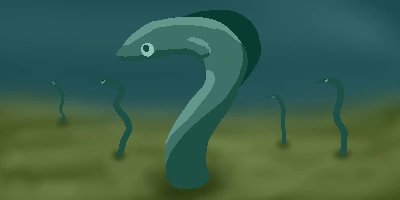

# Eel

| Eel          |                                                                                                                             |
|--------------|-----------------------------------------------------------------------------------------------------------------------------|
| Home worlds  | [Frigid World](frigid-world.md)  [Shrouded World](shrouded-world.md)  [Tempestuous World](tempestuous-world.md) |
| Base cost    | 15 Fish                                                                                                                     |
| Base income  | +0.3 Fish  +0.3 Sand                                                                                                  |
| Breeder      | [Eel Pit](stuff.md#eel-pit)                                                                                                 |
| Career paths | [Eel Technician](eel.md#eel-technician)  [Eel Sifter](eel.md#eel-sifter)                                              |

**Eels** are available in only the darkest worlds. They become available for purchase after researching [Seabed Geology](laboratory.md#seabed-geology) provided you have at least 50 fish. Their description is "Offer a new home and fish supply to an eel. They can round up fish and sand."

## Career Path

Eels jobs become available after researching [Eel Habitats](laboratory.md#eel-habitats).The positions are Eel Technician and Eel Sifter. Sifter is one of 3 positions able to produce [kelp](stuff.md#kelp). Technician is a [research](laboratory.md) position.

| Job                                       | Base Cost                      | Base Income                             |
|-------------------------------------------|--------------------------------|-----------------------------------------|
| [Eel Technician](stuff.md#eel-technician) | 1 Eel 30 Fish 5 Crystals | +0.8 Science                            |
| [Eel Sifter](stuff.md#eel-sifter)         | 1 Eel 30 Fish               | +0.2 Sand +0.9 Crystals +0.5 Kelp |

## Laboratory Research

There are 4 upgrades that can be researched that are specific to only eels and 1 generic upgrade that affects eel income. The research listed below is available in every world and has an effect on eels and their jobs:

| Upgrade                                                                                                                                     | Description                                                                                       | Result                                  | Cost                    |
|---------------------------------------------------------------------------------------------------------------------------------------------|---------------------------------------------------------------------------------------------------|-----------------------------------------|-------------------------|
| **[Seabed Geology](laboratory.md#seabed-geology)** Study the bottom of the ocean to determine the rich, deep, juicy secrets it contains. | Rays are twice as effective with their understanding of the seabed and its varieties of sediment. | Unlocks • Hire eel • Eel Habitats | 250 Science 250 Sand |

The following research is available in every world in which eels can be found:

| Upgrade                                                                                                                                                                | Description                                                                                                                                                          | Result                                                                                                                                                                                     | Cost                      |
|------------------------------------------------------------------------------------------------------------------------------------------------------------------------|----------------------------------------------------------------------------------------------------------------------------------------------------------------------|--------------------------------------------------------------------------------------------------------------------------------------------------------------------------------------------|---------------------------|
| **[Eel Habitats](laboratory.md#eel-habitats)** So we keep seeing these things we thought were kelp on the seabed, but it turns out they're not kelp. What are they? | Eels are twice as effective now we know how they prefer to live. Eels are also able to specialise in a variety of different ways with a place to store their things. | Eel power x2 Unlocks • Dig eel pit • Teach eel technician • Train eel sifter • Crevice Creches • Bioelectricity (also requires [Engineering](laboratory.md#engineering)) | 800 Science 200 Clam   |
| **[Crevice Creches](laboratory.md#crevice-creches)** We can probably figure out a way to make eel pits cosier for their inhabitants.                                | Eels are twice as effective, and so are eel pits. Expect many baby eels in the future.                                                                               | Eel power x2 Eel pit power x2                                                                                                                                                           | 800 Science 200 Clams  |
| **[Bioelectricity](laboratory.md#bioelectricity)** There has to be a way to harness the powers of some of the eels. We all know they have powers. Painful ones.     | Eel technicians are twice as effective. So are our machines. Convenient!                                                                                             | Eel technician power x2 Unlocks Leviathan Heart                                                                                                                                         | 1.6K Science 400 Clams |
| **[Leviathan Heart](laboratory.md#leviathan-heart)** The eels are meek and unassuming, but deep within them lies a greater potential. Let's unleash it.             | Eels and their roles are all four times as effective. The power of determination can overcome many odds.                                                             | Eel power x4 Eel pit power x4 Eel sifter power x4 Eel technician power x4                                                                                                         | 10B Science               |

## Story

Warning: This section includes speculation, as canon answers don't yet exist.

    Snaking elegance, talented attendants.

The eels are technologically gifted, though they haven’t developed electronics of their own.[1] This may be due to a lack of ambition, meek and unassuming as they are.[2] The sharks are hesitant at first, perhaps because their curiosity led to some painful surprises, but soon come to trust their eel friends.[3]

Once the eels learn of their ancient ancestors they become much more productive.[4] This suggests that eels in general lack confidence. It may be that they’re so willing to help the sharks because of the kindness and encouragement they’re shown.

## Species List

|                                                                                                                                                           |                                                                                                                                                                     |
|-----------------------------------------------------------------------------------------------------------------------------------------------------------|---------------------------------------------------------------------------------------------------------------------------------------------------------------------|
| • false moray • mud eel • spaghetti eel • moray eel • thin eel • worm eel • conger • longneck eel • pike conger • duckbill eel | • snake eel • snipe eel • sawtooth eel • cutthroat eel • electric eel • bobtail snipe eel • silver eel • long finned eel • short finned eel |

## Trivia

Electric eels can generate up to 800 volts of electricity, more than 3 times the voltage of a standard European outlet and almost 8 times the voltage of American outlets.[5] But electric eels aren't eels at all! Their snake-like bodies are similar to an eel's, but has a different arrangement of fins.[6] Electric eels are freshwater fish, and while genuine eels can sometimes be found in fresh water they are primarily ocean animals.[7]

[1] [Laboratory: Eel Habitats](laboratory.md#eel-habitats)

[2] [Laboratory: Leviathan Heart](laboratory.md#leviathan-heart)

[3] [Laboratory: Bioelectricity](laboratory.md#bioelectricity)

[4]

[5] [Energy Education: Electrical Outlet](https://energyeducation.ca/encyclopedia/Electrical_outlet)

[6] [Smithsonian’s National Zoo & Conservation Biology Institute: Electric Eel](https://nationalzoo.si.edu/animals/electric-eel)

[7] Inoue, J.G., et al. (6 Jan. 2010). Deep-Ocean Origin of the Freshwater Eels. *Biology Letters, 6(3),* 363–366. via [Wikipedia: Eel](https://en.wikipedia.org/wiki/Eel)

---

*Originally from the [Shark Game Wiki on Fandom](https://shark-game.fandom.com/wiki/Eel), licensed under [CC BY-SA 3.0](https://creativecommons.org/licenses/by-sa/3.0/).*
