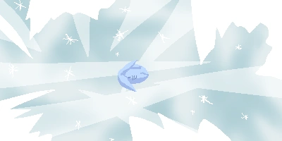
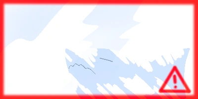
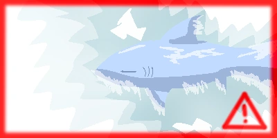

# Frigid World

*A cold, chilling ocean freezing slowly to death.*

> **You are a shark in a freezing white sea.**

> So cold. The food supplies freeze quickly here. Too hard to chew.

## Summary

Frozen worlds have, as you might expect, very few resources. What they do have is [ice](stuff.md#ice), which builds up over time unless you build [heaters](stuff.md#heater). Ice build-up will not end your game or prevent you from opening the [Strange Gate](strange-gate.md), but the more ice you have the more quickly your materials will be lost. Progress in these worlds may seem slow because of the low multiplier on [breeders](stuff.md#producers).

## Resources

### Frenzy

|                            |                    |
|----------------------------|--------------------|
| • Shark • Ray • Crab | • Eel • Octopus |

### Basic Materials

|                                |                                 |          |
|--------------------------------|---------------------------------|----------|
| • Fish • Sand • Crystals | • Clam • Jellyfish • Kelp | • Sponge |

### Advanced Resources

|                                        |
|----------------------------------------|
| • Sharkonium • Residue • Spronge |

### Other

- [Ice](stuff.md#ice) (-0.001 Basic Materials /s)
- [Heater](stuff.md#heater) (-10 Ice /s)

### Multipliers

- Planetary Income Reciprocal Multiplier - Breeders (1)
  - [Living breeders](stuff.md#producers) produce animals at their normal rate divided by the Climate Level
- Planetary Income Multiplier - Machines (1)
  - Machines produce materials at their normal rate multiplied by the Climate Level
- Planetary Income - Ice (0.001)
  - Ice is produced at a rate of Climate Level×0.001/s

## Special Events

 Something has to be done before the ice destroys us all! Maybe a machine can save us? (Get 50 Ice)

 So cold. So hungry. So hopeless. (Get 200 Ice)

## Ending Messages

"Congratulations. Nature cannot touch you."  
"Did you prefer arctic waters?"  
"Few worlds are so harsh. Fewer survive."  
"You are a worthy traveller."

## Trivia

Seawater freezes at almost 5 degrees Fahrenheit colder than fresh water, pushing the salt out of the water at the same time. This makes the water underneath the ice saltier and more dense so that it sinks, then moves across the ocean floor towards the equator. The process helps push along what's called the ocean's global "conveyor-belt" circulation, forming the basis of many sea currents. In this way, sea ice is responsible for much of the global climate.[1]

[1] [National Snow & Ice Data Center: All About Sea Ice](https://nsidc.org/cryosphere/seaice/index.html)

---

*Originally from the [Shark Game Wiki on Fandom](https://shark-game.fandom.com/wiki/Frigid_World), licensed under [CC BY-SA 3.0](https://creativecommons.org/licenses/by-sa/3.0/).*
