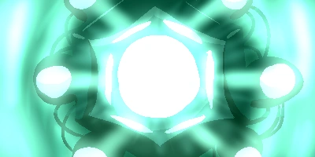

# Gateway

You are a shark in the space between worlds.

[Artifacts](artifacts.md)

[Worlds](worlds.md)

If a world is completed successfully, Essence is awarded on entry to the Gateway at quantity of 1+(Climate Level÷5) rounded down. From here you can purchase artifacts and choose the next world you enter. Essence is also obtained extremely slowly through the Whale Chorus (Every 1 million seconds (11 days, 13 hours, 46 minutes, and 40 seconds) in the original, and every 2,500 seconds (41 minutes and 40 seconds) in the remaster) but that is currently not implemented in the New Frontiers and Dev versions.

## Essence Based Messages

You may get any of these messages depending on how much Essence you have when you enter the Gateway.

**Maximum of 1 Essence:**

"Hello, newcomer."  
"Ah. Welcome, new one."  
"Your journey has only just begun."  
"Welcome to the end of the beginning."

**Between 2 and 10 Essence:**

"Your aptitude grows, I see."  
"Your presence is weak, but it grows stronger."  
"What new sights have you seen in these journeys?"  
"How are you finding your voyage?"  
"Have you noticed how few can follow you through the gates?"

**Between 11 and 30 Essence:**

"How quickly do you travel through worlds?"  
"You are becoming familiar with this."  
"Back so soon?"  
"Welcome back, to the space between spaces."

**Between 31 and 50 Essence:**

"You are a traveller like any other."  
"I see you here more than ever. Can you see me?"  
"Well met, shark friend."  
"You remind me of myself, from a long, long time ago."  
"Welcome back to irregular irreality."

**Between 51 and 200 Essence:**

"What do you seek?"  
"Have you found your home yet?"  
"Surely your home lies but a jump or two away?"  
"Have you ever returned to one of the worlds you've been before?"  
"Can you find anyone else that journeys so frequently as you?"  
"You have become so strong. So powerful."  
"I remember when you first arrived here, with confusion and terror in your mind."

**More than 200 Essence:**

"Your devotion to the journey is alarming."  
"You exceed anything I've ever known."  
"You are a force of will within the shell of a shark."  
"It surprises me how much focus and dedication you show. Perhaps you may settle in your next world?"  
"Does your home exist?"  
"Is there an end to your quest?"  
"Why are you still searching? Many others would have surrendered to the odds by this point."

## World Based Messages

Depending on the world you just finished, more messages are added to the pool from which your ending message is selected. These messages can be found on the pages for [each world type](worlds.md) under "Ending Messages".

## Generic Messages

You may receive any of these messages, regardless of circumstances.

"There is no warmth or cold here. Only numbness."  
"What do you seek?"  
"We are on the edge of infinity, peering into a boundless sea of potential."  
"You may not see me. Do not worry. I can see you."  
"What am I? Oh, it is not so important. Not so soon."  
"Is this the dream of a shark between worlds, or are the worlds a dream and this place your reality?"  
"A crossroads. Decisions. Decisions that cannot be shaken so lightly."  
"There are such sights to behold for the ones who can see here."  
"You are to the ocean what we are to the pathways."  
"You swim through liquid eternity. You are now, always, and forever."  
"The prodigal shark returns."  
"Your constant drive to continue fuels your capacity to overcome."  
"There is no space in this universe you cannot make your own."

## Loss Messages

You will see one of these messages if you lose, and be awarded 0 Essence. "Loss" happens when you select "skip" from the main menu after the first world, next to the "help" link. You will be transported back to the Gateway to select a different world with no other negative repercussions.

"No matter. You will succeed in future, no doubt."  
"Never give in. Never surrender. Empty platitudes, perhaps, but sound advice nonetheless."  
"Mistakes are filled with lessons. Learn never to repeat them."  
"How does it feel to know that everyone who trusted you has perished?"  
"Another world dies. Was this one significant to you?"  
"A sad event. There is plenty of time to redeem yourself."  
"What a pity. What a shame. I hear the mournful cries of a dying ocean."  
"You can do better. You will do better. Believe."  
"You wish to get back here so quickly?"  
"You and everything you knew has died. Perhaps not you. Perhaps not."  
"One more try, perhaps?"

## Trivia

The Elder Gods of H.P. Lovecraft's canon are often said to exist in the space between worlds.[1] Much like the concept of a [portal between worlds](strange-gate.md), this space is never actually mentioned in Lovecraft's own writings.[2] Still, it's likely that this is the inspiration for the Gateway and the unseen voice that inhabits it.

[1] [TV Tropes: Void Between the Worlds](https://tvtropes.org/pmwiki/pmwiki.php/Main/VoidBetweenTheWorlds)

[2] [The H.P.Lovecraft Wiki: Elder Thing](https://lovecraft.fandom.com/wiki/Elder_Thing)

---

*Originally from the [Shark Game Wiki on Fandom](https://shark-game.fandom.com/wiki/Gateway), licensed under [CC BY-SA 3.0](https://creativecommons.org/licenses/by-sa/3.0/).*
