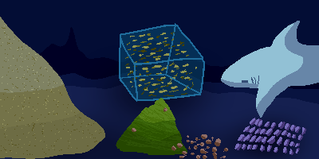

# Grotto

 The Grotto is unlocked by researching [Storage Caverns](laboratory.md#storage-caverns) in the laboratory. It shows various statistics, including details about resource income and [Climate Level](worlds.md). From the Grotto you are also able to dispose of any resources you possess. Unlike the [Recycler](recycler.md) you don't get anything from disposed resources, so consider carefully before you proceed. Specialists of any species (i.e. [creatures with jobs](stuff.md#jobs)) are transformed into the [Frenzy](stuff.md#frenzy) animal used to create them, making this a good way to change how much of a particular material is being gained or consumed because of these positions.

## Income Details

The Income Details table on this page shows the normal amount of income received by each additional unit (as recorded on the [Units](stuff.md) page) along with any multipliers and the total income for each materials produced by all of a particular item that you possess. It does not show how many of a particular item you possess, as that can be found in the Stuff table on the left side of the game screen.

Any [Planetary Boosts](worlds.md) to single materials are shown in green directly to the right of the base income amount. To the right of that multipliers from [Laboratory research](laboratory.md) are shown in a darker grey. Next, any [World Multipliers](worlds.md) are shown in blue. Multipliers from [Artifacts](artifacts.md) are shown next in light green. [Time Anemone](artifacts.md#time-anemone) applies a special bonus to all income and is shown on the far right in white with a green glow.

|                                                         |                                               |                                           |                                        |                                        |                                           |                                        |                                                                                                                                        |                                              |
|---------------------------------------------------------|-----------------------------------------------|-------------------------------------------|----------------------------------------|----------------------------------------|-------------------------------------------|----------------------------------------|----------------------------------------------------------------------------------------------------------------------------------------|----------------------------------------------|
| chimaera transmuters | sharkonium | +1/s  |                                        | x2 | x0.40 | x2 | x2 | +32/s    |
|                                                         | sand       | -5/s  |                                        |                                        |                                           |                                        |                                                                                                                                        | -1600/s  |
|                                                         | crystals   | -15/s | x5 |                                        |                                           |                                        |                                                                                                                                        | -2.40K/s |

This is an example row of the Income Details table.

The example above is from 10 [chimaera transmuters](stuff.md#chimaera-transmuter) in a level 5 [Shrouded](shrouded-world.md) world. Crystals get a 5x Planetary Boost from the World Climate. [Chimaeras](chimaera.md) and their specialists get a 2x multiplier because Abyssal Enigmas has been researched. As specialists chimaera transmuters get a 0.40x World Multiplier. Level 1 Totem of Chimaera Artifact grants a 2x boost, while level 1 Time Anemone gives another 2x boost. The end result is that the transmuters are creating 32 sharkonium per second while consuming 1,600 sand and 2,400 crystals.

In the essence row, if you've unlocked the [whale chorus](https://shark-game.fandom.com/wiki/Laboratory#Eternal_Song), you would be able to see the amount of essence that is increasing. Keep in mind, essence multiplies by [☀0.6048 essence <strong>per week</strong>.](https://gaming.stackexchange.com/questions/197313/how-to-get-a-whale-chorus-to-generate-essense/207292) By adding the time anemone multiplier, you would begin farming essence at a faster pace.

## Reflection

The Reflection tab is unlocked the first time a new world is reached, even if no artifacts have been purchased. It is mentioned here because it is essentially a free extension of the grotto. In this tab you can see which Artifacts have been purchased and what level they are. Unfortunately no more information is shown here than can be seen when purchasing the Artifacts.

## Trivia

Sea caves are formed by the force of waves, usually against limestone. These geological features are also called littoral caves, and form close to the surface along the shore.[1] Sea caves found in deeper waters or even high above sealevel are a result of changing coastlines. This is the only way a grotto such as that used in the game could exist, as sea caves closer to sealevel continue to be pounded by waves and would not make a good storage warehouse for sharks.

[1] Lace, M. (2013). *Coastal Karst Landforms* (p. 235). via [Wikipedia: Sea Cave](https://en.wikipedia.org/wiki/Sea_cave)

---

*Originally from the [Shark Game Wiki on Fandom](https://shark-game.fandom.com/wiki/Grotto), licensed under [CC BY-SA 3.0](https://creativecommons.org/licenses/by-sa/3.0/).*
