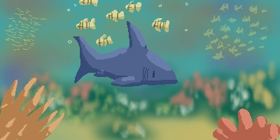

# Haven World

*An aquamarine world of plenty. So beautiful, yet so vulnerable.*

> **You are a shark in a thriving aquamarine sea.**

> The oceans are rich with life. But it's still not home.

## Summary

Haven worlds have all the resources you could want (besides [eels](eel.md)) and some great bonuses. Progress is quick, and the higher level planet you visit the quicker it is. Although these worlds are described by the [Gateway](gateway.md) as "vulnerable", there are no real threats that will affect your game. Still, it does seem to suggest that you are the biggest threat here...

## Resources

### Frenzy

|                            |                                    |                      |
|----------------------------|------------------------------------|----------------------|
| • Shark • Ray • Crab | • Shrimp • Lobster • Dolphin | • Whale • Octopus |

### Basic Materials

|                                |                                   |                                   |         |
|--------------------------------|-----------------------------------|-----------------------------------|---------|
| • Fish • Sand • Crystals | • Coral • Sea Apples • Clam | • Kelp • Jellyfish • Sponge | • Algae |

### Advanced Materials

|                                              |                        |
|----------------------------------------------|------------------------|
| • Sharkonium • Delphinium • Coralglass | • Residue • Spronge |

### Multipliers

- Planetary Income Multiplier - Breeders (1)
  - [Living breeders](stuff.md#producers) produce animals at their normal rate multiplied by the Climate Level
- Planetary Boost - Animals (1)
  - Animal materials (i.e. fish, clam, sponge, jellyfish and sea apples) are produced at their normal rate multiplied by the Climate Level

## Ending messages

"A beautiful paradise. It may be a while before you find a world so peaceful."  
"Did you ruin the world that fed you? There is no judgement here, only curiosity."  
"A rare gem of a world. You will miss it, before long."  
"What shining atoll do you leave behind? Those who could not follow you will surely live happily."

## Trivia

The word "aquamarine" comes from the latin "aqua marina", which means "sea water".[1] It was first used to refer to the blue to blue-green variety of the gemstone Beryl, of which Emerald is another variety. Jewelry-cut Aquamarine is usually a clear, light blue, but rough gems have a variety of tones that look a great deal like seawater.[2] The word was later used to refer to the color of the gem, making it especially appropriate for the Gateway to describe this world as a "rare gem".

[1] [Online Etymology Dictionary](https://www.etymonline.com/word/aquamarine)

[2] [Minerals.net](https://www.minerals.net/gemstone/aquamarine_gemstone.aspx)

---

*Originally from the [Shark Game Wiki on Fandom](https://shark-game.fandom.com/wiki/Haven_World), licensed under [CC BY-SA 3.0](https://creativecommons.org/licenses/by-sa/3.0/).*
