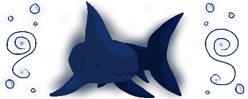
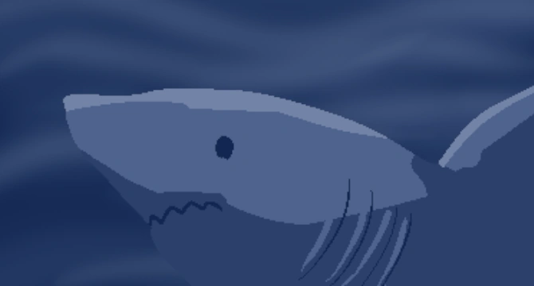
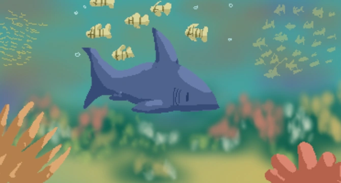
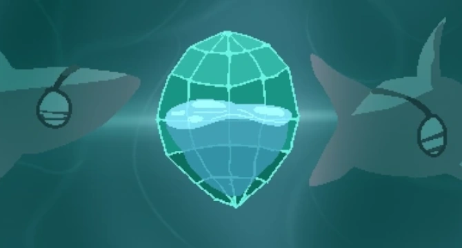
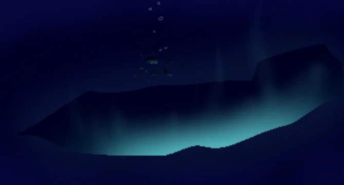

# Shark Game Wiki

**!!THIS WIKI IS CURRENTLY UNDER DEVELOPMENT AND ITS CURRENT FORM IS NOT FINAL!!**  
*For the people working on the game, while optional itd be nice if you could add in your world or changes to this wiki before publishing (Though I will just do it if you dont)*

Welcome to Shark Game Wiki!

The **Unnamed Shark Game** is an idle resource management game played in the browser. It runs on Javascript, so is compatible with any system or browser that has Javascript enabled. The game is located at <http://cirri.al/sharks/> and was developed by [Cirrial](http://cirri.al/). This version of the game was created in August 2014 and was updated to version 0.71 in 2016, but has since been discontinued.  
  
In 2020, [spencers145](https://github.com/spencers145) sought to revive the game by making the **Shark Game: New Frontiers** that continues where Cirrial left off. You can find it at <https://spencers145.github.io/SharkGame/> or at <https://shark.tobot.dev/>. The game has two current versions, New Frontiers, which is described as being closer to the original game, but heavily outdated, and the Dev Version, which released in July 2021, and is a steadily updated work in progress. The games discord can be found at <https://discord.com/invite/nN7BQDJR2G> or is simply named Cirrial's Untitled Shark Server.

[ Your journey begins here! You are a shark in a strange blue sea.](starter-world.md)

[ Plenty of fish in the sea... Discover all the different ways you can hoard them!](stuff.md)

[ Make with the science. So much to learn, so little time!](laboratory.md)

[ Dive deeper... Find out what lays beyond the gate.](story.md)

In this clicker mystery/science-fiction game you are a shark in a strange blue sea. As you begin to gather fish you are joined by fellow sharks, rays, and other creatures who help you collect a variety of resources and learn about the world around you. As you explore you discover something strange in the darkest depths of the sea floor.

---

*Originally from the [Shark Game Wiki on Fandom](https://shark-game.fandom.com/wiki/Shark_Game_Wiki), licensed under [CC BY-SA 3.0](https://creativecommons.org/licenses/by-sa/3.0/).*
