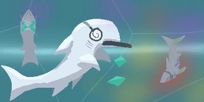
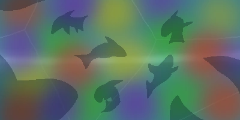

# Laboratory

The Laboratory unlocks after getting 10 Science. Certain research must be conducted in order to move on to the next world, but not all research is available in every world.

The multipliers listed are multiplied together, so that two 3x boosts to the same category will result in an overall 9x boost, and not a 6x boost.

Note that power boosts apply only to the exact item listed. E.g. A boost to shark power will apply to sharks, but not science sharks or nurse sharks.

## Story Upgrades

These upgrades are needed to complete each world.

| Upgrade                                                                                                                                              | Log Entry                                                                                                     | Description                                                                                                                                                                   | Effects                                                                                                                                                                                                                                                                                                                                                                                                                                                                                                                                                                                                                                                                                                                                                                                                                                                                                                                                                                                                           | Cost                                |
|------------------------------------------------------------------------------------------------------------------------------------------------------|---------------------------------------------------------------------------------------------------------------|-------------------------------------------------------------------------------------------------------------------------------------------------------------------------------|-------------------------------------------------------------------------------------------------------------------------------------------------------------------------------------------------------------------------------------------------------------------------------------------------------------------------------------------------------------------------------------------------------------------------------------------------------------------------------------------------------------------------------------------------------------------------------------------------------------------------------------------------------------------------------------------------------------------------------------------------------------------------------------------------------------------------------------------------------------------------------------------------------------------------------------------------------------------------------------------------------------------|-------------------------------------|
| **Crystal Containers** Make weird bottle things from the crystals we have. Maybe useful??                                                         | Well, things can go into these containers that aren't water. This makes science easier!                       | Scientists are twice as effective at making with the science.                                                                                                                 | Science shark power x2 Unlocks: • [Storage Caverns](laboratory.md#storage-caverns) • [Underwater Chemistry](laboratory.md#underwater-chemistry) • [Seabed Geology](laboratory.md#seabed-geology)                                                                                                                                                                                                                                                                                                                                                                                                                                                                                                                                                                                                                                                                                                                                                                                                      | 100 Science 50 Crystals          |
| **Seabed Geology** Study the bottom of the ocean to determine the rich, deep, juicy secrets it contains.                                          | Not only did we find a whole bunch of weird things, the rays found that there was more sand!                  | Rays are twice as effective with their understanding of the seabed and its varieties of sediment.                                                                             | Ray power x2 Unlocks • Aquire shrimp • Gain lobster • Hire eel • [Thermal Vents](laboratory.md#thermal-vents) • [Sponge Collection](laboratory.md#sponge-collection) • [Clam Scooping](laboratory.md#clam-scooping) • [Jellyfish Hunting](laboratory.md#jellyfish-hunting) • [Agriculture](laboratory.md#agriculture) • [Eel Habitats](laboratory.md#eel-habitats) (also requires [Biology](laboratory.md#biology))                                                                                                                                                                                                                                                                                                                                                                                                                                                                                                                                                                 | 250 Science 250 Sand             |
| **Agriculture** The hunter-gatherer lifestyle will only work so well for us. Maybe we should gather these animals in one place and let them grow. | It is so much easier to get things when they're all in one place. It's like the ocean is our grotto now!      | Various roles are twice as effective thanks to farming regions for coral and sponge.                                                                                          | Worker shrimp power x2 Harvester lobster power x2 Dolphin treasurer power x2 Octopus scavenger power x2 Unlocks • [Kelp Horticulture](laboratory.md#kelp-horticulture) • [Biology](laboratory.md#biology) (also requires [Underwater Chemistry](laboratory.md#underwater-chemistry)) • [Xenobiology](laboratory.md#xenobiology) • [Sun Observation](laboratory.md#sun-observation)                                                                                                                                                                                                                                                                                                                                                                                                                                                                                                                                                                                                        | 500 Science 1K Sand              |
| **Sun Observation** We must determine what is with the weird glare on the surface of the water.                                                   | Shark science has discovered the sun! It has also discovered that looking directly into the sun hurts.        | Planter crabs are twice as effective, and shrimp are four times as effective. Is a suns worth many fish? We can see a sun, but where is it really? And by what is it made of? | Planter crab power x2 Shrimp power x4 Unlocks • [Crab Biology](laboratory.md#crab-biology) (also requires [Biology](laboratory.md#biology)) • [Exploration](laboratory.md#exploration)                                                                                                                                                                                                                                                                                                                                                                                                                                                                                                                                                                                                                                                                                                                                                                                                                | 5K Science                          |
| **Exploration** Swim beyond the home seas to see what can be found!                                                                               | Found lots of schools of fish! So many different schools! And such untapped sand reserves!                    | Sharks and rays are twice as effective. Did you know oceans are big? Fascinating!                                                                                             | Shark power x2 Ray power x2 Unlocks • Procure chimaera • Employ octopus • [Octopus Methodology](laboratory.md#octopus-methodology) • [Far Explorations](laboratory.md#far-explorations)                                                                                                                                                                                                                                                                                                                                                                                                                                                                                                                                                                                                                                                                                                                                                                                                         | 5K Science 5K Fish               |
| **Far Explorations** Explore the vast reaches beyond the home ocean.                                                                              | Crystal-rich deposits were found, as well as strange, deep chasms.                                            | Crabs are four times as effective. Did you know oceans are actually even bigger than big? Remarkable!                                                                         | Crab power x4 Unlocks • [Chasm Exploration](laboratory.md#chasm-exploration) • [Chimaera Mysticism](laboratory.md#chimaera-mysticism)                                                                                                                                                                                                                                                                                                                                                                                                                                                                                                                                                                                                                                                                                                                                                                                                                                                                    | 8K Science 15K Fish              |
| **Chasm Exploration** A campaign of risky, foolhardy expeditions to the deeps, to find whatever can be found.                                     | A strange structure was found from clues within the chasms. The cost was great, but the discovery is greater! | Something ancient lurked in the depths.                                                                                                                                       | Unlocks • [Strange Gate](strange-gate.md) • [Ancestral Recall](laboratory.md#ancestral-recall) • [Utility Carapace](laboratory.md#utility-carapace) (also requires [Coralglass Smelting](laboratory.md#coralglass-smelting)) • [Primordial Song](laboratory.md#primordial-song) (also requires [Cetacean Awareness](laboratory.md#cetacean-awareness)) • [Leviathan Heart](laboratory.md#leviathan-heart) (also requires [Bioelectricity](laboratory.md#bioelectricity)) • [Eightfold Optimisation](laboratory.md#eightfold-optimisation) (also requires [Eightfold Optimisation](laboratory.md#eightfold-optimisation)) • [Mechanized Alchemy](laboratory.md#mechanized-alchemy) (also requires [Engineering](laboratory.md#engineering)) • [Mobius Shells](laboratory.md#mobius-shells) (also requires [Coral Circuitry](laboratory.md#coral-circuitry)) • [Imperial Designs](laboratory.md#imperial-designs) (also requires [Dolphin Technology](laboratory.md#dolphin-technology)) | 1M Science 1K Sharks 50K Fish |

## General Upgrades

These upgrades are available in every world.

| Upgrade                                                                                                                                                       | Log Entry                                                                                                                                               | Description                                                                                                                                            | Effects                                                                                                                                                                                                                                                                                                                                                                                                                                                                                                                                                                       | Cost                                                                                                                                                                                                                                                                                                                                                                                                                                                                                                                                                                                                                                                                                                       |
|---------------------------------------------------------------------------------------------------------------------------------------------------------------|---------------------------------------------------------------------------------------------------------------------------------------------------------|--------------------------------------------------------------------------------------------------------------------------------------------------------|-------------------------------------------------------------------------------------------------------------------------------------------------------------------------------------------------------------------------------------------------------------------------------------------------------------------------------------------------------------------------------------------------------------------------------------------------------------------------------------------------------------------------------------------------------------------------------|------------------------------------------------------------------------------------------------------------------------------------------------------------------------------------------------------------------------------------------------------------------------------------------------------------------------------------------------------------------------------------------------------------------------------------------------------------------------------------------------------------------------------------------------------------------------------------------------------------------------------------------------------------------------------------------------------------|
| **Crystal Bite-Gear** Bite the crystals we have into something to help biting!                                                                             | Weird teeth-wear has been developed, and sharks can now catch fish better as a result.                                                                  | Sharks are twice as effective with their new biting gear. Turns out they work better outside the mouth!                                                | Shark power x2                                                                                                                                                                                                                                                                                                                                                                                                                                                                                                                                                                | 50 Science 10 Fish                                                                                                                                                                                                                                                                                                                                                                                                                                                                                                                                                                                                                                                                                      |
| **Crystal Spades** Fashion strange harness-tools for the rays.                                                                                             | The rays can now bother the sand more effectively, and dig up more sand now!                                                                            | Rays are twice as effective with their specially adapted digging tools.                                                                                | Ray power x2                                                                                                                                                                                                                                                                                                                                                                                                                                                                                                                                                                  | 50 Science 20 Sand                                                                                                                                                                                                                                                                                                                                                                                                                                                                                                                                                                                                                                                                                      |
| **Storage Caverns** It's about time to start moving the stores we have to a better place. We've found one but it needs setting up.                         | All the goods we've acquired are now being stored and itemised in a mostly flooded cavern system. No more stray currents washing it all away hopefully! | By storing things centralized location, we now finally have an idea of what we're doing. Sort of.                                                      | Unlocks [Grotto](grotto.md)                                                                                                                                                                                                                                                                                                                                                                                                                                                                                                                                                   | 150 Science                                                                                                                                                                                                                                                                                                                                                                                                                                                                                                                                                                                                                                                                                                |
| **Underwater Chemistry** With the weird bottles, we can now put things and other things into them and see what happens.                                    | Well, nothing useful was determined, but if we keep on doing it we make tremendous leaps for science!                                                   | Scientists are twice as effective with their new chemical insights.                                                                                    | Science shark power x2 Unlocks • [Transmutation](laboratory.md#transmutation) (also requires [Thermal Vents](laboratory.md#thermal-vents)) • [Biology](laboratory.md#biology) (also requires [Agriculture](laboratory.md#agriculture))                                                                                                                                                                                                                                                                                                                               | 200 Science 50 Crystals                                                                                                                                                                                                                                                                                                                                                                                                                                                                                                                                                                                                                                                                                 |
| **Thermal Vents** Investigate the boiling vents that just seem to keep on heating things up.                                                               | This is a wondrous, unending source of heat! Something good must come from this.                                                                        | A power source for future technologies has been discovered.                                                                                            | Unlocks • [Laser Rays](laboratory.md#laser-rays) • [Transmutation](laboratory.md#transmutation) (also requires [Underwater Chemistry](laboratory.md#underwater-chemistry)) • [Automation](laboratory.md#automation) (also requires [Transmutation](laboratory.md#transmutation)) • [Coralglass Smelting](laboratory.md#coralglass-smelting) (also requires [Crustacean Biology](laboratory.md#crustacean-biology)) • [Industrial-Grade Sponge](laboratory.md#industrial-grade-sponge) (also requires [Octopus Methodology](laboratory.md#octopus-methodology)) | 300 Science 500 Sand                                                                                                                                                                                                                                                                                                                                                                                                                                                                                                                                                                                                                                                                                    |
| **Laser Rays** Using arcane shark mystery science, capture the heat of the vents for use by rays.                                                          | The rays can now be granted gear that will let them fuse sand into crystal! Future!                                                                     | Laser rays can now be geared up to burn the very sand to glassy crystal.                                                                               | Unlocks • Equip laser ray • [Ray Biology](laboratory.md#ray-biology) (also requires [Biology](laboratory.md#biology))                                                                                                                                                                                                                                                                                                                                                                                                                                                   | 100 Science 2K Sand 100 Crystals                                                                                                                                                                                                                                                                                                                                                                                                                                                                                                                                                                                                                                                                     |
| **Automation** Using sharkonium, we can make things to do things so we don't have to do the things!                                                        | Now we don't have to do all the work, machines can do it for us! Future                                                                                 |                                                                                                                                                        | Machines can be built to supplement population duties. This is efficient.                                                                                                                                                                                                                                                                                                                                                                                                                                                                                                     | Unlocks • Build crystal miner • Build sand digger • Build fish machine • [Engineering](laboratory.md#engineering) • [Recycler](laboratory.md#recycler) • [Coral Circuitry](laboratory.md#coral-circuitry) (also requires [Coralglass Smelting](laboratory.md#coralglass-smelting)) • [Spronge Biomimicry](laboratory.md#spronge-biomimicry) (also requires [Industrial-Grade Sponge](laboratory.md#industrial-grade-sponge)) • [Dolphin Technology](laboratory.md#dolphin-technology) (also requires [Aquamarine Fusion](laboratory.md#aquamarine-fusion)) • [Environmentalism](laboratory.md#environmentalism) • [Thermal Conditioning](laboratory.md#thermal-conditioning) |
| **Engineering** The machines sort of suck. Let's make them better by learning how!                                                                         | The machines are twice as good now! We've figured out new designs in the process, too!                                                                  | Machines are twice as effective. Skimmers and auto-transmuters are now possible to create.                                                             | Crystal miner power x2 Fish machine power x2 Sand digger power x2 Unlocks • Build auto-transmuter • Build skimmer (also requires [Recycler](laboratory.md#recycler)) • [Bioelectricity](laboratory.md#bioelectricity) (also requires [Eel Habitats](laboratory.md#eel-habitats))                                                                                                                                                                                                                                                                            | 2K Science 2K Sharkonium                                                                                                                                                                                                                                                                                                                                                                                                                                                                                                                                                                                                                                                                                |
| **Recycler** Devise a system of pulverising unwanted resources into a component paste, and reusing them as something else.                                 | Well this thing is frankly terrifying. I wouldn't swim anywhere near the input holes if I were you. Maybe it'll help though!                            | Allows recycling of materials by virtue of a horrifying mechanical maw that consumes all that ventures near it. Future?                                | Unlocks [the Recycler](recycler.md)                                                                                                                                                                                                                                                                                                                                                                                                                                                                                                                                           | 3K Science 3K Sharkonium                                                                                                                                                                                                                                                                                                                                                                                                                                                                                                                                                                                                                                                                                |
| **Biology** What is a shark? What is inside a shark, except for large amounts of fish?                                                                     | With a new understanding of their own biology, sharks can now specialise in the manufacture of new sharks.                                              | Sharks are twice as effective. Did you know shark eggs don't actually form just because a shark wills them to exist?                                   | Shark power x2 Unlocks • Train nurse shark • [Ray Biology](laboratory.md#ray-biology) (also requires [Laser Rays](laboratory.md#laser-rays)) • [Eel Habitats](laboratory.md#eel-habitats) (also requires [Seabed Geology](laboratory.md#seabed-geology)) • [Crab Biology](laboratory.md#crab-biology) (also requires [Sun Observation](laboratory.md#sun-observation)) • [Crustacean Biology](laboratory.md#crustacean-biology) • [Cetacean Awareness](laboratory.md#cetacean-awareness)                                                                 | 400 Science                                                                                                                                                                                                                                                                                                                                                                                                                                                                                                                                                                                                                                                                                                |
| **Ray Biology** Though kindred to the sharks, we know so little about the rays. If only we could fix this. We need to bait a sand trap.                    | Apparently we could have just asked. We learned how rays make more rays. It's kinda similar to sharks, really, but rays.                                | Rays and laser rays are twice as effective. We may never repair the shark-ray relations to their former state after how awkward this whole affair was. | Ray power x2 Laser ray power x2 Unlocks Instruct a ray maker                                                                                                                                                                                                                                                                                                                                                                                                                                                                                                            | 700 Science 600 Sand                                                                                                                                                                                                                                                                                                                                                                                                                                                                                                                                                                                                                                                                                    |
| **Transmutation** By heating things up and doing science things to them, maybe new things can be made!                                                     | A new form of material has been discovered! It has been named after its discoverer, Dr. Sharkonium.                                                     | Enables transmutation of some random junk we have lying around into sharkonium, material of the future.                                                | Unlocks • Transmute stuff to sharkonium • [Pearl Conversion](laboratory.md#pearl-conversion) (also requires [Clam Scooping](laboratory.md#clam-scooping)) • [Automation](laboratory.md#automation) (also requires [Thermal Vents](laboratory.md#thermal-vents)) • [Aquamarine Fusion](laboratory.md#aquamarine-fusion) (also requires [Cetacean Awareness](laboratory.md#cetacean-awareness))                                                                                                                                                                     | 1K Science 4K Sand 2K Crystals                                                                                                                                                                                                                                                                                                                                                                                                                                                                                                                                                                                                                                                                       |
| **Ancestral Recall** The sharks and rays know we share some features among ourselves. Using the vague glimpses of dreams, let's piece together the puzzle. | Our giant ancestors and the creatures of a long distant past have inspired us to become even greater!                                                   | Sharks, rays and chimaeras, and their roles, are all four times as effective. We have had a glorious past. Now, on to a glorious future.               | Shark power x4 Diver shark power x4 Science power x4 Nurse shark power x4 Ray power x4 Ray maker power x4 Laser ray power x4 Chimaera power x4 Chimaera transmuter power x4 Chimaera explorer power x4                                                                                                                                                                                                                                                                                                                                             | 10B Science                                                                                                                                                                                                                                                                                                                                                                                                                                                                                                                                                                                                                                                                                                |
| **Mechanized Alchemy** Better engineering and transmutation processes lead to a refinement of our machines.                                                | We are blurring the line between science and magic more than ever before!                                                                               | Shark machines are all four times as effective. We work better with the machines, not against them.                                                    | Fish machine power x4 Crystal miner power x4 Sand digger power x4 Auto-transmuter power x4 Skimmer power x4 Purifier power x4 Heater power x4                                                                                                                                                                                                                                                                                                                                                                                                               | 10B Science                                                                                                                                                                                                                                                                                                                                                                                                                                                                                                                                                                                                                                                                                                |

## Material Upgrades

These upgrades are available in every world in which the materials concerned are also available.

| Upgrade                                                                                                                                            | Log Entry                                                                                                                                 | Description                                                                                                                              | Effects                                                                                                                                    | Cost                  |
|----------------------------------------------------------------------------------------------------------------------------------------------------|-------------------------------------------------------------------------------------------------------------------------------------------|------------------------------------------------------------------------------------------------------------------------------------------|--------------------------------------------------------------------------------------------------------------------------------------------|-----------------------|
| **Sponge Collection** We can see these things littering the reefs and beds, but we don't know how to collect them without breaking them.        | Understanding the fragile nature of sponges and their weird porous texture, we can now collect sponges by not biting so hard.             | Sponge can be collected in the same way fish can be.                                                                                     | Unlocks Pry sponge                                                                                                                         | 400 Science           |
| **Clam Scooping** We see these things all over the seabed but we can't tell which are clams and which are rocks.                                | Patient observation has shown that clams and rocks are in fact different and distinct things. Now we won't be scooping up any more rocks! | Clams can be collected like fish. The rays do a better job of scooping things, for some reason.                                          | Unlocks • Get clam • [Pearl Conversion](laboratory.md#pearl-conversion) (also requires [Transmutation](laboratory.md#transmutation)) | 600 Science           |
| **Pearl Conversion** There's these things inside the clams that look shiny like crystals. Maybe we can transmute them to crystals?              | Well, we can transmute pearls to crystals now, but we need more of the clam. The whole clam. Yes. The entire clam.                        | We can turn clams into crystals using the pearls inside them as a focus. Maybe one day we won't need to use the entire clam.             | Unlocks Convert clam to crystal                                                                                                            | 1500 Science          |
| **Jellyfish Hunting** Jellyfish are plenty in the farther waters, but our attempts to catch them is met only with pain. We need better tactics. | The trick to catching jellyfish is caution and avoiding the stinging tendrils. They burn. Oh, they burn.                                  | Jellyfish can be caught like fish. Hey, a fish is a fish, right?                                                                         | Unlocks Grab jellyfish                                                                                                                     | 800 Science           |
| **Kelp Horticulture** Determine what it takes to plant kelp all over the seabed. Maybe this is useful.                                          | Crab-specific gear has been invented to allow for kelp farming! This is possibly useful.                                                  | Crabs can become kelp farmers and grow a living carpet across the bottom of the sea.                                                     | Unlocks Gear up planter crab                                                                                                               | 1K Science 2K Sand |
| **Xenobiology** Determine what is with these weird faceless creatures we keep finding.                                                          | Results inconclusive! Further research required. It could be such a benefit for science!                                                  | Kelp produces sea apples twice as fast. Also, sea apple isn't a fruit. We can also dissect sea apples, jellyfish and sponge for science. | Kelp power x2 Sea apple production x2 Unlocks • Study Sea apple • Dismantle jellyfish • Dissect Sponge                      | 600 Science           |

## Machine Upgrades

These upgrades involve "Other Machines". Coralglass machines are available in any world with shrimp or lobster, Delphinium in any world with dolphins, and Spronge in any world with Octopi.

| Upgrade                                                                                                                                                  | Log Entry                                                                                                                                               | Description                                                                                                                       | Effects                                                                                                                                                    | Cost                                  |
|----------------------------------------------------------------------------------------------------------------------------------------------------------|---------------------------------------------------------------------------------------------------------------------------------------------------------|-----------------------------------------------------------------------------------------------------------------------------------|------------------------------------------------------------------------------------------------------------------------------------------------------------|---------------------------------------|
| **Coralglass Smelting** Careful observation of crustacean smelting processes will let us copy their method for coralglass creation.                   | Our allies among the shelled creatures have revealed to us the secrets of underwater glassmaking! It's, uh, complicated.                                | Enables smelting of coralglass, a vital component in crustacean technology.                                                       | Unlocks • Smelt stuff to coralglass • [Coral Circuitry](laboratory.md#coral-circuitry) (also requires [Automation](laboratory.md#automation))        | 1K Science 3K Sand 3K Coral     |
| **Coral Circuitry** We almost know enough to replicate crustacean technology. Just a few core components remain.                                      | We've unlocked the secrets of crustacean machinery. It's more environmentally friendly, but less efficient.                                             | We can copy some of the safe but slow machines used by the lobsters and shrimp.                                                   | Unlocks • Build sponge farmer • Build berry sprayer • Build glass maker                                                                           | 3K Science 3K Coralglass           |
| **Industrial-Grade Sponge** Our octopus contacts inform us that sponge is highly useful with a little augmentation. Let's figure this out.            | By infusing sponge with processed matter, we have devised spronge, a versatile super-material that kind of freaks us out!                               | Enables creation of spronge, the backbone... uh... the core material in cephalopod technology.                                    | Unlocks • Forge sponge into spronge • [Spronge Biomimicry](laboratory.md#spronge-biomimicry) (also requires [Automation](laboratory.md#automation))  | 1K Science 2K Sponge 4K Residue |
| **Spronge Biomimicry** The cephalopod school of thought is that a machine that mimics life is a better machine. We don't understand this so well yet. | For machines that mimic life, these things sure put out a lot of pollution. It's sort of alarming. Very alarming, even.                                 | We can mimic some of the life-mimicking biotechnology the octopuses use, but it gums up the oceans so quickly. So very dangerous. | Unlocks • Build clam collector • Build egg brooder • Build spronge smelter • Build prosthetic polyp                                            | 3K Science 3K Spronge              |
| **Aquamarine Fusion** Those uppity dolphins think they're the only ones who can make their special delphinium. We'll show them.                       | In a weird corrupted version of our own transmutation, we've figured out how to make delphinium and now we feel gross.                                  | Enables transmutation of a different bunch of junk into delphinium, a substance inherently inferior to sharkonium.                | Unlocks • Fuse stuff into delphinium • [Dolphin Technology](laboratory.md#dolphin-technology) (also requires [Automation](laboratory.md#automation)) | 1K Science 4K Crystals 4K Coral |
| **Dolphin Technology** The warm-blooded squeakers have machinery that might be useful. Let's reverse-engineer it.                                     | The elaborate crystalline structures of dolphin technology are a ruse to mask their limited function. Inside, they're not so different to our machines. | We've reverse-engineered some dolphin machinery. We also, regretfully, learned what the designs are called.                       | Unlocks • Build silent archivist • Build tireless crafter                                                                                            | 3K Science 3K Delphinium              |
| **Imperial Designs** Some of the dolphins remember and have copies of plans for their machines from wherever they used to call home.                  | These designs will never work. Look, let's show them-- oh. Oh, apparently they do. Huh.                                                                 | Cetacean machines are all four times as effective. We begrudingly admit their quality is not entirely terrible.                   | Tireless crafter power x4 Silent archivist power x4                                                                                                     | 1B Science                            |

## Crustacean Upgrades

These upgrades are available in every world in which the crustaceans concerned (i.e. crab, shrimp and/or lobster) are also available.

| Upgrade                                                                                                                                              | Log Entry                                                                                                                                                  | Description                                                                                                                                                | Effects                                                                                                                                                                                                                                                                        | Cost                     |
|------------------------------------------------------------------------------------------------------------------------------------------------------|------------------------------------------------------------------------------------------------------------------------------------------------------------|------------------------------------------------------------------------------------------------------------------------------------------------------------|--------------------------------------------------------------------------------------------------------------------------------------------------------------------------------------------------------------------------------------------------------------------------------|--------------------------|
| **Crab Biology** Crabs are a mystery. They keep to themselves and dig up crystals or put down plants. What is even up with that? What ARE crabs?? | It turns out crabs are friendly crustaceans that have revealed to the sharks the secrets of crab generation. It involves eggs, or something. Squirmy eggs. | Crabs and planter crabs are twice as effective. Crabs are alright but they are also sort of terrifying and weird. Good job they're on our side!            | Crab power x4 Planter crab power x2 Unlocks Form crab brood                                                                                                                                                                                                              | 500 Science 100 Kelp  |
| **Crustacean Biology** These strange creatures related to crabs require further investigation. What is with exoskeletons?                         | We've figured out how these shellfish function. There's far too many limbs involved.                                                                       | Shrimp and lobsters are twice as effective. Lobsters can now gather other things or cover themselves in shiny eggs, also called 'berries'. What's a berry? | Shrimp power x2 Lobster power x2 Unlocks • Form lobster berrier • Train lobster harvester • [Eusociality](laboratory.md#eusociality) • [Coralglass Smelting](laboratory.md#coralglass-smelting) (also requires [Thermal Vents](laboratory.md#thermal-vents)) | 500 Science 100 Clam  |
| **Eusociality** The shrimp are weirder than we thought. They have some advanced social system beyond our comprehension. What is the deal?         | We have learned far more than we needed to about the duties of egg bearing queens in eusocial colonies.                                                    | Shrimp are twice as effective. Shimp queens and dedicated shrimp workers are available, and we'll never sleep soundly again.                               | Shrimp power x2 Unlocks • Crown shrimp queen • Assign shrimp worker                                                                                                                                                                                                   | 1K Science 500 Sponge |
| **Worm Warriors** Shrimp sponge hives are under constant threat from outside invaders that aren't us. A collaboration effort might help them out. | Primordial shark techniques of self-defense have lead to the establishment of a new shrimp caste - the worm warrior.                                       | Shrimp, shrimp queens and shrimp workers are twice as effective now that they don't need to worry about worms eating them.                                 | Shrimp power x2 Shrimp queen power x2 Worker shrimp power x2                                                                                                                                                                                                             | 3K Science 300 Shrimp |
| **Utility Carapace** The exoskeleton is good enough, but with some adjustments, perhaps coralglass can improve it.                                | Coralglass carapace augmentation is a go! The crustaceans now carry their protection and their tools everywhere they go.                                   | Crabs, shrimp and lobsters, and their roles, are all four times as effective. A shell protects, and a shell interfaces.                                    | Crab power x4 Crab brood power x4 Planter crab power x4 Shrimp power x4 Worker shrimp power x4 Shrimp queen power x4 Lobster power x4 Lobster berrier power x4 Harvester lobster power x4                                                              | 10B Science              |
| **Mobius Shells** The intricate glasswork of crustacean technology can be made even finer for maximised performance.                              | So beautiful. So impossible, but yet so effective. Is it impossible? What are we looking at here?                                                          | Crustacean machines are all four times as effective. Their glass shells defy all reason and geometry.                                                      | Sponge farmer power x4 Berry sprayer power x4 Glass maker power x4                                                                                                                                                                                                       | 1B Science               |

## Octopus Upgrades

These upgrades are available in every world that has octopi.

| Upgrade                                                                                               | Log Entry                                                                                                                                                        | Description                                                                                               | Effects                                                                                                                                                                                                                                                                                                                                                                                                      | Cost                       |
|-------------------------------------------------------------------------------------------------------|------------------------------------------------------------------------------------------------------------------------------------------------------------------|-----------------------------------------------------------------------------------------------------------|--------------------------------------------------------------------------------------------------------------------------------------------------------------------------------------------------------------------------------------------------------------------------------------------------------------------------------------------------------------------------------------------------------------|----------------------------|
| **Octopus Methodology** The octopuses claim they know ways to improve their routines and machines. | We have no idea what thought processes guide these cephalopod allies of ours, but they know how to get results.                                                  | Octopuses can specialise in different tasks, and their machines are constructed to be twice as efficient. | Clam collector power x2 Egg brooder power x2 Spronge smelter power x2 Sea scourer power x2 Prosthetic polyp power x2 Unlocks • Reassign octopus as collector • Reassign octopus as scavenger • [Octal Efficiency](laboratory.md#octal-efficiency) • [Industrial Grade Sponge](laboratory.md#industrial-grade-sponge) (also requires [Thermal Vents](laboratory.md#thermal-vents)) | 8888 Science 88 Clam    |
| **Octal Efficiency** The octopuses wish to further enhance their productivity for collective gain. | The instructions constructed and disseminated by the octopuses are complex and only understood to other octopuses. Head hurts. Something about the number eight. | Octopuses and their specialists are twice as effective, as our their machines. Find unity in efficiency.  | Clam collector power x2 Egg brooder power x2 Spronge smelter power x2 Sea scourer power x2 Prosthetic polyp power x2 Octopus power x2 Octopus collector power x2 Octopus scavenger power x2 Unlocks [Eightfold Optimisation](laboratory.md#eightfold-optimisation)                                                                                                                   | 88888 Science 888 clams |
| **Eightfold Optimisation** Enhance productivity. Optimise. Improve. Improve.                       | Peak productivity attained. Maintain course. Maintain efficiency.                                                                                                | Octopuses and their roles, as well as their machines, are all four times as effective. Optimised.         | Octopus power x4 Octopus collector power x4 Octopus scavenger power x4 Clam collector power x4 Egg brooder power x4 Spronge smelter power x4 Sea scourer power x4 Prosthetic polyp power x4                                                                                                                                                                                             | 80B Science                |

## Eel Upgrades

These upgrades are available in every world that has eel.

| Upgrade                                                                                                                                  | Log Entry                                                                                                                                                                                         | Description                                                                                                                                                          | Effects                                                                                                                                                                                                                                                     | Cost                      |
|------------------------------------------------------------------------------------------------------------------------------------------|---------------------------------------------------------------------------------------------------------------------------------------------------------------------------------------------------|----------------------------------------------------------------------------------------------------------------------------------------------------------------------|-------------------------------------------------------------------------------------------------------------------------------------------------------------------------------------------------------------------------------------------------------------|---------------------------|
| **Eel Habitats** So we keep seeing these things we thought were kelp on the seabed, but it turns out they're not kelp. What are they? | After some discussion with the eels on the nature of eel pits and safety and security in the form of seabed holes, we understand, maybe.                                                          | Eels are twice as effective now we know how they prefer to live. Eels are also able to specialise in a variety of different ways with a place to store their things. | Eel power x2 Unlocks • Dig eel pit • Teach eel technician • Train eel sifter • [Crevice Creches](laboratory.md#crevice-creches) • [Bioelectricity](laboratory.md#bioelectricity) (also requires [Engineering](laboratory.md#engineering)) | 800 Science 200 Clam   |
| **Crevice Creches** We can probably figure out a way to make eel pits cosier for their inhabitants.                                   | We've developed a design to improve the quality of eel pits involving a complicated system of chambers and subterranean warrens. Look, it... let's not worry about the specifics this time, okay? | Eels are twice as effective, and so are eel pits. Expect many baby eels in the future.                                                                               | Eel power x2 Eel pit power x2                                                                                                                                                                                                                            | 800 Science 200 Clams  |
| **Bioelectricity** There has to be a way to harness the powers of some of the eels. We all know they have powers. Painful ones.       | The technically inclined electric eels practically jumped out of the water at the chance to work with the machines. Should we be concerned?                                                       | Eel technicians are twice as effective. So are our machines. Convenient!                                                                                             | Eel technician power x2 Fish machine power x2 Sand digger power x2 Auto-transmuter power x2 Skimmer power x2 Purifier power x2 Heater power x2 Unlocks [Leviathan Heart](laboratory.md#leviathan-heart)                                | 1.6K Science 400 Clams |
| **Leviathan Heart** The eels are meek and unassuming, but deep within them lies a greater potential. Let's unleash it.                | We have found the connection between the eels we know and the ancient giant serpents we knew only in legend. This has inspired every eel we know to do greater things.                            | Eels and their roles are all four times as effective. The power of determination can overcome many odds.                                                             | Eel power x4 Eel pit power x4 Eel sifter power x4 Eel technician power x4                                                                                                                                                                          | 10B Science               |

## Dolphin & Whale Upgrades

These upgrades are available in every world in which the cetacians concerned (i.e. dolphin or whale) are also available.

| Upgrade                                                                                                                                                                                  | Log Entry                                                                                                                                                     | Description                                                                                                                                                                | Effects                                                                                                                                                                                                                                                                                                        | Cost                    |
|------------------------------------------------------------------------------------------------------------------------------------------------------------------------------------------|---------------------------------------------------------------------------------------------------------------------------------------------------------------|----------------------------------------------------------------------------------------------------------------------------------------------------------------------------|----------------------------------------------------------------------------------------------------------------------------------------------------------------------------------------------------------------------------------------------------------------------------------------------------------------|-------------------------|
| **Cetacean Awareness** From a distance, it's harder to tell which of us are really sharks or... those other things. We need to figure this out.                                       | Right, so, dolphins and whales have a horizontal tail and sharks have a vertical tail. Also, they have warm blood and bigger brains. Jerks.                   | Whales and dolphins are twice as effective, now that we can adapt our hunting strategies to their supposed 'strengths'.                                                    | Dolphin power x2 Whale power x2 Unlocks • Fetch dolphin • Reach whale • [Dolphin Biology](laboratory.md#dolphin-biology) • [Aquamarine Fusion](laboratory.md#aquamarine-fusion) (also requires [Transmutation](laboratory.md#transmutation)) • [Eternal Song](laboratory.md#eternal-song) | 2K Science 500 Fish  |
| **Dolphin Biology** Do we really have to learn about this? We do? Alright, then.                                                                                                      | We managed to offend the dolphins with our questions so much they decided to form their own biological research team.                                         | Dolphins are twice as effective but double a small number is still small. Also now they can make more dolphins. Hooray.                                                    | Dolphin power x2 Unlocks • Train dolphin biologist • [Delphine Philosophy](laboratory.md#delphine-philosophy)                                                                                                                                                                                         | 3K Science 1K Fish   |
| **Delphine Philosophy** The whales are known to be natural philosophers. The dolphins, not so much. Nonetheless, we need to appreciate their culture for them to pay attention to us. | Please let's never do this again. They have fifty dozen parables involving bubbles. BUBBLES. NEVER AGAIN.                                                     | Dolphin biologists are twice as effective now that we don't keep openly mocking them. Also, dolphins are more comfortable in their former roles.                           | Dolphin Biologist power x2 Unlocks • Qualify dolphin philosopher • Promote dolphin treasurer • [Coral Halls](laboratory.md#coral-halls)                                                                                                                                                            | 5K Science 1K Fish   |
| **Coral Halls** The demands don't stop! Now they want living spaces made of coral! Is this really necessary?                                                                          | We begrudingly helped them establish new living spaces a little distant from the rest of our frenzy.                                                          | Dolphins are happier and twice as effective. Philosophers and treasurers are also twice as effective. Everyone wins, and all it cost us was our dignity and resolve. Sigh. | Dolphin power x2 Dolphin philosopher power x2 Dolphin treasurer power x2                                                                                                                                                                                                                                 | 10K Science 2K Coral |
| **Eternal Song** The whales claim to know segments of some form of ancient ethereal music that connects worlds. We can collect what they know to piece it together ourselves.         | We have determined the eternal song of the gates. We don't know what it does yet.                                                                             | A chorus of whales can be assembled to sing the eternal song, but we have no clue what it will do.                                                                         | Unlocks Assemble whale chorus                                                                                                                                                                                                                                                                                  | 1B Science              |
| **Primordial Song** Even the dolphins can remember an ancient song. The whales know more, but it stirs within both of them.                                                           | The dolphins were shaken and moved by their collective realisation of something greater than them. They've been quieter since. The whales seemed indifferent. | Dolphins and whales, and their roles, are all four times as effective. The song of the ocean is older than life itself.                                                    | Dolphin power x4 Dolphin biologist power x4 Dolphin treasurer power x4 Dolphin philospher power x4 Whale power x4                                                                                                                                                                                  | 10B Science             |

## World-Specific Upgrades

These upgrades are available in only one world each: Abandoned, Frigid, Shrouded and Shrouded respectively.

| Upgrade                                                                                                                                                   | Log Entry                                                                                                                            | Description                                                                                                                                                                 | Effects                                                                                                                      | Cost                         |
|-----------------------------------------------------------------------------------------------------------------------------------------------------------|--------------------------------------------------------------------------------------------------------------------------------------|-----------------------------------------------------------------------------------------------------------------------------------------------------------------------------|------------------------------------------------------------------------------------------------------------------------------|------------------------------|
| **Environmentalism** So the machines might be destroying the ocean. We need to fix this.                                                               | We've determined that the goop produced by our technology can be refined away into nothing but crystal fresh water!                  | Purifiers can be made to combat the harmful effects of the other machines. Anti-machine machines?                                                                           | Unlocks Build purifier                                                                                                       | 500 Science                  |
| **Thermal Conditioning** We're freezing to death! Machines make heat, right? We need to work on this                                                   |                                                                                                                                      | Breakthrough! Machines can run alarmingly hot if we take out some of the safeguards!                                                                                        | Heaters can be made to fight the freezing process. We don't want to become giant novelty ice cubes!                          | Unlocks Build heater         |
| **Chimaera Mysticism** We know the chimaeras, but we don't \[understand\] them very well. We need to adjust our thinking to understand their riddles.  | After much thoughtful contemplation, the chimaeras have despaired at our inability to understand and shared their knowledge with us. | Chimaeras can now become dedicated transmuters or explorers, using our knowledge to assist our industry or sharing their knowledge as they journey through the deeper seas. | Unlocks • Induct chimaera transmuter • Prepare chimaera explorer • [Abyssal Enigmas](laboratory.md#abyssal-enigmas) | 12K Science 700 Jellyfish |
| **Abyssal Enigmas** The chimaeras have returned from the deeper oceans with artifacts they can't explain. We need to work together to understand them. | Well, we still have no idea what these things are, but we've formed a stronger bond with our estranged kin.                          | Chimaeras and their specialists are twice as effective thanks to stronger trust and friendship. Also we still don't know what these things they found do.                   | Chimaera power x2 Chimaera transmuter power x2 Chimaera explorer power x2                                              | 40K Science 2K Jellyfish  |

## Trivia

Normal pens and paper don't work underwater, but pencils can still be used with specialized writing surfaces. Several types are available, ranging from simple plastic to screens embedded with magnetic particles. You can even buy traditional notebooks filled with waterproofed, tear-resistant paper. The most commonly used underwater "clipboards" are inexpensive standard dive slates: small plastic rectangles, often with a pencil attached and a place to hook it on to your person.[1]

  
Sort of just off to the side, the science sharks quietly wrap up their badly disguised party and pretend to work. Looks like that's it! No more things to figure out. (Research all upgrades)

[1] [Scuba Essentials: Underwater Writing Devices](https://dipndive.com/blog/scuba-essentials-underwater-writing-devices/)

---

*Originally from the [Shark Game Wiki on Fandom](https://shark-game.fandom.com/wiki/Laboratory), licensed under [CC BY-SA 3.0](https://creativecommons.org/licenses/by-sa/3.0/).*
