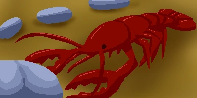

# Lobster

| Lobster      |                                                          |
|--------------|----------------------------------------------------------|
| Home worlds  | All but [Starter](starter-world.md), Frigid and Shrouded |
| Base cost    | 10 Clams                                                 |
| Base income  | +1 Clam  +0.5 Sand                                 |
| Breeder      | [Lobster Berrier](stuff.md#lobster-berrier)              |
| Career paths | [Harvester Lobster](lobster.md#lobster-harvester)        |

**Lobsters** are available in almost every world after the first, but can't be found in [Frigid](frigid-world.md) or [Shrouded](shrouded-world.md) worlds. They become available for purchase after researching [Seabed Geology](laboratory.md#seabed-geology) provided you have at least 10 clams. Their description is "Lobster like clams. Will work for clams. Good work. Many clams."

## Career Path

Lobsters have the option of becoming Harvester Lobsters after researching [Crustacean Biology](laboratory.md#crustacean-biology). This is usually the last method available to gather kelp, but is significantly faster than relying on [planter crabs](crab.md).

| Job                                             | Base Cost                         | Base Income            |
|-------------------------------------------------|-----------------------------------|------------------------|
| [Harvester Lobster](stuff.md#harvester-lobster) | 1 Lobster 25 Clams 5 Sponge | +0.3 Sponge +1 Kelp |

## Laboratory Research

There are 2 generic upgrades that can be [researched](laboratory.md) that affect lobster income, 3 upgrades to [crustacean technology](stuff.md#other-machines) and 2 upgrades specific to crustaceans in general. The research listed below is available in every world and has an effect on lobsters and their jobs:

| Upgrade                                                                                                                                                                           | Description                                                                                       | Result                                     | Cost                    |
|-----------------------------------------------------------------------------------------------------------------------------------------------------------------------------------|---------------------------------------------------------------------------------------------------|--------------------------------------------|-------------------------|
| **[Seabed Geology](laboratory.md#seabed-geology)** Study the bottom of the ocean to determine the rich, deep, juicy secrets it contains.                                       | Rays are twice as effective with their understanding of the seabed and its varieties of sediment. | Unlocks • Gain lobster • Agriculture | 250 Science 250 Sand |
| **[Agriculture](laboratory.md#agriculture)** The hunter-gatherer lifestyle will only work so well for us. Maybe we should gather these animals in one place and let them grow. | Various roles are twice as effective thanks to farming regions for coral and sponge.              | Harvester lobster power x2                 | 500 Science 1K Sand  |

The following research is available in every world besides Starter and Frigid:

| Upgrade                                                                                                                                                                     | Description                                                                                                                                                | Result                                                                                                                                                                   | Cost                        |
|-----------------------------------------------------------------------------------------------------------------------------------------------------------------------------|------------------------------------------------------------------------------------------------------------------------------------------------------------|--------------------------------------------------------------------------------------------------------------------------------------------------------------------------|-----------------------------|
| **[Coralglass Smelting](laboratory.md#coralglass-smelting)** Careful observation of crustacean smelting processes will let us copy their method for coralglass creation. | Enables smelting of coralglass, a vital component in crustacean technology.                                                                                | Unlocks • Smelt stuff to coralglass • Coral Circuitry (also requires [Automation](laboratory.md#automation))                                                       | 1K Science 3K Sand 3K Coral |
| **[Coral Circuitry](laboratory.md#coral-circuitry)** We almost know enough to replicate crustacean technology. Just a few core components remain.                        | We can copy some of the safe but slow machines used by the lobsters and shrimp.                                                                            | Unlocks • Build sponge farmer • Build berry sprayer • Build glass maker                                                                                         | 3K Science 3K Coralglass |
| **[Mobius Shells](laboratory.md#mobius-shells)** The intricate glasswork of crustacean technology can be made even finer for maximised performance.                      | Crustacean machines are all four times as effective. Their glass shells defy all reason and geometry.                                                      | Sponge farmer power x4 Berry sprayer power x4 Glass maker power x4                                                                                                 | 1B Science                  |
| **[Crustacean Biology](laboratory.md#crustacean-biology)** These strange creatures related to crabs require further investigation. What is with exoskeletons?            | Shrimp and lobsters are twice as effective. Lobsters can now gather other things or cover themselves in shiny eggs, also called 'berries'. What's a berry? | Lobster power x2 Unlocks • Form lobster berrier • Train lobster harvester • Coralglass Smelting (also requires [Thermal Vents](laboratory.md#thermal-vents)) | 500 Science 100 Clam     |
| **[Utility Carapace](laboratory.md#utility-carapace)** The exoskeleton is good enough, but with some adjustments, perhaps coralglass can improve it.                     | Crabs, shrimp and lobsters, and their roles, are all four times as effective. A shell protects, and a shell interfaces.                                    | Lobster power x4 Lobster berrier power x4 Harvester lobster power x4                                                                                               | 10B Science                 |

## Story

Warning: This section includes speculation, as canon answers don't yet exist.

    The lobsters work, but seem carefree. They worry about nothing.

The lobsters are artisans of the sea floor. They are the inventors of coralglass, and have crafted this delicate material into complex technologies.[1] They are apparently more interested in the artistry and minimizing harm to the environment than the products of their machines, and their technology is the only kind that doesn’t create tar in [Abandoned World](abandoned-world.md).[2][3]

While many artists struggle, the lobsters seem to specialize in relaxing.[4] They get along well with the sharks, though the invention of an automated breeding machine is cause for concern according to the log. The lobsters are too unenthusiastic to pose any real threat, and their technology earns plenty of admiration.

## Species List

|                                                                                                                                                                                             |
|---------------------------------------------------------------------------------------------------------------------------------------------------------------------------------------------|
| • scampi • crayfish • clawed lobster • spiny lobster • slipper lobster • hummer lobster • crawfish • rock lobster • langouste • shovel-nose lobster • crawdad |

## Trivia

Live lobsters are typically darkly colored. The red coloring most people are familiar with occurs during cooking, when heat causes the release of a chemical called astaxanthin.[5] However, there are many colors of lobster possible. The phenomenon is rare, but lobsters may change color depending partially on what they eat. The New England Aquarium has seen lobsters in bright blue, yellow, white, orange, and even combinations of the above. While white lobsters are albino the other colors are seemingly the result of the different layers of a lobster's shell, which are yellow, blue and red.[6]

[1] [Laboratory: Mobius Shells](laboratory.md#mobius-shells)

[2] [Artifacts: Totem of Carapace](artifacts.md#totem-of-carapace)

[3] [Abandoned World: Other](abandoned-world.md#other)

[4] [Artifacts: Lobster Migrator](artifacts.md#lobster-migrator)

[5] [Live Science: Why Do Lobsters Turn Red When They're Cooked?](https://www.livescience.com/66093-why-cooked-lobsters-turn-red.html)

[6] [Boston.com News: Orange, yellow, blue, and even ‘Halloween’: The rarest lobster colors, explained](https://www.boston.com/news/animals/2017/09/13/the-rarest-lobster-colors-explained)

---

*Originally from the [Shark Game Wiki on Fandom](https://shark-game.fandom.com/wiki/Lobster), licensed under [CC BY-SA 3.0](https://creativecommons.org/licenses/by-sa/3.0/).*
