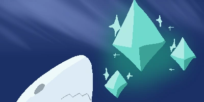

# Log Entries

The game log sits under the Stuff table on the left side of the game screen. Every action you take adds an entry, but no more than 50 can be displayed at a time. The game also updates the log when it is saved or autosaved, so many of these entries may be missed.

As some of the log entries reveal plot points, they have been collected here for reference.

## Basic

"Catch fish"

|                                                                                                                                                                                                                                                                                           |                                                                                                                                                                                                                                                    |                                                                                                                                                                                                                                                                              |
|-------------------------------------------------------------------------------------------------------------------------------------------------------------------------------------------------------------------------------------------------------------------------------------------|----------------------------------------------------------------------------------------------------------------------------------------------------------------------------------------------------------------------------------------------------|------------------------------------------------------------------------------------------------------------------------------------------------------------------------------------------------------------------------------------------------------------------------------|
| • Dropped the bass. • Ate a kipper. Wait. Hang on. • You eat a fish hooray! • Fish. • Ate a shark. Wait. No, it wasn't a shark. • Ate an anchovy. • Ate a catfish. • Ate a flounder. • Ate a haddock. • Ate a herring. • Ate a mackerel. • Ate a mullet. | • Ate a perch. • Ate a pollock. • Ate a salmon. • Ate a sardine. • Ate a sole. • Ate a tilapia. • Ate a trout. • Ate a whitefish. • Ate a bass. • Ate a carp. • Ate a cod. • Ate a halibut. • Ate a mahi mahi. | • Ate a monkfish. • Ate a perch. • Ate a snapper. • Ate a bluefish. • Ate a grouper. • Ate a sea bass. • Ate a yellowfin tuna. • Ate a marlin. • Ate an orange roughy. • Ate a shark. • Ate a swordfish. • Ate a tilefish. • Ate a tuna. |

"Pry sponge"

|                                                                                                                                                                                                                                                                                                                                                                                                                                                                                                                                                                                        |                                                                                                                                                                                                                                                                                                                                                                                                                                                                                                                                                                                                         |
|----------------------------------------------------------------------------------------------------------------------------------------------------------------------------------------------------------------------------------------------------------------------------------------------------------------------------------------------------------------------------------------------------------------------------------------------------------------------------------------------------------------------------------------------------------------------------------------|---------------------------------------------------------------------------------------------------------------------------------------------------------------------------------------------------------------------------------------------------------------------------------------------------------------------------------------------------------------------------------------------------------------------------------------------------------------------------------------------------------------------------------------------------------------------------------------------------------|
| • ”Pried an orange elephant ear sponge from the rocks." • ”Pried a brain sponge from the rocks." • ”Pried a branching tube sponge from the rocks." • ”Pried a brown volcano carpet from the rocks." • ”Pried a row pore rope sponge from the rocks." • ”Pried a branching vase sponge from the rocks." • ”Pried a chicken liver sponge from the rocks." • ”Pried a red boring sponge from the rocks." • ”Pried a heavenly sponge from the rocks." • ”Pried a brown encrusting octopus sponge from the rocks." • ”Pried a stinker sponge from the rocks." | • ”Pried a black-ball sponge from the rocks." • ”Pried a strawberry vase sponge from the rocks." • ”Pried a convoluted orange sponge from the rocks." • ”Pried a touch-me-not sponge from the rocks. Ow." • ”Pried a lavender rope sponge from the rocks." • ”Pried a red-orange branching sponge from the rocks." • ”Pried a variable boring sponge from the rocks." • ”Pried a loggerhead sponge from the rocks." • ”Pried a yellow sponge from the rocks." • ”Pried an orange lumpy encrusting sponge from the rocks." • ”Pried a giant barrel sponge from the rocks." |

"Get clam"

|                                                                                                                                                                                                                                                                                                |                                                                                                                                                                                                                                                                                |
|------------------------------------------------------------------------------------------------------------------------------------------------------------------------------------------------------------------------------------------------------------------------------------------------|--------------------------------------------------------------------------------------------------------------------------------------------------------------------------------------------------------------------------------------------------------------------------------|
| • ”Got a grooved carpet shell." • ”Got a hard clam." • ”Got a manila clam." • ”Got a soft clam." • ”Got an atlantic surf clam." • ”Got an ocean quahog." • ”Got a pacific razor clam." • ”Got a pismo clam." • ”Got a geoduck." • ”Got an atlantic jackknife clam." | • ”Got a lyrate asiatic hard clam." • ”Got an ark clam." • ”Got a nut clam." • ”Got a duck clam." • ”Got a marsh clam." • ”Got a file clam." • ”Got a giant clam." • ”Got an asiatic clam." • ”Got a peppery furrow shell." • ”Got a pearl oyster." |

"Grab jellyfish"

|                                                                                                                                                                                                                                                                                                                                                                |                                                                                                                                                                                                                                                                                                                                                                                           |                                                                                                                                                                                                                                                                                                                                                            |
|----------------------------------------------------------------------------------------------------------------------------------------------------------------------------------------------------------------------------------------------------------------------------------------------------------------------------------------------------------------|-------------------------------------------------------------------------------------------------------------------------------------------------------------------------------------------------------------------------------------------------------------------------------------------------------------------------------------------------------------------------------------------|------------------------------------------------------------------------------------------------------------------------------------------------------------------------------------------------------------------------------------------------------------------------------------------------------------------------------------------------------------|
| • ”Grabbed a mangrove jellyfish." • ”Grabbed a lagoon jellyfish." • ”Grabbed a nomuras jellyfish." • ”Grabbed a sea nettle jellyfish." • ”Grabbed an upside down jellyfish." • ”Grabbed a comb jellyfish." • ”Grabbed a sand jellyfish." • ”Grabbed a box jellyfish." • ”Grabbed a sea wasp jellyfish." • ”Grabbed a blue blubber." | • ”Grabbed a white spotted jellyfish." • ”Grabbed an immortal jellyfish." • ”Grabbed a pelagia noctiluca." • ”Grabbed a moon light jellyfish." • ”Grabbed an iracongi irukandji jellyfish." • ”Grabbed an irukandji jellyfish." • ”Grabbed a moon jellyfish." • ”Grabbed an aurelia aurita." • ”Grabbed a ball jellyfish." • ”Grabbed a cannonball jellyfish." | • ”Grabbed a man of war." • ”Grabbed a war jellyfish." • ”Grabbed a blue bottle jellyfish." • ”Grabbed a lion's mane jellyfish." • ”Grabbed a mane jellyfish." • ”Grabbed a sun jellyfish." • ”Grabbed a square jellyfish." • ”Grabbed a physalia jellyfish." • ”Grabbed a king jellyfish." • ”Grabbed a cassiopeia jellyfish." |

## Frenzy

*See item pages for species entries.* "Recruit shark"

|                                                                                                                                                                                                                                                                                                                                                                                                                                                     |
|-----------------------------------------------------------------------------------------------------------------------------------------------------------------------------------------------------------------------------------------------------------------------------------------------------------------------------------------------------------------------------------------------------------------------------------------------------|
| • ”A whole bunch of sharks join you." • ”That's a lot of sharks." • ”The shark community grows!" • ”More sharks! MORE SHARKS!" • ”Sharks for the masses. Mass sharks." • ”A shiver of sharks! No, that's a legit name. Look it up." • ”A school of sharks!" • ”A shoal of sharks!" • ”A frenzy of sharks!" • ”A gam of sharks! Yes, that's correct." • ”A college of sharks! They're a little smarter than a school." |

"Hire ray"

|                                                                                                                                                                                                                                                                                                                                                                                                                              |
|------------------------------------------------------------------------------------------------------------------------------------------------------------------------------------------------------------------------------------------------------------------------------------------------------------------------------------------------------------------------------------------------------------------------------|
| • "These guys seem to be kicking up a lot of sand!" • ”A whole bunch of rays join you." • ”That's a lot of rays." • ”The ray conspiracy grows!" • ”I can't even deal with all of these rays." • ”More rays more rays more more more." • ”A school of rays!" • ”A fever of rays! Yes, seriously. Look it up." • ”A whole lotta rays!" • ”The sand is just flying everywhere!" • ”So many rays." |

"Acquire crab"

|                                                                                                                                                                                                                                                                                                                        |
|------------------------------------------------------------------------------------------------------------------------------------------------------------------------------------------------------------------------------------------------------------------------------------------------------------------------|
| • ”A crab starts sifting shiny things out of the sand." • ”A lot of crabs join you." • ”CRABS EVERYWHERE" • ”Crabs. Crabs. Crabs!" • ”Feels sort of crab-like around here." • ”A cast of crabs!" • ”A dose of crabs!" • ”A cribble of crabs! Okay, no, that one's made up." • ”So many crabs." |

”Acquire shrimp"

|                                                                                                                                                                                                                                                                                                        |
|--------------------------------------------------------------------------------------------------------------------------------------------------------------------------------------------------------------------------------------------------------------------------------------------------------|
| • ”That's a lot of shrimp." • ”So many shrimp, it's like a cloud!" • ”I can't cope with this many shrimp!" • ”Shrimp, they're like bugs, except not bugs or anything related at all!" • ”They're so tiny!" • ”How can something so small take up so much space?" • ”Sponge forever!" |

”Gain lobster"

|                                                                                                                                                                                                                                                                                                                               |
|-------------------------------------------------------------------------------------------------------------------------------------------------------------------------------------------------------------------------------------------------------------------------------------------------------------------------------|
| • ”Lobsters lobsters lobsters lobsters." • ”But they weren't rocks..." • ”The clam forecast is looking good!" • ”They're all about the clams!" • ”More lobsters, because why not?" • ”HEAVY LOBSTERS" • ”More lobsters for the snipping and the cutting and the clam grab!" • ”Clam patrol, here we go." |

”Fetch dolphin"

|                                                                                                                                                                                        |
|----------------------------------------------------------------------------------------------------------------------------------------------------------------------------------------|
| • ”A pod of dolphins!" • ”More of them. Hm." • ”More of these squeaky chatterers." • ”More whiners." • ”Do we need these guys?" • ”They have to be good for something." |

”Reach whale"

|                                                                                                                                                                                                                                      |
|--------------------------------------------------------------------------------------------------------------------------------------------------------------------------------------------------------------------------------------|
| • ”A pod of whales!" • ”Aloof, mysterious, big." • ”So majestic. Wait, no, we're looking at a boulder formation." • ”The songs are mesmerising." • ”They might not all eat fish, but they're great at rounding them up." |

”Hire eel"

|                                                                                                                                                                                                                                                                                                                                                                                                                                                                 |
|-----------------------------------------------------------------------------------------------------------------------------------------------------------------------------------------------------------------------------------------------------------------------------------------------------------------------------------------------------------------------------------------------------------------------------------------------------------------|
| • ”Eels combining elements of the sharks and the eels to create something not quite as good as either." • ”The seabed sways with the arrival of new eels." • ”Fish and sand go hand in hand with eels! Well, fin and fin." • ”Don't mess with the creatures with jaws inside their jaws." • ”Eel nation arise!" • ”That's a lot of eels." • ”So there's more eels. Whee." • ”The eels increase in number." • ”More eels happened. Yay." |

”Procure chimaera"

|                                                                                                                                                                                                                                                                                                                                                                                                              |
|--------------------------------------------------------------------------------------------------------------------------------------------------------------------------------------------------------------------------------------------------------------------------------------------------------------------------------------------------------------------------------------------------------------|
| • ”Many chimaeras come from the deep." • ”Like ghosts, they come." • ”The chimaeras avert your gaze, but set to work quickly." • ”The jellyfish stocks shall climb ever higher!" • ”Well, it saves you the effort of braving the stinging tentacles." • ”What have they seen, deep in the chasms?" • ”They aren't sharks, but they feel so familiar." • ”The long-lost kindred return." |

”Employ octopus"

|                                                                                                                                                                                                                                                                                                                                                                                                                                                                                       |
|---------------------------------------------------------------------------------------------------------------------------------------------------------------------------------------------------------------------------------------------------------------------------------------------------------------------------------------------------------------------------------------------------------------------------------------------------------------------------------------|
| • ”Efficiency increases with limb count." • ”Hard to understand, but hardworking nonetheless." • ”The minds of the octopuses are a frontier unbraved by many sharks." • ”They hardly seem to notice you. They take their payment and begin to harvest." • ”They say something about the schedule being on target." • ”One of the new batch tells you to find unity in efficiency." • ”You could have sworn you saw an octopus among the crowd glinting like metal." |

## Jobs

”Prepare diver shark"

|                                                                                                                                                                                                                                                                                                                                                          |
|----------------------------------------------------------------------------------------------------------------------------------------------------------------------------------------------------------------------------------------------------------------------------------------------------------------------------------------------------------|
| • ”Well, better you than me." • ”Good luck down there!" • ”You're doing good work for us, diver shark." • ”Fare well on your expeditions, shark!" • ”Follow the crystals!" • ”We will find the secrets of the deep!" • ”Brave the deep!" • ”Find the crystals for science!" • ”Deep, dark, scary waters. Good luck, all of you." |

”Train science shark"

|                                                                                                                                                                                                                                                                                                                                                                                                                                                                                                                                                                                                                                                        |
|--------------------------------------------------------------------------------------------------------------------------------------------------------------------------------------------------------------------------------------------------------------------------------------------------------------------------------------------------------------------------------------------------------------------------------------------------------------------------------------------------------------------------------------------------------------------------------------------------------------------------------------------------------|
| • ”Doctor Shark, coming right up!" • ”A scientist shark is revealed!" • ”After many painful years of study, a shark that has developed excellent skills in making excuses-- er, in science!" • ”PhD approved!" • ”Graduation complete!" • ”A new insight drives a new shark to take up the cause of science!" • ”The training program was a success!" • ”Look at all this science!" • ”Building a smarter, better shark!" • ”Beakers! Beakers underwater! It's madness!" • ”Let the science commence!" • ”Underwater clipboards! No I don't know how that works either!" • ”Careful teeth record the discoveries!" |

”Equip laser ray"

|                                                                                                                                                                                                                                                                                                                                                                                                                                                         |
|---------------------------------------------------------------------------------------------------------------------------------------------------------------------------------------------------------------------------------------------------------------------------------------------------------------------------------------------------------------------------------------------------------------------------------------------------------|
| • ”Laser ray online!" • ”Laser ray! With a laser ray! It's laser ray, with a laaaaaser raaaay!" • ”Laser ray." • ”Ray suited up with a laaaaaaser!" • ”Ray lasered. To use a laser. Not the subject of a laser." • ”Boil the seabed!" • ”Churn the sand to crystal!" • ”Laser ray armada in position!" • ”Ray crystal processing initiative is growing stronger every day!" • ”Welcome to the future! The future is lasers!" |

”Gear up planter crab"

|                                                                                                                                                                                                                                                                                                                                                                                                                                                                                                   |
|---------------------------------------------------------------------------------------------------------------------------------------------------------------------------------------------------------------------------------------------------------------------------------------------------------------------------------------------------------------------------------------------------------------------------------------------------------------------------------------------------|
| • ”Crab set up with seeds." • ”Shell studded with kelp." • ”Crab is going on a mission. A mission... to farm." • ”Planter crab equipped and ready to move a few feet and start planting some things!" • ”Crab is ready to farm!" • ”Carpet the seabed!" • ”Kelp kelp kelp kelp kelp kelp kelp kelp." • ”Horticulturists unite!" • ”Strike the sand!" • ”Pat the sand very gently and put kelp in it!" • ”More kelp. The apples. They hunger. They hunger for kelp." |

”Assign shrimp worker"

|                                                                                                                                                                                                                                                                                                                                                                                                                                                                                                                                                                                                                   |
|-------------------------------------------------------------------------------------------------------------------------------------------------------------------------------------------------------------------------------------------------------------------------------------------------------------------------------------------------------------------------------------------------------------------------------------------------------------------------------------------------------------------------------------------------------------------------------------------------------------------|
| • ”No more work for this shrimp! Of their particular variety! Now slightly different work! Go!" • ”Consider this a promotion." • ”This shrimp is going to have to come in on weekends now, I'm afraid." • ”We sure love micromanaging these tiny guys on an individual basis, don't we." • ”This little shrimp is so happy to be picked out of the crowd." • ”These are some pretty fluid castes." • ”Promotions for everybody!" • ”We're reorganising the superorganism." • ”The sponge must grow." • ”The sponge is the life." • ”Glory to the sponge. Glory to the shrimp mass." |

”Train lobster harvester"

|                                                                                                                                                                                                                                                                                                                                                                                                                                                                                                                 |
|-----------------------------------------------------------------------------------------------------------------------------------------------------------------------------------------------------------------------------------------------------------------------------------------------------------------------------------------------------------------------------------------------------------------------------------------------------------------------------------------------------------------|
| • ”Yes, lobster, put these claws to better use." • ”It is time for this one to seek more interesting prey. Wait. Wait, no, it's just as stationary. Never mind. False alarm." • ”Lobster sticks to seabed!" • ”Cut down the kelp forests!" • ”Rip the sponge and tear the kelp!" • ”Harvest the seafloor!" • ”The lobster tide shall claim the-- wait no you said harvesters. Okay. Adjusting that, then." • ”These guys are pretty unenthusiastic about everything they do, aren't they." |

”Qualify dolphin philosopher"

|                                                                                                                                                                                                                                                                                                                                                                                                                                                                                                                                                                    |
|--------------------------------------------------------------------------------------------------------------------------------------------------------------------------------------------------------------------------------------------------------------------------------------------------------------------------------------------------------------------------------------------------------------------------------------------------------------------------------------------------------------------------------------------------------------------|
| • ”We've given a dolphin free opportunity to ramble. WHY?!" • ”Let's humour this dolphin's rambling." • ”This philosopher might have some insight." • ”Maybe this dolphin can answer the question of why we're even working with dolphins." • ”We begrudgingly acknowledge that working together is providing us with new insights." • ”It's time to wax poetic and ponder." • ”These pretentious clicking jerks can sometimes raise a good point." • ”Oh joy. We're encouraging them to talk more." • ”What's wrong with shark science?!" |

”Promote dolphin treasurer"

|                                                                                                                                                                                                                                                                                                                                                                                                                                                                |
|----------------------------------------------------------------------------------------------------------------------------------------------------------------------------------------------------------------------------------------------------------------------------------------------------------------------------------------------------------------------------------------------------------------------------------------------------------------|
| • ”Treasurer of the dolphin treasures, go!" • ”We are trusting this dolphin with a lot. Is that wise?" • ”A dolphin is promoted to where it can do slightly more damage!" • ”Dolphin treasurer ready to do... whatever it is they do." • ”Do we need this many treasurers?" • ”Should we be encouraging this?" • ”We require more crystals." • ”You're might be playing a dangerous game trusting these guys." • ”The treasury grows!" |

”Teach eel technician"

|                                                                                                                                                                                                                                                                                                                           |
|---------------------------------------------------------------------------------------------------------------------------------------------------------------------------------------------------------------------------------------------------------------------------------------------------------------------------|
| • ”We have a technician!" • ”Technical problems no more!" • ”No, the eel won't fix your computer." • ”Eel technician!" • ”Let's get technical!" • ”Qualified and certified!" • ”Support squad on the rise!" • ”Let us not question the nature of eel technical training." • ”Science progresses!" |

”Train eel sifter"

|                                                                                                                                                                                                                                                                                                                                                                                                                                           |
|-------------------------------------------------------------------------------------------------------------------------------------------------------------------------------------------------------------------------------------------------------------------------------------------------------------------------------------------------------------------------------------------------------------------------------------------|
| • ”Eel sifter ready to find things!" • ”Eel ready to sift through the sands!" • ”Time to sift, eel. Time to seek, search and sift." • ”Time for this little guy to find some goodies." • ”Time to find the things!" • ”Sift. It's a fun word. Siiiiffft." • ”Sifters scouring the seabed for some special stuff." • ”Shifters ready to shift! Wait. No. Hang on." • ”Sifting the seabed for scores of surprises!" |

”Induct chimaera transmuter"

|                                                                                                                                                                                                                                                                                                                                                                           |
|---------------------------------------------------------------------------------------------------------------------------------------------------------------------------------------------------------------------------------------------------------------------------------------------------------------------------------------------------------------------------|
| • ”Transmuter taught." • ”The chimaera's eyes flicker with power." • ”The water glows around the chimaera." • ”The chimaera forms the material of progress." • ”The chimaeras are now masters of matter." • ”The transmuters revel in our revealed secrets." • ”The process continues." • ”The matter matters." • ”The immaterial made material." |

”Prepare chimaera explorer"

|                                                                                                                                                                                                                                                                                                                                                                                                   |
|---------------------------------------------------------------------------------------------------------------------------------------------------------------------------------------------------------------------------------------------------------------------------------------------------------------------------------------------------------------------------------------------------|
| • ”A seeker of mysteries is prepared." • ”The chimaera explorer is ready for their journey." • ”Explorer ready for some answers!" • ”The chimaera swims down to the ocean below." • ”The exploration party is ready." • ”Learn the secrets of the deeps!" • ”More mysteries to uncover." • ”Ancient riddles for ancient creatures." • ”Find the truth beneath the waves!" |

”Reassign octopus as collector"

|                                                                                                                                                                                                                                                                                                                                                                                                                             |
|-----------------------------------------------------------------------------------------------------------------------------------------------------------------------------------------------------------------------------------------------------------------------------------------------------------------------------------------------------------------------------------------------------------------------------|
| • ”An octopus is a collector now." • ”Octopus, collector." • ”The role has been assigned. Collector." • ”The delegation has been made. Collector." • ”This individual now collects." • ”Collectors will retrieve that which has value to others." • ”Collectors will collect what they feel is required." • ”Collectors will begin their thankless harvest." • ”Collectors will act as instructed." |

”Reassign octopus as scavenger"

|                                                                                                                                                                                                                                                                                                                                                                                                                                                             |
|-------------------------------------------------------------------------------------------------------------------------------------------------------------------------------------------------------------------------------------------------------------------------------------------------------------------------------------------------------------------------------------------------------------------------------------------------------------|
| • ”An octopus is a scavenger now." • ”Octopus, scavenger." • ”The role has been assigned. Scavenger." • ”The delegation has been made. Scavenger." • ”This individual now scavenges." • ”Scavengers will retrieve that which has value to their kind." • ”Scavengers will scavenge what they can from below." • ”Scavengers will pry the substrate of future progress from the ocean floor." • ”Scavengers will act as instructed." |

## Producers

”Train nurse shark"

|                                                                                                                                                                                                                                                                                                                                                                                                       |
|-------------------------------------------------------------------------------------------------------------------------------------------------------------------------------------------------------------------------------------------------------------------------------------------------------------------------------------------------------------------------------------------------------|
| • ”A nurse shark is ready!" • ”Shark manufacturer primed." • ”Nurse shark trained." • ”Medical exam passed! Nurse shark is go!" • ”More sharks are on the way soon." • ”Shark swarm begins!" • ”There will be no end to the sharks!" • ”Sharks forever!" • ”The sharks will never end. The sharks are eternal." • ”More sharks to make more sharks to make more sharks..." |

”Instruct a ray maker"

|                                                                                                                                                                                                                                                                                                                                                                                                                                                                                                                                                                                                                                                                                                                                                                                                                                                                                                                                                                                                                      |
|----------------------------------------------------------------------------------------------------------------------------------------------------------------------------------------------------------------------------------------------------------------------------------------------------------------------------------------------------------------------------------------------------------------------------------------------------------------------------------------------------------------------------------------------------------------------------------------------------------------------------------------------------------------------------------------------------------------------------------------------------------------------------------------------------------------------------------------------------------------------------------------------------------------------------------------------------------------------------------------------------------------------|
| • ”The application of kelp supplements has made a ray very productive." • ”More rays lets you get more rays which you can then use to get more rays." • ”The ray singularity begins!" • ”A ray maker is ready." • ”Looks like you gave them quite the ray maker blow! 'Them' being the intangible enemy that is lacking in resources." • ”The ray seems concerned, but obliges. The mission has been given." • ”All these makers. What are they making? What is it for? Oh. It's rays, and it's probably for sand or something." • ”More ray makers means more rays. Do you understand what that means?! Do you?! It means more rays. Good. On the same page, then." • ”Rapidly breeding aquatic wildlife is probably a severe ecological hazard. Good thing this isn't Earth's oceans, probably!" • ”Have you ever thought about what the rays wanted? Because this might have been what they wanted after all." • ”MORE LASER RAYS FOR THE LASER ARMY-- oh. Well, this is good too." |

”Form crab brood"

|                                                                                                                                                                                                                                                                                                                                                                                                                                                                                                                                                                                                                                                                                                                                                                                                                                                                                                                                                                                                                                                                |
|----------------------------------------------------------------------------------------------------------------------------------------------------------------------------------------------------------------------------------------------------------------------------------------------------------------------------------------------------------------------------------------------------------------------------------------------------------------------------------------------------------------------------------------------------------------------------------------------------------------------------------------------------------------------------------------------------------------------------------------------------------------------------------------------------------------------------------------------------------------------------------------------------------------------------------------------------------------------------------------------------------------------------------------------------------------|
| • ”A bunch of crabs pile together into some sort of weird cluster." • ”Crab team, assemble! FORM THE CRAB BROOD!" • ”\[This message has been censored for reasons of being mostly really gross.\]" • ”Eggs, eggs everywhere, but never stop and think." • ”Writhing crab pile. Didn't expect those words next to each other today, did you." • ”The crab brood is a rarely witnessed phenomenon, due to being some strange behaviour of crabs that have been driven to seek crystals for reasons only they understand." • ”The broods grow. The swarm rises." • ”All these crabs are probably a little excessive. ...is what I could say, but I'm going to say this instead. MORE CRABS." • ”A sea of crabs on the bottom of the sea. Clickity clackity." • ”Snip snap clack clack burble burble crabs crabs crabs crabs." • ”More crabs are always a good idea. Crystals aren't cheap." • ”The broods swell in number. The sharks are uneasy, but the concern soon passes." • ”Yes. Feed the kelp. Feed it. Feeeeeed it." |

”Crown shrimp queen"

|                                                                                                                                                                                                                                                                                                                                                                                                                                                                                                                                                                                                                                           |
|-------------------------------------------------------------------------------------------------------------------------------------------------------------------------------------------------------------------------------------------------------------------------------------------------------------------------------------------------------------------------------------------------------------------------------------------------------------------------------------------------------------------------------------------------------------------------------------------------------------------------------------------|
| • ”Shrimp queen prepped for duty!" • ”A royal shrimp is she!" • ”More shrimp for the shrimp superorganism!" • ”Give it time before they start singing about wanting to break free." • ”Long live the tiny tiny shrimp queen!" • ”Okay, so it's not exactly a royal role, but hey, they're gonna be making eggs for a long time. Humour them." • ”This is the weirdest monarchy in existence." • ”Welcome to the superorganisation!" • ”They want to ride their bicycle." • ”Give it time before they start singing about wanting to break free." • ”Queens for the shrimp colony! Eggs for the egg throne!" |

”Form lobster berrier"

|                                                                                                                                                                                                                                                                                                                                                                                                                                                                                                                                                                                                                            |
|----------------------------------------------------------------------------------------------------------------------------------------------------------------------------------------------------------------------------------------------------------------------------------------------------------------------------------------------------------------------------------------------------------------------------------------------------------------------------------------------------------------------------------------------------------------------------------------------------------------------------|
| • ”We didn't need to see the process behind this." • ”One lobster brimming with eggs to go." • ”It's like some weird counterpart to the planter crab. But with eggs." • ”Lobster with rocks ready to make a move. Oh, okay, eggs, whatever, see, they look like shiny pebbles from a distance and... oh, forget it." • ”Berrier isn't even a word!" • ”Berries and eggs aren't even the same thing!" • ”How do these things swim with this much weighing them down?" • ”We aren't running out of volunteers any time soon." • ”Did you see them fight for this job? Claws everywhere, I tell you!" |

”Train dolphin biologist"

|                                                                                                                                                                                                                                                                                                                                                                              |
|------------------------------------------------------------------------------------------------------------------------------------------------------------------------------------------------------------------------------------------------------------------------------------------------------------------------------------------------------------------------------|
| • ”Dolphin biologist graduated!" • ”Biologist trained." • ”Dolphin dedicated to dolphin duty." • ”Specialist dolphin ready for dolphin." • ”More of them. Eesh." • ”Dolphins proliferate." • ”Dolphin biologists ready for whatever passes for their 'research'." • ”Smug hedonists, the lot of them!" • ”The dolphin population regretfully grows." |

”Dig eel pit"

|                                                                                                                                                                                                                                                                                                                                                                                           |
|-------------------------------------------------------------------------------------------------------------------------------------------------------------------------------------------------------------------------------------------------------------------------------------------------------------------------------------------------------------------------------------------|
| • ”Why does it take three eels? Oh well. We don't really need to know." • ”Dig that pit. We can dig it." • ”Let's get digging." • ”Oh, hey, this hole's already empty. Well, isn't that something." • ”Let's get digging." • ”Eel tide rises." • ”More eels! They're handy to have." • ”Many eyes from the caves." • ”Secret homes!" • ”The eels are content." |

## Processing

"Study sea apples"

|                                                                                                                                                                                                                                                                                           |
|-------------------------------------------------------------------------------------------------------------------------------------------------------------------------------------------------------------------------------------------------------------------------------------------|
| • "There's science inside these things, surely!" • "The cause of science is advanced!" • "This is perhaps maybe insightful!" • "Why are we even doing this? Who knows! Science!" • "What is even the point of these things? Why are they named for fruit? They're squirming!" |

"Dissect sponge"

|                                                                                                                                                                                                                                                                                                                                           |
|-------------------------------------------------------------------------------------------------------------------------------------------------------------------------------------------------------------------------------------------------------------------------------------------------------------------------------------------|
| • "Squishy porous science!" • "The sponge has been breached and the science is leaking out!" • "This is the best use of a sponge. Teeth dissections are the best." • "Sponge is now so many shreds. But so much was learned!" • "The sponge is apparently not a plant. Yet plants feel more sophisticated than these things." |

"Dismantle jellyfish"

|                                                                                                                                                                                                                                                                                                  |
|--------------------------------------------------------------------------------------------------------------------------------------------------------------------------------------------------------------------------------------------------------------------------------------------------|
| • "Eww eww gross it's so gloopy and fragile and OW IT STUNG ME" • "These things are like a bag of wonders. Weird, tasteless wonders." • "Wow, sea apples seemed weird, but these things barely exist." • "Well, they turned out just as fragile as they looked." • "So interesting!" |

"Convert clam pearls"

|                                                                                                                                                                                                                                                                                                                                                                                                   |
|---------------------------------------------------------------------------------------------------------------------------------------------------------------------------------------------------------------------------------------------------------------------------------------------------------------------------------------------------------------------------------------------------|
| • "Pearls to crystals! One day. One day, we will get this right and only use the pearl." • "Welp, we somehow turned rocks to crystals. Oh. Nope, those were clams. Not rocks. It's so hard to tell sometimes." • "Okay, we managed to only use the pearls this time, but we, uh, had to break the clams open pretty roughly." • "Pearls to... nope. Clams to crystals. Science is hard." |

"Transmute stuff to sharkonium"

|                                                                                                                                                                                                                                                                                                                                                                                                                                                        |
|--------------------------------------------------------------------------------------------------------------------------------------------------------------------------------------------------------------------------------------------------------------------------------------------------------------------------------------------------------------------------------------------------------------------------------------------------------|
| • "Transmutation destination!" • "Transmutation rejuvenation!" • "Transmogrification revelation!" • "Transformation libation!" • "Transfiguration nation! ...wait." • "Sharkonium arise!" • "Arise, sharkonium!" • "More sharkonium!" • "The substance that knows no name! Except the name sharkonium!" • "The substance that knows no description! It's weird to look at." • "The foundation of a modern shark frenzy!" |

"Smelt stuff to coralglass"

|                                                                                                                                                                                                                                                                                    |
|------------------------------------------------------------------------------------------------------------------------------------------------------------------------------------------------------------------------------------------------------------------------------------|
| • "Coralglass smelted!" • "Coralglass melted! No. Wait." • "How does coral become part of glass? Well, you see, it's all very simple, or that's what the lobster told me." • "The backbo-- the exoskeleton of the crustacean industry!" • "So fragile. Yet so useful." |

"Fuse stuff into delphinium"

|                                                                                                                                                                                                                                                                                             |
|---------------------------------------------------------------------------------------------------------------------------------------------------------------------------------------------------------------------------------------------------------------------------------------------|
| • "Fusion confusion." • "Fission's fishy." • "Delphinium, something that, much like its inventors, just isn't quite as legitimate in the ocean." • "Delphinium, a substance we tolerate!" • "Delphinium! It's a product!" • "Delphinium! It... uh, is a thing! That exists!" |

## Shark Machines

”Build crystal miner"

|                                                                                                                                                                                                                                                                                                         |
|---------------------------------------------------------------------------------------------------------------------------------------------------------------------------------------------------------------------------------------------------------------------------------------------------------|
| • ”Crystal miner activated." • ”Crystal miner constructed." • ”Mining machine online." • ”Construction complete." • ”Carve rock. Remove sand. Retrieve target." • ”The machines rise." • ”The miners dig." • ”The crystal shall be harvested." • ”Crystal miners are complete." |

”Build sand digger"

|                                                                                                                                                                                                                                                                                                                                                                                                                                                           |
|-----------------------------------------------------------------------------------------------------------------------------------------------------------------------------------------------------------------------------------------------------------------------------------------------------------------------------------------------------------------------------------------------------------------------------------------------------------|
| • ”Sand digger constructed." • ”Sand digger reaches into the seabed." • ”The digger begins to shuffle sand into its machine maw. Rays dart away." • ”The machine is online." • ”The machine acts immediately, shovelling sand." • ”The machines increase in number." • ”The diggers devour." • ”All sand must be gathered." • ”The rays are concerned." • ”Devour the sands. Consume." • ”Giant machines blot out our sun." |

”Build fish machine"

|                                                                                                                                                                                                                                                                                                                                                                                                                                                                                                                                                          |
|----------------------------------------------------------------------------------------------------------------------------------------------------------------------------------------------------------------------------------------------------------------------------------------------------------------------------------------------------------------------------------------------------------------------------------------------------------------------------------------------------------------------------------------------------------|
| • ”Fish machine activated." • ”Fish machine constructed." • ”Fishing machine online." • ”Construction complete." • ”The quarry moves. But the machine is faster." • ”One day there will be no fish left. Only the machines." • ”Today the shark is flesh. Tomorrow, machine." • ”Your metal servants can sate the hunger. The hunger for fish." • ”The fishing machines are more efficient than the sharks. But they aren't very smart." • ”Automated fishing." • ”The power of many, many sharks, in many, many devices." |

”Build auto-transmuter"

|                                                                                                                                                                                                                                                                                                                                                                                                                   |
|-------------------------------------------------------------------------------------------------------------------------------------------------------------------------------------------------------------------------------------------------------------------------------------------------------------------------------------------------------------------------------------------------------------------|
| • ”Auto-transmuter activated." • ”Auto-transmuter constructed." • ”Transmutation machine online." • ”Construction complete." • ”Provide inputs. Only the output matters." • ”Auto-transmuters are prepared." • ”The difference between science and magic is reliable application." • ”All is change." • ”Change is all." • ”The machines know many secrets, yet cannot speak of them." |

”Build skimmer"

|                                                                                                                                                                                                                                                                                                                                                                                                                                      |
|--------------------------------------------------------------------------------------------------------------------------------------------------------------------------------------------------------------------------------------------------------------------------------------------------------------------------------------------------------------------------------------------------------------------------------------|
| • ”Skimmer activated." • ”Skimmer constructed." • ”Residue producer online." • ”Construction complete." • ”Sacrifices must be made for progress." • ”The lesser resource becomes the greatest of all." • ”Transmutation is limited. The recycler is greater." • ”Consumption and production are two halves of the greater whole." • ”The creations of sharks emerge from a pattern as old as their species." |

”Build purifier"

|                                                                                                                                                                                                                                                                                                                                                                                                                                                                                                                                                               |
|---------------------------------------------------------------------------------------------------------------------------------------------------------------------------------------------------------------------------------------------------------------------------------------------------------------------------------------------------------------------------------------------------------------------------------------------------------------------------------------------------------------------------------------------------------------|
| • ”Purifier activated." • ”Purifier constructed." • ”Machine gills online." • ”Construction complete." • ”Not all machines carry such weight." • ”We can almost hear these machines as they start. We can hear them speak. \\We will save you from your mistakes.\\ No, I'm just, must be hearing things, ignore me." • ”The problems of old will be solved by the new." • ”The waters will return to clarity." • ”The machines may destroy, but so too can they heal and repair." • ”The end is not nearly so soon." • ”Hope." |

”Build heater"

|                                                                                                                                                                                                                                                                                                                                                                                         |
|-----------------------------------------------------------------------------------------------------------------------------------------------------------------------------------------------------------------------------------------------------------------------------------------------------------------------------------------------------------------------------------------|
| • ”Heater activated." • ”Heater constructed." • ”Climate control online." • ”Construction complete." • ”The end of ice." • ”The ice age comes to a close." • ”Is this replacing one form of destruction for another?" • ”Life becomes easier." • ”The warmth. The warmth we desired so much." • ”Life returns to the frozen sea." • ”This world awakens." |

## Other Machines

”Build sponge farmer"

|                                                                                                                                                                                                                                                                                                                                                                                                                                      |
|--------------------------------------------------------------------------------------------------------------------------------------------------------------------------------------------------------------------------------------------------------------------------------------------------------------------------------------------------------------------------------------------------------------------------------------|
| • ”Sponge farmer is active." • ”Sponge farmer capable." • ”This sponge farming machine clatters to life." • ”This automated caretaker gets to work." • ”Sponges are not hard to domesticate. It's harder to make them wild." • ”The shrimp will be happier." • ”There is something missing compared to our machines. Ours are slightly more menacing, but also more effective." • ”Who needs this much sponge?" |

”Build berry sprayer"

|                                                                                                                                                                                                                                                                                                                                                                                                                                                                                                                                            |
|--------------------------------------------------------------------------------------------------------------------------------------------------------------------------------------------------------------------------------------------------------------------------------------------------------------------------------------------------------------------------------------------------------------------------------------------------------------------------------------------------------------------------------------------|
| • ”Berry sprayer is active." • ”Berry sprayer capable." • ”This egg spraying machine clatters to life." • ”This automated caretaker gets to work." // yeah, it's lazy, I know, but still just as appropriate • ”Automation of population? What a terrifying concept." • ”The machine rears lobster eggs. Wouldn't the shrimp want something like this too?" • ”There is an uneasiness about these machines that fills the sharks with concern." • ”Why was this machine invented? Are we helping to prepare an army?" |

”Build glass maker"

|                                                                                                                                                                                                                                                                                                                                                                                                                                                                                                                                                             |
|-------------------------------------------------------------------------------------------------------------------------------------------------------------------------------------------------------------------------------------------------------------------------------------------------------------------------------------------------------------------------------------------------------------------------------------------------------------------------------------------------------------------------------------------------------------|
| • ”Glass maker is active." • ”Glass maker capable." • ”This glass forging machine clatters to life." • ”The coralglass factory whirrs and boils." • ”Coralglass. The sharkonium of the shelled kind." • ”The raw heat from these things could boil the ocean dry. How they do it, we don't know." • ”Coralglass. So fragile, so beautiful, yet so durable. They make the machines in their own image." • ”The fine intricacies of these machines are lost on us, given how much of our technological development involves our mouths." |

”Build silent archivist"

|                                                                                                                                                                                                                                                                                                                                                                                                                                                                                                                 |
|-----------------------------------------------------------------------------------------------------------------------------------------------------------------------------------------------------------------------------------------------------------------------------------------------------------------------------------------------------------------------------------------------------------------------------------------------------------------------------------------------------------------|
| • ”Silent archivist watches on." • ”Silent archivist shows no bias." • ”Silent archivist makes a note." • ”Silent archivist views us with disdain." • ”More archivers of our grand works as a collective." • ”These machines share the same insights as their creators, but are much less painful to deal with." • ”The design for these machines seems strangely familiar." • ”These things are too silent. We aren't sure if they're even on." • ”Science is nothing without review." |

”Build tireless crafter"

|                                                                                                                                                                                                                                                                                                                                                                                                                                                                                                                                                                                    |
|------------------------------------------------------------------------------------------------------------------------------------------------------------------------------------------------------------------------------------------------------------------------------------------------------------------------------------------------------------------------------------------------------------------------------------------------------------------------------------------------------------------------------------------------------------------------------------|
| • ”Tireless crafter fuses the matter." • ”Tireless crafter never ceases." • ”Tireless crafter lays foundation for a future." • ”Tireless crafter is an accident waiting to happen." • ”Delphinium. The warped counterpart to sharkonium." • ”A silent, heatless process, much like the auto-transmuter's method of operation." • ”Delphinium. We don't understand it. It feels a lot like sharkonium, but warmer." • ”The complexity of these machines is unwarranted. The dolphins think themselves smarter, but we have simpler, more effective solutions." |

”Build clam collector"

|                                                                                                                                                                                                                                                                                                                                                                                                                                                                  |
|------------------------------------------------------------------------------------------------------------------------------------------------------------------------------------------------------------------------------------------------------------------------------------------------------------------------------------------------------------------------------------------------------------------------------------------------------------------|
| • ”Machine: clam collector. Operation: in progress." • ”Machine: clam collector. Operation: beginning." • ”Machine: clam collector. Result: clam collection." • ”Machine: clam collector. Result: food for the masses." • ”These machines feel strangely alive. They pulse and throb." • ”There exist more clam collectors now." • ”The biomachine expands." • ”The octopuses tell me, find unity in efficiency. Find peace in automation." |

”Build egg brooder"

|                                                                                                                                                                                                                                                                                                                                                                                                                                                                                                                              |
|------------------------------------------------------------------------------------------------------------------------------------------------------------------------------------------------------------------------------------------------------------------------------------------------------------------------------------------------------------------------------------------------------------------------------------------------------------------------------------------------------------------------------|
| • ”Machine: egg brooder. Operation: in progress." • ”Machine: egg brooder. Operation: beginning." • ”Machine: egg brooder. Result: egg maintenance." • ”Machine: egg brooder. Result: population rises." • ”Machine: egg brooder. Cost: within acceptable parameters." • ”These machines feel strangely alive. They pulse and throb." • ”There exist more egg brooders now." • ”The biomachine expands." • ”The octopuses tell me, find unity in efficiency. Find peace in an optimised generation." |

”Build spronge smelter"

|                                                                                                                                                                                                                                                                                                                                                                                                                                                                               |
|-------------------------------------------------------------------------------------------------------------------------------------------------------------------------------------------------------------------------------------------------------------------------------------------------------------------------------------------------------------------------------------------------------------------------------------------------------------------------------|
| • ”Machine: spronge smelter. Operation: in progress." • ”Machine: spronge smelter. Operation: beginning." • ”Machine: spronge smelter. Result: spronge smelting." • ”Machine: spronge smelter. Result: further development." • ”These machines feel strangely alive. They pulse and throb." • ”There exist more spronge smelters now." • ”The biomachine expands." • ”The octopuses tell me, find unity in efficiency. Find peace in an assured future." |

”Build sea scourer"

|                                                                                                                                                                                                                                                                                                                                                                                                                                                                                 |
|---------------------------------------------------------------------------------------------------------------------------------------------------------------------------------------------------------------------------------------------------------------------------------------------------------------------------------------------------------------------------------------------------------------------------------------------------------------------------------|
| • ”Machine: sea scourer. Operation: in progress." • ”Machine: sea scourer. Operation: beginning." • ”Machine: sea scourer. Result: pollution conversion." • ”Machine: sea scourer. Result: appropriating inefficiency." • ”These machines feel strangely alive. They pulse and throb." • ”There exist more sea scourers now." • ”The biomachine expands." • ”The octopuses tell me, find unity in efficiency. Find peace in the impermanence of mistakes." |

”Build prosthetic polyp"

|                                                                                                                                                                                                                                                                                                                                                                                                                                                                                 |
|---------------------------------------------------------------------------------------------------------------------------------------------------------------------------------------------------------------------------------------------------------------------------------------------------------------------------------------------------------------------------------------------------------------------------------------------------------------------------------|
| • ”Machine: prosthetic polyp. Operation: in progress." • ”Machine: prosthetic polyp. Operation: beginning." • ”Machine: prosthetic polyp. Result: coral generation." • ”Machine: prosthetic polyp. Result: ecosystem restabilisation." • ”These machines feel strangely alive. They pulse and throb." • ”There exist more prosthetic polyps now." • ”The biomachine expands." • ”The octopuses tell me, find unity in efficiency. Find peace in creation." |

## Unique

”Assemble whale chorus"

|                                                                                                                                                                                                                               |
|-------------------------------------------------------------------------------------------------------------------------------------------------------------------------------------------------------------------------------|
| • ”The chorus is made." • ”The singers sing an immortal tune." • ”The song is indescribable." • ”Serenity, eternity." • ”What purpose does the song have?" • ”Liquid infinity swirls around the grand chorus." |

## Recycler

Input

|                                                                                                                                                                                                                                                                                                 |
|-------------------------------------------------------------------------------------------------------------------------------------------------------------------------------------------------------------------------------------------------------------------------------------------------|
| • "The machines grind and churn." • "Screech clunk chomp munch erp." • "Clunk clunk clunk screeeeech." • "The recycler hungrily devours the stuff you offer." • "The offerings are no more." • "Viscous, oily mess sloshes within the machine." • "The recycler reprocesses." |

Output

|                                                                                                                                                                                                                                                                                                                                                                                     |
|-------------------------------------------------------------------------------------------------------------------------------------------------------------------------------------------------------------------------------------------------------------------------------------------------------------------------------------------------------------------------------------|
| • "A brand new whatever!" • "The recycler regurgitates your demand, immaculately formed." • "How does a weird blackish gel become THAT?" • "Some more stuff to use! Maybe even to recycle!" • "Gifts from the machine! Gifts that may have cost a terrible price!" • "How considerate of this unfeeling, giant apparatus! It provides you stuff at inflated prices!" |

## Resource Disposal

Frenzy

|                                                                                                                                                                                                                                                                                                                                                                                                                        |
|------------------------------------------------------------------------------------------------------------------------------------------------------------------------------------------------------------------------------------------------------------------------------------------------------------------------------------------------------------------------------------------------------------------------|
| • "You bid farewell as your community gets smaller." • "Goodbye, faithful workforce. There's plenty of other fish out in the sea." • "Well, it was good while it lasted." • "Perhaps one day they'll send you a message of how they're doing." • "Yes, throw your friends away. Callously discard them. I won't judge you." • "Was it something they said?" • "Are you happy with what you've done?" |

Producers

|                                                                                                                                                                                                                                                      |
|------------------------------------------------------------------------------------------------------------------------------------------------------------------------------------------------------------------------------------------------------|
| • "Parenting is hard work anyway." • "Overpopulation is a real concern!" • "Responsible population management is always good to see." • "You sure you want to disrupt this accelerated growth curve?" • "Back to a simpler life, maybe." |

Jobs, Whale Chorus

|                                                                                                                                                                                                                                                                                                                                                                                                                                                                                 |
|---------------------------------------------------------------------------------------------------------------------------------------------------------------------------------------------------------------------------------------------------------------------------------------------------------------------------------------------------------------------------------------------------------------------------------------------------------------------------------|
| • "All that training for nothing. Oh well." • "Their equipment isn't salvageable, unfortunately, but that's how these things go. The ocean gives, and the ocean corrodes things away." • "Well, they'll be waiting if you need them to take up their specialisation again." • "They might be happier this way. Or maybe they were happier before. Well, 50-50 odds!" • "Back to their past jobs and simpler lives." • "They return to what they once knew best." |

Shark Machines, Other Machines

|                                                                                                                                                                                                                                                                                                                                                                                                                    |
|--------------------------------------------------------------------------------------------------------------------------------------------------------------------------------------------------------------------------------------------------------------------------------------------------------------------------------------------------------------------------------------------------------------------|
| • "The stopped machines are left as a home for tinier life." • "The machines calculate your actions as inefficient and a danger to productivity." • "The machines want to know if they will dream." • "'Daisy, Daisy, give me your answer do...'" • "An engineer shark looks on as their hard work lies buried under the sands." • "The other machines feel a little quieter and almost resentful." |

Science

|                                                                                                                                                                                                                                                                                                                                                                                                                                                                |                                      |
|----------------------------------------------------------------------------------------------------------------------------------------------------------------------------------------------------------------------------------------------------------------------------------------------------------------------------------------------------------------------------------------------------------------------------------------------------------------|--------------------------------------|
| • "Thousands of sharkhours of research down the drain." • "What possible reason are you doing this for?!" • "The shark academies will hear of this anti-intellectual act of barbarism!" • "The science advisors frantically murmur among themselves while disposing of the science." \*"We're getting rid of the science now! No more learning! No more progression! Just mindlessly clicking the exact same buttons we've been clicking for hours | " • "Are you afraid of PROGRESS?" |

Animal Basic Materials (i.e. fish, sea apples, sponge, jellyfish, clam)

|                                                                                                                                                                                                                                                                                                                                              |
|----------------------------------------------------------------------------------------------------------------------------------------------------------------------------------------------------------------------------------------------------------------------------------------------------------------------------------------------|
| • "Go free, simple creatures!" • "What does famine even mean, really?" • "We'll probably not need that or regret it or whatever." • "But we need that to eat!" • "We didn't need all of that anyway." • "Do you think the aim of the game is to make the numbers go DOWN?!" • "Sure hope you know what you're doing here." |

Non-Animal Basic Materials (i.e. sand, crystals, kelp, coral, algae)

|                                                                                                                                                                                                                                                                                                                                                                                                                                                    |
|----------------------------------------------------------------------------------------------------------------------------------------------------------------------------------------------------------------------------------------------------------------------------------------------------------------------------------------------------------------------------------------------------------------------------------------------------|
| • "The stuff is dumped in some random hole in the ocean." • "We didn't need that anyway. Right? I think we didn't." • "The survey sharks bite up their notes in frustration and begin counting everything all over again." • "Well, someone else can deal with it now." • "We didn't need all of that anyway." • "Do you think the aim of the game is to make the numbers go DOWN?!" • "Well I hope you know what you're doing." |

Advanced Materials (i.e. sharkonium, coralglass, delphinium, spronge, residue)

|                                                                                                                                                                                                                                                                                                                                                                                                     |
|-----------------------------------------------------------------------------------------------------------------------------------------------------------------------------------------------------------------------------------------------------------------------------------------------------------------------------------------------------------------------------------------------------|
| • "Disposed of, very carefully, with lots of currents and plenty of distance." • "Industrial waste, coming through." • "This stuff is hopefully not toxic. Hopefully." • "This stuff is the future! The future of awkward-to-dispose substances!" • "The foundation of a modern shark frenzy, perhaps, but also sort of taking up all the space." • "Let's hope we don't regret it." |

## Cheats Menu

Give/Remove (x) Items

|                                            |
|--------------------------------------------|
| • "Gave (x) (item) • Removed (x) (item) |

Game Speed Up

|                                                                                                                                                                                                                                                                                                                                                   |
|---------------------------------------------------------------------------------------------------------------------------------------------------------------------------------------------------------------------------------------------------------------------------------------------------------------------------------------------------|
| • "Going twice as fast." • "Going 4 times normal speed" • "Going 8 times normal speed." • "Going 16 times normal speed." • "Going 32 times normal speed." • "Going 64 times normal speed." • "Going 128 times normal speed." • "Going 256 times normal speed." • "Going...really fast." • "I think you've had enough." |

Game Speed Down

|                                                                                                                                                                                                                                                                                                                                                                                                               |
|---------------------------------------------------------------------------------------------------------------------------------------------------------------------------------------------------------------------------------------------------------------------------------------------------------------------------------------------------------------------------------------------------------------|
| • "Going twice as slow.." • "Going 0.25 times normal speed." • " Going 0.125 times normal speed ." • " Going 0.0625 times normal speed ." • " Going 0.03125 times normal speed ." • " Going 0.015625 times normal speed ." • " Going 0.0078125 times normal speed ." • "Going 0.00390625 times normal speed." • "Going...really slow." • "I think that's slow enough, don't you?." |

Tar, Ice (This function has been coded, but does not work)

|                                      |
|--------------------------------------|
| "Oh, you'd like that, wouldn't you." |

Essence (This function has been coded, but does not work)

|                        |
|------------------------|
| "What have you done??" |

Error (This function has been coded, but does not work)

|                                                         |
|---------------------------------------------------------|
| "Can't dispose that much! You don't have enough of it." |

---

*Originally from the [Shark Game Wiki on Fandom](https://shark-game.fandom.com/wiki/Log_Entries), licensed under [CC BY-SA 3.0](https://creativecommons.org/licenses/by-sa/3.0/).*
