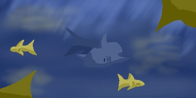

# Marine World

*A serene blue world. Peaceful, beautiful, so close to home.*

> **You are a shark in a strange blue sea.**

> The fish never run dry here. This place feels so familiar.

## Summary

Marine worlds have plenty of resources and an over-abundance of fish. It's repeatedly hinted that these worlds are the most similar to the [Starter World](starter-world.md), and since it has no negative multipliers and fewer resources than [Haven](haven-world.md) worlds this is technically true. However, the Starter world doesn't have [lobster](lobster.md), [dolphins](dolphin.md), [whales](whale.md) or [octopi](octopus.md) so was also missing sponge, jellyfish, algae and clams.

## Resources

### Frenzy

|                            |                                   |           |
|----------------------------|-----------------------------------|-----------|
| • Shark • Ray • Crab | • Lobster • Dolphin • Whale | • Octopus |

### Basic Materials

|                                |                                   |                                   |         |
|--------------------------------|-----------------------------------|-----------------------------------|---------|
| • Fish • Sand • Crystals | • Coral • Sea Apples • Clam | • Kelp • Jellyfish • Sponge | • Algae |

### Advanced Resources

|                                              |                        |
|----------------------------------------------|------------------------|
| • Sharkonium • Delphinium • Coralglass | • Residue • Spronge |

### Multipliers

- Planetary Boost - Fish (1.5)
  - Fish are produced at their normal rate multiplied by Climate Level×1.5/s

## Ending Messages

"Did your last ocean feel all too familiar?"  
"Like your origins, but too different still."  
"Was that world not your home?"  
"A blue world. A dream of a former life, perhaps."

## Trivia

Fish form schools for a number of reasons, but one reason is actually for protection against predators. A spherical formation is an effective way for a large number of fish to leave the smallest number of individuals exposed and thwart predators who primarily target fish at a time - it's hard to catch a single fish when it moves so quickly out of sight. Unfortunately this formation is also called a bait ball, because the large group attracts the attention of more predators who are often clever enough to snap at whatever is in reach.[1]

[1] [Smithsonian: Ocean](https://ocean.si.edu/ocean-life/fish/bait-ball)

---

*Originally from the [Shark Game Wiki on Fandom](https://shark-game.fandom.com/wiki/Marine_World), licensed under [CC BY-SA 3.0](https://creativecommons.org/licenses/by-sa/3.0/).*
