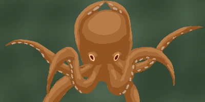

# Octopus

| Octopus      |                                                                                                        |
|--------------|--------------------------------------------------------------------------------------------------------|
| Home worlds  | All but [Starter](starter-world.md), Chaotic and Violent                                               |
| Base cost    | 15 Clams                                                                                               |
| Base income  | +2 Clams                                                                                               |
| Breeder      | [Egg Brooder](stuff.md#egg-brooder)                                                                    |
| Career paths | [Octopus Collector](octopus.md#octopus-collector) [Octopus Scavenger](octopus.md#octopus-scavenger) |

**Octopi** are available in almost every world after the first, but can't be found in [Chaotic](chaotic-world.md) or [Violent](violent-world.md) worlds. They are also the only species that can be automatically [produced](stuff.md#producers) only by [machine](stuff.md#egg-brooder). They become available for purchase after researching [Exploration](laboratory.md#exploration) provided you have at least 20 clams. Their description is "Pay an octopus for their efficient clam retrieval services."

## Career Path

Octopus jobs become available after researching [Octopus Methodology](laboratory.md#octopus-methodology). The positions are Octopus Collector and Octopus Scavenger. Collectors collect coral faster than any item besides [prosthetic polyps](stuff.md#prosthetic-polyp). Scavengers produce sponge as quickly as [shrimp workers](shrimp.md) and are present in worlds that have no shrimp or [dolphins](dolphin.md) to do the work in their place.

| Job                                             | Base Cost             | Base Income            |
|-------------------------------------------------|-----------------------|------------------------|
| [Octopus Collector](stuff.md#octopus-collector) | 1 Octopus 50 Clams | +1 Crystal +3 Coral |
| [Octopus Scavenger](stuff.md#octopus-scavenger) | 1 Octopus 30 Clams | +2 Sand +2 Sponge   |

## Laboratory Research

There are 3 upgrades that can be [researched](laboratory.md) that are specific to only octopi, 2 generic upgrades that affect octopus income, 2 upgrades to octopus technology. The research listed below is available in every world and has an effect on dolphins and their jobs:

| Upgrade                                                                                                                                                                           | Description                                                                          | Result                                                                                    | Cost                   |
|-----------------------------------------------------------------------------------------------------------------------------------------------------------------------------------|--------------------------------------------------------------------------------------|-------------------------------------------------------------------------------------------|------------------------|
| **[Agriculture](laboratory.md#agriculture)** The hunter-gatherer lifestyle will only work so well for us. Maybe we should gather these animals in one place and let them grow. | Various roles are twice as effective thanks to farming regions for coral and sponge. | Octopus scavenger power x2                                                                | 500 Science 1K Sand |
| **[Exploration](laboratory.md#exploration)** Swim beyond the home seas to see what can be found!                                                                               | Sharks and rays are twice as effective. Did you know oceans are big? Fascinating!    | Unlocks • Employ octopus • [Octopus Methodology](laboratory.md#octopus-methodology) | 5K Science 5K Fish  |

The following research is available in every world in which lobsters can be found:

|                                                                                                                                                                                              |                                                                                                                                   |                                                                                                                                                                                                                                                                                                                                   |                                       |
|----------------------------------------------------------------------------------------------------------------------------------------------------------------------------------------------|-----------------------------------------------------------------------------------------------------------------------------------|-----------------------------------------------------------------------------------------------------------------------------------------------------------------------------------------------------------------------------------------------------------------------------------------------------------------------------------|---------------------------------------|
| **[Industrial-Grade Sponge](laboratory.md#industrial-grade-sponge)** Our octopus contacts inform us that sponge is highly useful with a little augmentation. Let's figure this out.       | Enables creation of spronge, the backbone... uh... the core material in cephalopod technology.                                    | Unlocks • Forge sponge into spronge • [Spronge Biomimicry](laboratory.md#spronge-biomimicry) (also requires [Automation](laboratory.md#automation))                                                                                                                                                                         | 1K Science 2K Sponge 4K Residue |
| **[Spronge Biomimicry](laboratory.md#spronge-biomimicry)** The cephalopod school of thought is that a machine that mimics life is a better machine. We don't understand this so well yet. | We can mimic some of the life-mimicking biotechnology the octopuses use, but it gums up the oceans so quickly. So very dangerous. | Unlocks • Build clam collector • Build egg brooder • Build spronge smelter • Build prosthetic polyp                                                                                                                                                                                                                   | 3K Science 3K Spronge              |
| **[Octopus Methodology](laboratory.md#octopus-methodology)** The octopuses claim they know ways to improve their routines and machines.                                                   | Octopuses can specialise in different tasks, and their machines are constructed to be twice as efficient.                         | Clam collector power x2 Egg brooder power x2 Spronge smelter power x2 Sea scourer power x2 Prosthetic polyp power x2 Unlocks • Reassign octopus as collector • Reassign octopus as scavenger • Octal Efficiency • Industrial Grade Sponge (also requires [Thermal Vents](laboratory.md#thermal-vents)) | 8,888 Science 88 Clam              |
| **[Octal Efficiency](laboratory.md#octal-efficiency)** The octopuses wish to further enhance their productivity for collective gain.                                                      | Octopuses and their specialists are twice as effective, as our their machines. Find unity in efficiency.                          | Clam collector power x2 Egg brooder power x2 Spronge smelter power x2 Sea scourer power x2 Prosthetic polyp power x2 Octopus power x2 Octopus collector power x2 Octopus scavenger power x2 Unlocks Eightfold Optimisation                                                                                | 88,888 Science 888 clams           |
| **[Eightfold Optimisation](laboratory.md#eightfold-optimisation)** Enhance productivity. Optimise. Improve. Improve.                                                                      | Octopuses and their roles, as well as their machines, are all four times as effective. Optimised.                                 | Octopus power x4 Octopus collector power x4 Octopus scavenger power x4 Clam collector power x4 Egg brooder power x4 Spronge smelter power x4 Sea scourer power x4 Prosthetic polyp power x4                                                                                                                  | 80B Science                           |

## Story

Warning: This section includes speculation, as canon answers don't yet exist.

    The octopuses speak of production and correct action.
    They speak of unity through efficiency.
    They regard us with cold, neutral eyes. (Employ 8 octopi)

The octopi may, in fact, be robots. They are said to have rational minds that are uncomfortable with more mystical environments like the Gateway.[1] Their machines are designed to mimic living organisms, not an easy feat to accomplish.[2] They have a fixation on efficiency that borders on obsession, with no regard for their impact on the environment.[3] They’re even described as being cold, or favoring cold decision-making.[4] Lastly is the log, which makes several interesting observations. The octopi all seem to repeat the phrase “Find unity in efficiency.”[5] They seem to notice little outside of their work. Collectors and scavengers will “act as instructed”. The most suspicious statement is this: "You could have sworn you saw an octopus among the crowd glinting like metal."

The octopi may or may not be robots, but they certainly think like machines.

## Species List

|                                                                                                                                                                                                                                                                                                                                                                                   |                                                                                                                                                                                                                                                                                                                                                  |                                                                                                                                                                                                    |
|-----------------------------------------------------------------------------------------------------------------------------------------------------------------------------------------------------------------------------------------------------------------------------------------------------------------------------------------------------------------------------------|--------------------------------------------------------------------------------------------------------------------------------------------------------------------------------------------------------------------------------------------------------------------------------------------------------------------------------------------------|----------------------------------------------------------------------------------------------------------------------------------------------------------------------------------------------------|
| • capricorn night octopus • plain-body night octopus • hammer octopus • southern keeled octopus • two-spot octopus • caribbean reef octopus • southern white-spot octopus • bigeye octopus • carolinian octopus • lesser pacific striped octopus • chestnut octopus • big blue octopus • lilliput longarm octopus • red-spot night octopus | • scribbled night octopus • bumblebee two-spot octopus • southern sand octopus • lobed octopus • starry night octopus • atlantic white-spotted octopus • maori octopus • mexican four-eyed octopus • galapagos reef octopus • ornate octopus • white-striped octopus • pale octopus • japanese pygmy octopus | • northern right-whale dolphin • long-snouted spinner dolphin • long-beaked common dolphin • atlantic white sided dolphin • atlantic hump-backed dolphin • atlantic spotted dolphin |

## Trivia

The script for the shark game contains the following hidden message from [Cirrial](http://cirri.al/):

> the word 'octopus' in english is taken from latin

> which in turn took it from greek

> when it was taken from greek and made into latin it kept the original plural

> now the word is taken from latin and maybe we should take the original plural but

> look basically the point is this is a long and storied word

> and the english plural system should apply because we're talking about octopus, not ὀκτώπους, so just

> why are you reading this

This is why the plural of octopus in this game is always written as 'octopuses' instead of 'octopi'. The word ὀκτώπους comes from ancient Greek, and translated literally means "eight-footed".[6] However, the word 'octopus' wasn't used to refer to the animal until the 18th century.[7] The plural form 'octopi' came about as a Latin translation, where the plural of any second-declension noun ending in -us is -i.[8] This may or may not be correct, considering that the word was coined well after Latin fell out of conversational use. Some feel that the proper plural is actually 'octopodes', but Webster's dictionary lists both 'octopuses' and 'octopi' as acceptable plurals.[9]

[1] [Artifacts#Octopus Migrator](artifacts.md#octopus-migrator)

[2] [Laboratory#Spronge Biomimicry](laboratory.md#spronge-biomimicry)

[3] [Laboratory# Eightfold Optimisation](laboratory.md#eightfold-optimisation)

[4] [Artifacts#Totem of Octopus](artifacts.md#totem-of-octopus)

[5] [Artifacts#Totem of Industry](artifacts.md#totem-of-industry)

[6] [Wiktionary: ὀκτώπους](https://en.wiktionary.org/wiki/%E1%BD%80%CE%BA%CF%84%CF%8E%CF%80%CE%BF%CF%85%CF%82)

[7] [Online Etymology Dictionary: Octopus](https://www.etymonline.com/word/octopus#etymonline_v_2487)

[8] [Latin Nouns: Second Declension](http://latin-dictionary.net/grammar/nouns/declensions/second-declension)

[9]

---

*Originally from the [Shark Game Wiki on Fandom](https://shark-game.fandom.com/wiki/Octopus), licensed under [CC BY-SA 3.0](https://creativecommons.org/licenses/by-sa/3.0/).*
