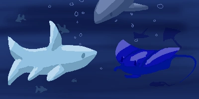

# Ray

| Ray          |                                                                |
|--------------|----------------------------------------------------------------|
| Home worlds  | [All Worlds](worlds.md)                                        |
| Base cost    | 15 Fish                                                        |
| Base income  | +0.2 Fish +1 Sand                                           |
| Breeder      | [Ray Maker](stuff.md#ray-maker)                                |
| Career paths | [Laser Ray](ray.md#laser-ray)                                  |

**Rays** are available in every world in the game. They are actually the secondary focus of the game, which was developed for charity to help save sharks and rays.[1] They become available for purchase once you have at least 15 fish. Their description is "Hire a ray to help collect fish. They might kick up some sand from the seabed."

## Career Path

Rays have the option of becoming Laser Rays after researching [Laser Rays](laboratory.md#laser-rays). This may be the first method available for gathering crystals, and is significantly faster than relying on [crabs](crab.md).

| Job                              | Base Cost            | Base Income           |
|----------------------------------|----------------------|-----------------------|
| [Laser Ray](stuff.md#laser-rays) | 1 Ray 50 Crystals | +1 Crystal -2 Sand |

## Laboratory Research

There are 3 generic upgrades that can be researched that are specific to only rays and 3 generic upgrades that affect ray income. The research listed below is available in every world and has an effect on rays and their jobs:

|                                                                                                                                                                                                 |                                                                                                                                                        |                                                                                                |                                        |
|-------------------------------------------------------------------------------------------------------------------------------------------------------------------------------------------------|--------------------------------------------------------------------------------------------------------------------------------------------------------|------------------------------------------------------------------------------------------------|----------------------------------------|
| **[Seabed Geology](laboratory.md#seabed-geology)** Study the bottom of the ocean to determine the rich, deep, juicy secrets it contains.                                                     | Rays are twice as effective with their understanding of the seabed and its varieties of sediment.                                                      | Ray power x2                                                                                   | 250 Science 250 Sand                |
| **[Exploration](laboratory.md#exploration)** Swim beyond the home seas to see what can be found!                                                                                             | Sharks and rays are twice as effective. Did you know oceans are big? Fascinating!                                                                      | Ray power x2                                                                                   | 5K Science 5K Fish                  |
| **[Crystal Spades](laboratory.md#crystal-spades)** Fashion strange harness-tools for the rays.                                                                                               | Rays are twice as effective with their specially adapted digging tools.                                                                                | Ray power x2                                                                                   | 50 Science 20 Sand                  |
| **[Laser Rays](laboratory.md#laser-rays)** Using arcane shark mystery science, capture the heat of the vents for use by rays.                                                                | Laser rays can now be geared up to burn the very sand to glassy crystal.                                                                               | Unlocks • Equip laser ray • Ray Biology (also requires [Biology](laboratory.md#biology)) | 100 Science 2K Sand 100 Crystals |
| **[Ray Biology](laboratory.md#ray-biology)** Though kindred to the sharks, we know so little about the rays. If only we could fix this. We need to bait a sand trap.                         | Rays and laser rays are twice as effective. We may never repair the shark-ray relations to their former state after how awkward this whole affair was. | Ray power x2 Laser ray power x2 Unlocks Instruct a ray maker                             | 700 Science 600 Sand                |
| **[Ancestral Recall](laboratory.md#ancestral-recall)** The sharks and rays know we share some features among ourselves. Using the vague glimpses of dreams, let's piece together the puzzle. | Sharks, rays and chimaeras, and their roles, are all four times as effective. We have had a glorious past. Now, on to a glorious future.               | Ray power x4 Ray maker power x4 Laser ray power x4                                       | 10B Science                            |

## Story

Warning: This section includes speculation, as canon answers don't yet exist.

    Flying across the ocean in grace and serenity.

The rays are kindred to the sharks, and are the first to come aboard when a shark starts forming a team.[2] Beyond that they’re fairly simple creatures. The sharks don’t hesitate to arm them with lasers, and actually get rather excited about it according to the log.[3] The two species have always been friends, though prying into ray biology creates some tension. They rely on the sharks to make discoveries and decisions, and are otherwise happy keeping at their work. [4]

## Species List

|                                                                                                                                                                                                                                                                                                        |                                                                                                                                                                                                                                                                                                                                        |                                                                                                                                                                                                                                                                                                    |
|--------------------------------------------------------------------------------------------------------------------------------------------------------------------------------------------------------------------------------------------------------------------------------------------------------|----------------------------------------------------------------------------------------------------------------------------------------------------------------------------------------------------------------------------------------------------------------------------------------------------------------------------------------|----------------------------------------------------------------------------------------------------------------------------------------------------------------------------------------------------------------------------------------------------------------------------------------------------|
| • spotted eagle ray • manta ray • stingray • clownnose ray • bluespotted maskray • bluntnose stingray • oman masked ray • bulls-eye electric ray • shorttailed electric ray • bentfin devil ray • lesser electric ray • cortez electric ray • feathertail stingray | • thornback ray • giant shovelnose ray • pacific cownose ray • bluespotted ribbontail ray • marbled ribbontail ray • blackspotted torpedo ray • marbled torpedo ray • atlantic torpedo ray • panther torpedo ray • spotted torpedo ray • ocellated torpedo • caribbean torpedo • striped stingaree | • sparesly-spotted stingaree • kapala stingaree • common stingaree • eastern fiddler ray • bullseye stingray • round stingray • yellow stingray • cortez round stingray • porcupine ray • sepia stingaree • banded stingaree • spotted stingaree • sea pancake |

## Trivia

Rays *are* kindred to sharks, as the two categories make up the taxonomic subclass. Both rays and sharks have skeletons made of cartilage and several rows of teeth. While [Manta rays](https://en.wikipedia.org/wiki/Manta_ray) feed mostly on plankton, other species of ray use these teeth to crush the shells of snails, clams, oysters and crustaceans or to bite down on fish.[5] Stingrays feed on these same animals, generally saving their stingers for defense.[6]

[1] [Starter World: Trivia](starter-world.md#trivia)

[2] [Laboratory: Ray Biology](laboratory.md#ray-biology)

[3] [Laboratory: Laser Rays](laboratory.md#laser-rays)

[4] [Laboratory: Seabed Geology](laboratory.md#seabed-geology)

[5] [Wikipedia: Elasmobranchii](https://en.wikipedia.org/wiki/Elasmobranchii)

[6] [National Geographic: Stingrays](https://www.nationalgeographic.com/animals/fish/group/stingrays/)

---

*Originally from the [Shark Game Wiki on Fandom](https://shark-game.fandom.com/wiki/Ray), licensed under [CC BY-SA 3.0](https://creativecommons.org/licenses/by-sa/3.0/).*
