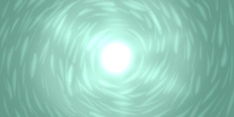

# Reflection

The **Reflection** is a prestige system added in spencers145's Shark Game: New Frontiers, serving as an expansion of the previous [Artifacts](artifacts.md) prestige system in Cirrial's Unnamed Shark Game.

## Reflection

The Reflection tab is unlocked once one first passes through the [Gateway](gateway.md). In the tab, one can view all the aspects they have attained, as well as the level the aspects are at.

## Aspects

Your will flows into solid shapes beyond your control.  
Focus. The aspects serve in a similar function to Artifacts, allowing the player to attain 4-5 essence each time they pass through the Gateway, and utilizing the essence to buy and upgrade various aspects. Aspects are organized in the form of a tree, with the player initially being given a single aspect to purchase, then branching out into different branches, which impact different sectors of gameplay.

### Aspect Tree and levels

| \|Aspect                | \|Effect                                                                                                                                                                     | \|Description                                                                                             | \|Essence cost             | \|Levels | \|Unlocked by                                                 |
|-------------------------|------------------------------------------------------------------------------------------------------------------------------------------------------------------------------|-----------------------------------------------------------------------------------------------------------|----------------------------|----------|---------------------------------------------------------------|
| Apotheosis              | Manual resource collection x4. \[Level 1\] Manual resource collection x8. \[Level 2\]                                                                                     | The path begins here.                                                                                     | 4 (Level 2)                |          | Passing through the [Gateway](gateway.md) for the first time. |
| Path of Enlightenment   | Reveals basic information about a world before you choose to visit it. \[Level 1\]                                                                                           | Unlock the potential of yourself.                                                                         |                            | 1        | Apotheosis                                                    |
| Path of Time            | Start with 20 [Crabs](crab.md) (if possible). \[Level 1\] Start with 80 Crabs (if possible). \[Level 2\]                                                                  | Begin each journey with swiftness.                                                                        | 5 (Level 2)                |          | Apotheosis                                                    |
| The Minute Hand         | For the first minute after arriving in a world, gain 4x production. \[Level 1\] For the first minute after arriving in a world, gain 5x production. \[Level 2\]           | Time is relative.                                                                                         | 3 (Level 2)                |          | Path of Time                                                  |
| Crystalline Skin        | Start with 20 crystals. If they do not exist, start with an equivalent. \[Level 1\] Start with 80 crystals. If they do not exist, start with an equivalent. \[Level 2\]   | Become one with the lattice.                                                                              | 6 (Level 2)                |          | The Minute Hand                                               |
| Internal Calculator     | If a research costs 150 science or less, then its science cost is halved. \[Level 1\] If a research costs 150 science or less, then all its costs are halved. \[Level 2\] | Shark science gets started a lot faster when we don't need to use an abacus. Also, what's a calculator?   | 4 (Level 2)                |          | Path of Time                                                  |
| Extensive Organization  | Start with the [grotto](grotto.md) already unlcoked. \[Level 1\] Start with the grotto and [laboratory](laboratory.md) already unlocked. \[Level 2\]                      | Be prepared. Organize. No wasted time.                                                                    | 2 (Level 2)                |          | Internal Calculator                                           |
| Path of Industry        | [Sharks](shark.md) collect fish 2 times faster. \[Level 1\] Sharks collect fish 3 times faster. \[Level 2\]                                                               | Unlock the potential of those around you.                                                                 | 6 (Level 3)                |          | Apotheosis                                                    |
| Adjusted Aquadynamics   | [Rays](ray.md) hunt fish 2.5 times faster. \[Level 1\] Rays hunt fish 5 times faster. \[Level 2\]                                                                         | A thin layer of essence greatly reduces drag, improving hunting proficiency.                              | 4 (Level 2)                |          | Path of Industry                                              |
| Constructed Conception  | Nurse sharks and ray makers are 2x times faster. \[Level 1\] Nurse sharks and ray makers are 3x times faster. \[Level 2\]                                                 | Making new sharks and crabs could be more efficient. It doesn't hurt to use a little essence to help out. | 6 (Level 2)                |          | Adjusted Aquadynamics                                         |
| Claw Sharpening         | Crabs hunt fish at 0.1/s. \[Level 1\] Crabs hunt fish at 0.2/s. \[Level 2\]                                                                                               | Perhaps crabs could collect fish if they were better equipped for hunting.                                | 3 (Level 2)                |          | Adjusted Aquadynamics                                         |
| Crustacean Aptitude     | Crabs and their professions collect world-specific resources 2x faster. \[Level 1\] Crabs and their professions collect world-specific resources 3x faster. \[Level 2\]   | Crabs are flexible. They'll do whatever we need them to.                                                  | 5 (Level 1) 7 (Level 2) |          | Adjusted Aquadynamics                                         |
| Synthetic Transmutation | Sharkonium is 20% cheaper to produce. \[Level 1\] Sharkonium is 40% cheaper to produce. \[Level 2\]                                                                       | Sharkonium is naturally unaffected by small impurities. Perhaps we can cheat a little.                    | 4 (Level 1) 6 (Level 2) |          | Path of Industry                                              |
| Amorphous Assembly      | Crystal miners and sand diggers have non-sharkonium costs reduced by half. \[Level 1\]                                                                                       | Machines that make use of similar components are better machines.                                         | 7 (Level 1)                |          | Synthetic Transmutation                                       |
|                         |                                                                                                                                                                              |                                                                                                           |                            |          |                                                               |

---

*Originally from the [Shark Game Wiki on Fandom](https://shark-game.fandom.com/wiki/Reflection), licensed under [CC BY-SA 3.0](https://creativecommons.org/licenses/by-sa/3.0/).*
