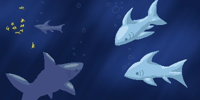

# Shark

| Shark        |                                                                                |
|--------------|--------------------------------------------------------------------------------|
| Home worlds  | [All Worlds](worlds.md)                                                        |
| Base cost    | 5 Fish                                                                         |
| Base income  | +1 Fish                                                                        |
| Breeder      | [Nurse Shark](stuff.md#nurse-shark)                                            |
| Career paths | [Science Shark](shark.md#science-shark) [Diver Shark](shark.md#diver-shark) |

**Sharks** are available in every world in the game, considering they're the central focus. They become available for purchase once you have at least 5 fish. Their description is "Recruit a shark to help catch more fish."

## Career Path

Sharks have the option of becoming Science Sharks once you have at least 1 shark and 20 crystals, or Diver Sharks once you have at least 1 shark in [Shrouded](shrouded-world.md) worlds. In most cases Science Sharks are the first method available for obtaining science and unlocking the [laboratory](laboratory.md).

| Job                                     | Base Cost              | Base Income                     |
|-----------------------------------------|------------------------|---------------------------------|
| [Science Shark](stuff.md#science-shark) | 1 Shark 20 Crystals | +0.50 Science                   |
| [Diver Shark](stuff.md#diver-shark)     | 1 Shark 30 Fish     | +0.5 Crystals +0.5 Jellyfish |

## Laboratory Research

There are 4 generic upgrades that can be researched that are specific to only sharks, 2 generic upgrades that affect shark income, and 5 upgrades that affect [shark technology](stuff.md#shark-machines). The research listed below is available in every world and has an effect on sharks and their jobs:

| Upgrade                                                                                                                                                                                         | Description                                                                                                                              | Result                                                                                                                                                                                  | Cost                                 |
|-------------------------------------------------------------------------------------------------------------------------------------------------------------------------------------------------|------------------------------------------------------------------------------------------------------------------------------------------|-----------------------------------------------------------------------------------------------------------------------------------------------------------------------------------------|--------------------------------------|
| **[Crystal Containers](laboratory.md#crystal-containers)** Make weird bottle things from the crystals we have. Maybe useful??                                                                | Scientists are twice as effective at making with the science.                                                                            | Science shark power x2 Unlocks Underwater Chemistry                                                                                                                                  | 100 Science 50 Crystals           |
| **[Exploration](laboratory.md#exploration)** Swim beyond the home seas to see what can be found!                                                                                             | Sharks and rays are twice as effective. Did you know oceans are big? Fascinating!                                                        | Shark power x2                                                                                                                                                                          | 5K Science 5K Fish                |
| **[Crystal Bite-Gear](laboratory.md#crystal-bite-gear)** Bite the crystals we have into something to help biting!                                                                            | Sharks are twice as effective with their new biting gear. Turns out they work better outside the mouth!                                  | Shark power x2                                                                                                                                                                          | 50 Science 10 Fish                |
| **[Underwater Chemistry](laboratory.md#underwater-chemistry)** With the weird bottles, we can now put things and other things into them and see what happens.                                | Scientists are twice as effective with their new chemical insights.                                                                      | Science shark power x2 Unlocks • Transmutation (also requires [Thermal Vents](laboratory.md#thermal-vents)) • Biology (also requires [Agriculture](laboratory.md#agriculture)) | 200 Science 50 Crystals           |
| **[Automation](laboratory.md#automation)** Using sharkonium, we can make things to do things so we don't have to do the things!                                                              | Machines can be built to supplement population duties. This is efficient.                                                                | Unlocks • Build crystal miner • Build sand digger • Build fish machine • Engineering                                                                                        | 1K Science 100 Sharkonium         |
| **[Engineering](laboratory.md#engineering)** The machines sort of suck. Let's make them better by learning how!                                                                              | Machines are twice as effective. Skimmers and auto-transmuters are now possible to create.                                               | Crystal miner power x2 Fish machine power x2 Sand digger power x2 Unlocks • Build auto-transmuter • Build skimmer (also requires [Recycler](laboratory.md#recycler))     | 2K Science 2K Sharkonium          |
| **[Biology](laboratory.md#biology)** What is a shark? What is inside a shark, except for large amounts of fish?                                                                              | Sharks are twice as effective. Did you know shark eggs don't actually form just because a shark wills them to exist?                     | Shark power x2 Unlocks Train nurse shark                                                                                                                                             | 400 Science                          |
| **[Transmutation](laboratory.md#transmutation)** By heating things up and doing science things to them, maybe new things can be made!                                                        | Enables transmutation of some random junk we have lying around into sharkonium, material of the future.                                  | Unlocks Transmute stuff to sharkonium                                                                                                                                                   | 1K Science 4K Sand 2K Crystals |
| **[Ancestral Recall](laboratory.md#ancestral-recall)** The sharks and rays know we share some features among ourselves. Using the vague glimpses of dreams, let's piece together the puzzle. | Sharks, rays and chimaeras, and their roles, are all four times as effective. We have had a glorious past. Now, on to a glorious future. | Shark power x4 Diver shark power x4 Nurse shark power x4                                                                                                                          | 10B Science                          |

The following research is available only in worlds with [eels](eel.md), [Frigid](frigid-world.md) worlds and [Abandoned](abandoned-world.md) worlds respectively:

| Upgrade                                                                                                                                                            | Description                                                                                       | Result                                                                                                                                | Cost                      |
|--------------------------------------------------------------------------------------------------------------------------------------------------------------------|---------------------------------------------------------------------------------------------------|---------------------------------------------------------------------------------------------------------------------------------------|---------------------------|
| **[Bioelectricity](laboratory.md#bioelectricity)** There has to be a way to harness the powers of some of the eels. We all know they have powers. Painful ones. | Eel technicians are twice as effective. So are our machines. Convenient!                          | Fish machine power x2 Sand digger power x2 Auto-transmuter power x2 Skimmer power x2 Purifier power x2 Heater power x2 | 1.6K Science 400 Clams |
| **[Environmentalism](laboratory.md#environmentalism)** So the machines might be destroying the ocean. We need to fix this.                                      | Purifiers can be made to combat the harmful effects of the other machines. Anti-machine machines? | Unlocks Build purifier                                                                                                                | 500 Science               |
| **[Thermal Conditioning](laboratory.md#thermal-conditioning)** We're freezing to death! Machines make heat, right? We need to work on this                      |                                                                                                   | Heaters can be made to fight the freezing process. We don't want to become giant novelty ice cubes!                                   | Unlocks Build heater      |

## Story

Warning: This section includes speculation, as canon answers don't yet exist.

    To hunt. To catch. To win.

Sharks are not the smartest creatures, but they have plenty of determination and can be found in every world with a gate. They turn out scientists early on but advancements come slowly mostly because, as the [log](log-entries.md) notes, the majority of their research is done with their mouths. Science sharks have seemingly endless curiosity though, considering the lengths they go to investigating even the hated [dolphins](dolphin.md).[1]

The feud between the sharks and the dolphins begins with the realization that they are essentially the same, but dolphins have bigger brains.[2] The dolphins don’t help the matter with their superior attitude, but the basis of their dislike for each other is that jealousy. The sharks manage to get along well if every other species they meet.

## Species List

|                                                                                                                                                                                            |                                                                                                                                                                                                |                                                                                                                                                                                        |
|--------------------------------------------------------------------------------------------------------------------------------------------------------------------------------------------|------------------------------------------------------------------------------------------------------------------------------------------------------------------------------------------------|----------------------------------------------------------------------------------------------------------------------------------------------------------------------------------------|
| • bignose shark • blacktip reef shark • blue shark • bull shark • cat shark • crocodile shark • dusky whaler shark • dogfish • graceful shark • grey reef shark | • goblin shark • hammerhead shark • hardnose shark • lemon shark • milk shark • nervous shark • oceanic whitetip shark • pigeye shark • sandbar shark • silky shark | • silvertip shark • sliteye shark • speartooth shark • spinner shark • spot-tail shark • mako shark • tiger shark • tawny shark • white shark • zebra shark |

## Trivia

Sharks have multiple rows of teeth that continue to grow constantly throughout their lives. These teeth move forward over time until they eventually fall out and are replaced by a corresponding tooth from the previous row. These rotating teeth work like a conveyor belt, ensuring the shark always has at least one full set of teeth to use.[3]

[1] [Laboratory: Dolphin Biology](laboratory.md#dolphin-biology)

[2] [Laboratory: Cetacean Awareness](laboratory.md#cetacean-awareness)

[3] [The Conversation: How sharks could help us regrow our own human teeth](https://theconversation.com/how-sharks-could-help-us-regrow-our-own-human-teeth-63531)

---

*Originally from the [Shark Game Wiki on Fandom](https://shark-game.fandom.com/wiki/Shark), licensed under [CC BY-SA 3.0](https://creativecommons.org/licenses/by-sa/3.0/).*
