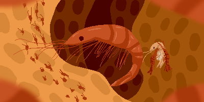

# Shrimp

| Shrimp       |                                                                                                                         |
|--------------|-------------------------------------------------------------------------------------------------------------------------|
| Home worlds  | [Haven World](haven-world.md)  [Violent World](violent-world.md)  [Tempestuous World](tempestuous-world.md) |
| Base cost    | 5 Sponge                                                                                                                |
| Base income  | +0.5 Algae                                                                                                              |
| Breeder      | [Shrimp Queen](stuff.md#shrimp-queen)                                                                                   |
| Career paths | [Worker Shrimp](shrimp.md#worker-shrimp)                                                                                |

**Shrimp** are available in only a handful of worlds with particularly rich environments. They become available for purchase after researching [Seabed Geology](laboratory.md#seabed-geology) provided you have at least 5 sponge. Their description is "Convince shrimp to assist you in the gathering of algae, which helps boost [sponge](stuff.md#sponge) production."

## Career Path

Shrimp have the option of becoming Worker Shrimp after researching [Eusociality](laboratory.md#eusociality). This is one of the last available methods for collecting sponge, but is significantly faster than [dolphins](dolphin.md) or [harvester lobsters](lobster.md).

| Job                                     | Base Cost          | Base Income             |
|-----------------------------------------|--------------------|-------------------------|
| [Worker Shrimp](stuff.md#worker-shrimp) | 1 Shrimp 20 Sponge | +0.1 Coral +2 Sponge |

## Laboratory Research

There are 2 upgrades that can be [researched](laboratory.md) that are specific to only shrimp, 3 generic upgrades that affect shrimp income and 2 upgrades specific to crustaceans in general. The research listed below is available in every world and has an effect on shrimp and their jobs:

| Upgrade                                                                                                                                                                           | Description                                                                                                                                                                   | Result                                                                             | Cost                    |
|-----------------------------------------------------------------------------------------------------------------------------------------------------------------------------------|-------------------------------------------------------------------------------------------------------------------------------------------------------------------------------|------------------------------------------------------------------------------------|-------------------------|
| **[Seabed Geology](laboratory.md#seabed-geology)** Study the bottom of the ocean to determine the rich, deep, juicy secrets it contains.                                       | Rays are twice as effective with their understanding of the seabed and its varieties of sediment.                                                                             | Unlocks • Aquire shrimp • [Agriculture](laboratory.md#agriculture)           | 250 Science 250 Sand |
| **[Agriculture](laboratory.md#agriculture)** The hunter-gatherer lifestyle will only work so well for us. Maybe we should gather these animals in one place and let them grow. | Various roles are twice as effective thanks to farming regions for coral and sponge.                                                                                          | Worker shrimp power x2 Unlocks [Sun Observation](laboratory.md#sun-observation) | 500 Science 1K Sand  |
| **[Sun Observation](laboratory.md#sun-observation)** We must determine what is with the weird glare on the surface of the water.                                               | Planter crabs are twice as effective, and shrimp are four times as effective. Is a suns worth many fish? We can see a sun, but where is it really? And by what is it made of? | Shrimp power x4                                                                    | 5K Science              |

The following research is available in every world in which shrimp can be found:

| Upgrade                                                                                                                                                                             | Description                                                                                                                                                | Result                                                                       | Cost                     |
|-------------------------------------------------------------------------------------------------------------------------------------------------------------------------------------|------------------------------------------------------------------------------------------------------------------------------------------------------------|------------------------------------------------------------------------------|--------------------------|
| **[Crustacean Biology](laboratory.md#crustacean-biology)** These strange creatures related to crabs require further investigation. What is with exoskeletons?                    | Shrimp and lobsters are twice as effective. Lobsters can now gather other things or cover themselves in shiny eggs, also called 'berries'. What's a berry? | Shrimp power x2 Unlocks [Eusociality](laboratory.md#eusociality)          | 500 Science 100 Clam  |
| **[Eusociality](laboratory.md#eusociality)** The shrimp are weirder than we thought. They have some advanced social system beyond our comprehension. What is the deal?           | Shrimp are twice as effective. Shimp queens and dedicated shrimp workers are available, and we'll never sleep soundly again.                               | Shrimp power x2 Unlocks • Crown shrimp queen • Assign shrimp worker | 1K Science 500 Sponge |
| **[Worm Warriors](laboratory.md#worm-warriors)** Shrimp sponge hives are under constant threat from outside invaders that aren't us. A collaboration effort might help them out. | Shrimp, shrimp queens and shrimp workers are twice as effective now that they don't need to worry about worms eating them.                                 | Shrimp power x2 Shrimp queen power x2 Worker shrimp power x2           | 3K Science 300 Shrimp |
| **[Utility Carapace](laboratory.md#utility-carapace)** The exoskeleton is good enough, but with some adjustments, perhaps coralglass can improve it.                             | Crabs, shrimp and lobsters, and their roles, are all four times as effective. A shell protects, and a shell interfaces.                                    | Shrimp power x4 Worker shrimp power x4 Shrimp queen power x4           | 10B Science              |

## Story

Warning: This section includes speculation, as canon answers don't yet exist.

    The shrimps are tiny, but hard-working. They live for their sponge hives.

The shrimp lead busy, highly organized lives. Eusociality means that every shrimp has a job to do.[1] Unfortunately a lot of that work revolves around avoiding getting eaten by worms.[2] In comparison the sharks and their other giant allies don’t pose much of a threat. Shrimp are too small for most of the bigger fish to eat and too big for the filter-feeder whales. Teaming up is fairly safe and comes along with plenty of benefits for the hive.

While they don’t always make use of it, each hive is able to form a hive mind to increase efficiency.[3] Likely this involves giving over all semblance of free will to the queen and working past the point of exhaustion. Sadly this doesn't seem like too big a difference from how they normally operate.

## Species List

|                                                                                                                                                                                                                     |                                                                                                                                                                                                                               |                                                                                                                                                                                                                          |
|---------------------------------------------------------------------------------------------------------------------------------------------------------------------------------------------------------------------|-------------------------------------------------------------------------------------------------------------------------------------------------------------------------------------------------------------------------------|--------------------------------------------------------------------------------------------------------------------------------------------------------------------------------------------------------------------------|
| • african filter shrimp • amano shrimp • bamboo shrimp • bee shrimp • black tiger shrimp • blue bee shrimp • blue pearl shrimp • blue tiger shrimp • brown camo shrimp • cardinal shrimp | • crystal red shrimp • dark green shrimp • glass shrimp • golden bee shrimp • harlequin shrimp • malaya shrimp • neocaridina heteropoda • ninja shrimp • orange bee shrimp • orange delight shrimp | • purple zebra shrimp • red cherry shrimp • red goldflake shrimp • red tiger shrimp • red tupfel shrimp • snowball shrimp • sulawesi shrimp • tiger shrimp • white bee shrimp • yellow shrimp |

## Trivia

There is a great deal of debate over what constitutes a shrimp, taxonomically. The infraorder listed above, Caridea, is the one group agreed upon to be definitively shrimp, and as a result is sometimes referred to as "true shrimp". Other, more controversial contenders include suborders [Dendrobranchiata](https://en.wikipedia.org/wiki/Dendrobranchiata) and [Natantia](https://en.wikipedia.org/wiki/Natantia), as well as infraorders [Procarididea](https://en.wikipedia.org/wiki/Procarididea), [Stenopodidea](https://en.wikipedia.org/wiki/Stenopodidea) and [Thalassinidea](https://en.wikipedia.org/wiki/Thalassinidea). Technically the suborder Natantia is considered outdated, but it still describes one of the widest accepted groups of shrimp species. A handful of other shrimp species can be found in other nearby branches of the taxonomical tree, making this an even more difficult group to define scientifically.[4]

[1] Duffy, J. E (1998). On the frequency of eusociality in snapping shrimps. *Bulletin of Marine Science. 63*(2) via [Wikipedia: Eusociality](https://en.wikipedia.org/wiki/Eusociality)

[2] [Laboratory: Worm Warriors](laboratory.md#worm-warriors)

[3] [Artifacts: Totem of Shrimp](artifacts.md#totem-of-shrimp)

[4] Rudloe, A., Rudloe, J. (2009). *Shrimp: The Endless Quest for Pink Gold* (pp. 15-26). via [Wikipedia: Shrimp](https://en.wikipedia.org/wiki/Shrimp)

---

*Originally from the [Shark Game Wiki on Fandom](https://shark-game.fandom.com/wiki/Shrimp), licensed under [CC BY-SA 3.0](https://creativecommons.org/licenses/by-sa/3.0/).*
