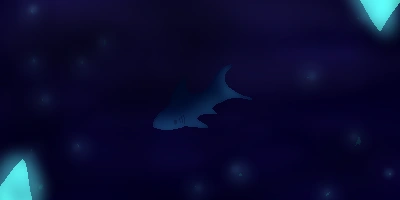
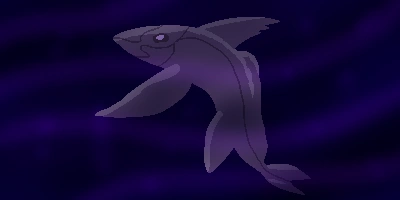

# Shrouded World

*A dark, murky ocean of secrecy and danger.*

> **You are a shark in a dark mysterious sea.**

> The crystals are easier to find, but the darkness makes it hard to find anything else.

## Summary

Shrouded worlds are loaded with resources, but progress moves slower the higher the Climate Level. It isn't unusual for a planet to be particularly dark, but no other world in the game comes with the implication that crystals glow. That and the presence of [chimaeras](chimaera.md) are part of what makes these worlds so mysterious, but it's also hinted that these are worlds you've visited before. Do you remember your first meeting with the chimaeras?

## Resources

### Frenzy

|                            |                                    |                    |
|----------------------------|------------------------------------|--------------------|
| • Shark • Ray • Crab | • Chimaera • Dolphin • Whale | • Eel • Octopus |

### Basic Materials

|                                |                                   |                                  |
|--------------------------------|-----------------------------------|----------------------------------|
| • Fish • Sand • Crystals | • Coral • Sea Apples • Clam | • Kelp • Jellyfish • Algae |

### Advanced Materials

|                                           |
|-------------------------------------------|
| • Sharkonium • Delphinium • Residue |

### Multipliers

- Planetary Income - Crystals (0.05)
  - Crystals are gained at a base rate of Climate Level×0.05/s
- Planetary Boost - Crystals (1)
  - Animals and machines produce crystals at their normal rate multiplied by the Climate Level
- Planetary Reciprocal Boost - Animals (1)
  - Animal materials (i.e. fish, clam, jellyfish and sea apples) are produced at their normal rate divided by the Climate Level
- Planetary Reciprocal Boost - [Kelp](stuff.md#kelp) (1)
  - Kelp is produced at its normal rate divided by the Climate Level
- Planetary Reciprocal Boost - Coral (1)
  - Coral is produced at its normal rate divided by the Climate Level
- Planetary Income Reciprocal Multiplier - Specialists (0.5)
  - [Animals with jobs](stuff.md#jobs) produce at their normal rate divided by the Climate Level×0.5

NOTE: Materials produced by animals with jobs which are also subject to a boost apply both multipliers. e.g. [octopus scavengers](stuff.md#octopus-scavenger) collect sand at the Specialist rate of 5÷(Climate Level×0.5), but coral at the boosted rate of 4×Climate Level÷(Climate Level×0.5).

## Special Events

  
The chimaeras are ancient kin of the shark kind, reunited through wild coincidence. What peerless wonders have they found in the dark? (Get 5 Chimaera)

## Ending messages

"The veil of mystery has yet to be pierced."  
"Did the chimaeras recognise who you were?"  
"What did you learn from the dark world?"  
"Would you know your home if you found it?"

## Trivia

While it's rare, some crystals do glow. When a minerals continues to give off light for a time after an outside light source has been removed (think glow-in-the-dark watch faces) it's said to be phosphorescent. Calcite is one mineral that is often found to be phosphorescent, can be clear or light blue in color and is common in the type of rock that might be found on the sea floor. It's unlikely that calcite crystals on the sea floor could absorb enough light to glow, much less in a sea that's darker than normal, but it's conceivable that calcite is the type of crystal found in this game.[1]

[1] [Minerals.net](https://www.minerals.net/resource/property/fluorescence_phosphoresence.aspx)

---

*Originally from the [Shark Game Wiki on Fandom](https://shark-game.fandom.com/wiki/Shrouded_World), licensed under [CC BY-SA 3.0](https://creativecommons.org/licenses/by-sa/3.0/).*
