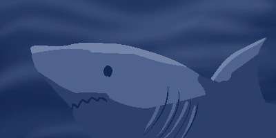

# Starter World

> **You are a shark in a strange blue sea.**

## Summary

This world is your home, and it has everything you need. Given that everything you need is really just fish, it even has quite a few things you don't need, and more than a normal shark like you could possibly imagine. Who knows what you can accomplish if you put your mind to it?

## Resources

### Frenzy

|                            |
|----------------------------|
| • Shark • Ray • Crab |

### Basic Materials

|                                |                        |
|--------------------------------|------------------------|
| • Fish • Sand • Crystals | • Kelp • Sea Apples |

### Advanced Materials

|                           |
|---------------------------|
| • Sharkonium • Residue |

## Ending messages

"No other world you find will be as forgiving, newcomer."  
"You have left the best of all possible worlds."  
"It's all more difficult from here."

## Trivia

The unnamed Shark Game was originally created in 3 days for Seamergency 2014. Seamergency was a marathon of speedrun games streamed on [Twitch](https://www.twitch.tv/seamergency/about) to raise awareness for sharks and manta rays as well as monetary support for the wildlife preservation charity [WildAid](https://wildaid.org/). This was the last time the event was held, but WildAid still takes donations for sharks and other animals in need, both under and over the sea.[1]

[1] [Seamergency 2014: A Speedrunning Marathon to Benefit Cute, Cuddly Sharks](https://www.nintendoenthusiast.com/seamergency-2014-a-speedrunning-marathon/)

---

*Originally from the [Shark Game Wiki on Fandom](https://shark-game.fandom.com/wiki/Starter_World), licensed under [CC BY-SA 3.0](https://creativecommons.org/licenses/by-sa/3.0/).*
