# Story

 The Unnamed Shark Game follows the story of a particularly clever shark who, with the help of some of their fellow sea creatures, discovers something strange on the ocean floor.

> **Spoilers Ahead!** This page contains details and plot points that may ruin the player's experience. *Proceed with caution.*

## Home World

The first time certain milestones are reached a new message is displayed. It should be noted that the following images are arranged left to right in order such that, should the requirements be met, the latest set is displayed. 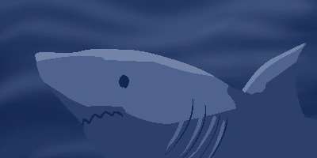 You are a shark in a strange blue sea.

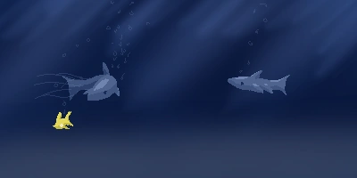 You attract the attention of a shark. Maybe they can help you catch fish! (Catch 5 fish)

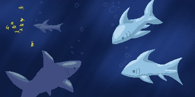 More sharks swim over, curious and watchful. (Recruit 1 shark)

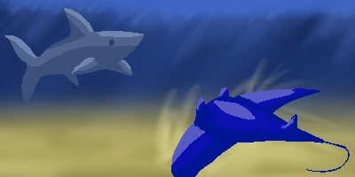 Some rays drift over. (Catch 15 fish)

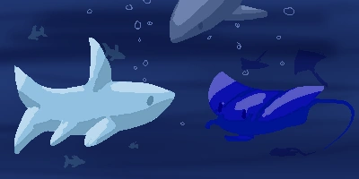 You have quite the group going now. (Hire 1 ray and recruit 1 shark)

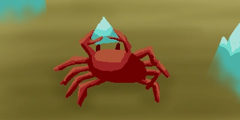 Some curious crabs come over. (Hire 4 ray and recruit 4 shark)

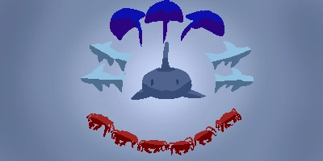 Your new tribe is at your command! (Acquire 1 crab)

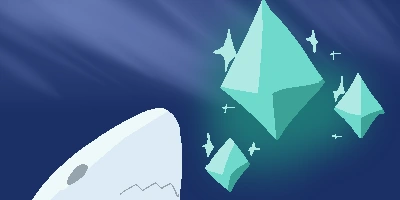 The crystals are shiny. Some sharks stare at them curiously. (Recruit 1 shark and dig up 10 crystals)

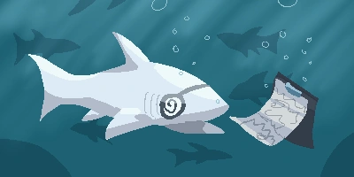 The science sharks swim in their own school. (Train 1 science shark)

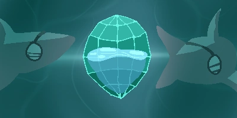 More discoveries are needed. (Research Crystal Container)

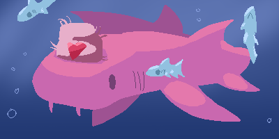 The shark community grows with time. (Train 1 nurse shark)

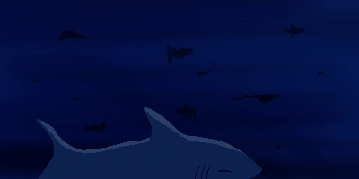 You hear faint songs and cries in the distance. (Research Exploration)

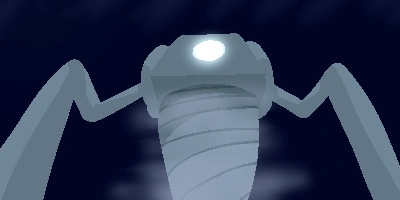 Machines to do things for you. Machines to do things faster than you or any shark. (Research Automation)

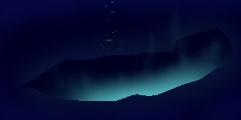 This place is not your home. You remember a crystal blue ocean. The chasms beckon. (Research Far Exploration)

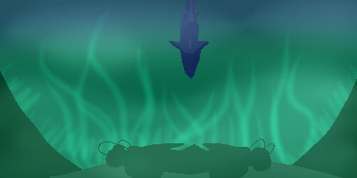 The gate beckons. The secret must be unlocked. (Research Chasm Exploration)

## The Gate

The shark passes through the [mysterious gate](strange-gate.md) and emerges alone into the strange place between worlds, somehow changed. It's not clear if the others follow, but none make it into the Gateway. Something unseen speaks, but isn't forthcoming with details. The same voice comments every time the Gateway is entered and when the menu is reopened, but rarely with anything useful, however it seems to drop occasional hints of what it might be. The shark then passes into one of 8 new [worlds](worlds.md) with only a foggy memory of what's happened.

## Stranger Oceans

From this point on the story continues on in a less organized manner. Each world has sprinkles of lore and possible refrences to someone like you having come before. New messages are displayed when new creatures are acquired, once again in order so that the latest message available is the one shown. 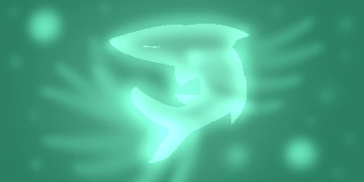 The other sharks obey and respect you, but they seem to fear you. It is not clear if you are truly a shark anymore, or something... else. (Earn 10 Essence)

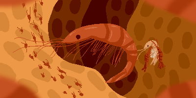 The shrimps are tiny, but hard-working. They live for their sponge hives. (Aquire 50 shrimp)

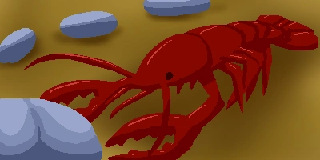 The lobsters work, but seem carefree. They worry about nothing. (Gain 20 lobsters)

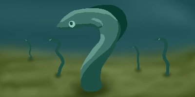 The eels chatter among their hiding places. They like the sharks. (Hire 10 eels)

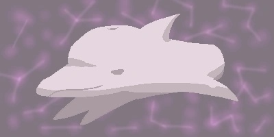 The dolphin pods that work with us speak of an star-spanning empire of their kind. They ask where our empire is. And they smile. (Fetch 5 dolphins)

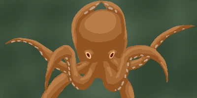 The octopuses speak of production and correct action. They speak of unity through efficiency. They regard us with cold, neutral eyes. (Employ 8 octopi)

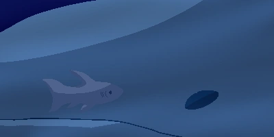 The whales speak rarely to us, working in silence as they sing to the ocean. What do they sing for? (Reach 1 whale)

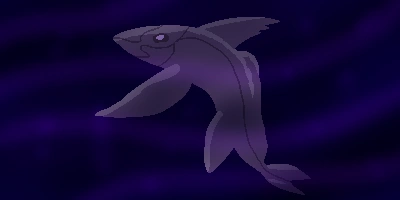 The chimaeras are ancient kin of the shark kind, reunited through wild coincidence. What peerless wonders have they found in the dark? (Procure 5 chimaeras)

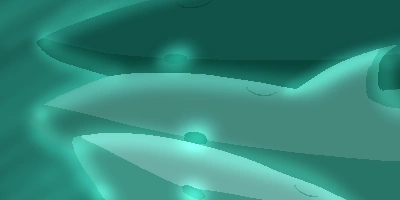 The whale song fills you with the same feeling as the gates. But so much smaller. (Assemble 1 whale chorus)

## Trivia

There is a currently unused item in the game called Numen that has glowing text in the land between the gate and displays the message when aquired through the debug menu "You also have (x) numen, and you radiate divinity." However this seems to have no effect on the game

The voice speaking to you from beyond the gate seems to be a future version of yourself.

There is no current way to reach the ending screen of the game, but it does exist. The following message is shown:

> Congratulations! You did it.  
> You saved the sharks!
>
> The gate leads away from this strange ocean...
>
> Back home to the oceans you came from!
>
> <h3>
>
> Or are they?
>
> </h3>

---

*Originally from the [Shark Game Wiki on Fandom](https://shark-game.fandom.com/wiki/Story), licensed under [CC BY-SA 3.0](https://creativecommons.org/licenses/by-sa/3.0/).*
