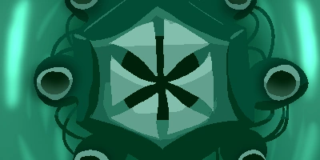
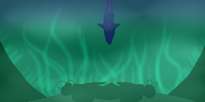
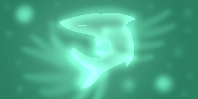
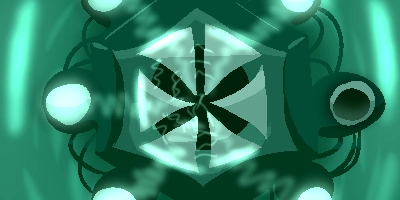
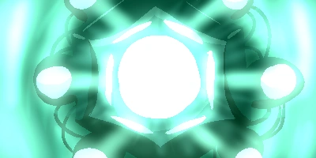

# Strange Gate

 The Strange Gate is unlocked by the researchable upgrade [Chasm Exploration](laboratory.md#chasm-exploration), costing 1K [Sharks](shark.md), 1M Science and 50K Fish. Once discovered the gate asks for 6 different items in specific quantities. These quantities must be met all at once, as the gate will not accept partial payments. The items the gate requests are determined by the type of world, and the quantity requested is the base amount multiplied by both the climate level and the gate cost multiplier of the gate controller artifact. The formula for this can be shown as ((BaseCost) \* (ClimateLevel) \* (GateCostMultiplier)), with the gate cost multiplier formula being (0.9 ^ GateControllerLevel)

Once all 6 slots are filled the gate opens and you can enter the [Gateway](gateway.md). From there you can purchase [Artifacts](artifacts.md) and proceed to other [Worlds](worlds.md).

## Gate Requirements

|                                                                                                                                                                               |                                                                                                                                                                                           |                                                                                                                                                             |
|-------------------------------------------------------------------------------------------------------------------------------------------------------------------------------|-------------------------------------------------------------------------------------------------------------------------------------------------------------------------------------------|-------------------------------------------------------------------------------------------------------------------------------------------------------------|
| **[Starter World](starter-world.md)** • 1M Fish • 1M Sand • 1M Crystals • 1K [Kelp](stuff.md#kelp) • 1K [Sea Apples](stuff.md#sea-apples) • 100K Sharkonium | **[Abandoned World](abandoned-world.md)** • 4M [Residue](recycler.md) • 5 [Purifiers](stuff.md#purifier) • 1M Coralglass • 500K Spronge • 1M Delphinium • 1M Sharkonium | **[Chaotic World](chaotic-world.md)** • 100K [Sponge](stuff.md#sponge) • 100K Clams • 1M Sand • 1M Crystals • 1000 Sharks • 1M Sharkonium |
| **[Frigid World](frigid-world.md)** • 1M Sand • 1M Crystals • 100K Clams • 10 [Heaters](stuff.md#heaters) • 100M Sharkonium • 100M Fish                     | **[Haven World](haven-world.md)** • 100M Fish • 10M Clams • 100M Sponge • 100M Kelp • 1M Coralglass • 20M Coral                                                         | **[Marine World](marine-world.md)** • 1B Fish • 10M Sand • 10M Crystals • 10M Kelp • 1M Sea Apples • 1M Sharkonium                        |
| **[Shrouded World](shrouded-world.md)** • 10M Jellyfish • 1M Clams • 100M Crystals • 10M Science • 10M Sharkonium • 10M Fish                                | **[Tempestuous World](tempestuous-world.md)** • 1B Residue • 50M Coral • 1M Spronge • 1M Delphinium • 1M Sharkonium • 50M Crystals                                      | **[Violent World](violent-world.md)** • 10B Sand • 1B Kelp • 1M Coral • 1000 Algae • 1M Sponge • 1B Residue                               |

## Special Events

 The gate beckons. The secret must be unlocked. (Requirement: Buy Chasm Exploration)

 The other sharks obey and respect you, but they seem to fear you. It is not clear if you are truly a shark anymore, or something... else. (Get 10 Essence)

 A foreboding circular structure, closed shut. One slot remains.

 The water glows and shimmers within it. A gentle tug pulls at you.

## Trivia

The presence of a gateway to another universe at the bottom of the ocean is reminiscent of the H.P. Lovecraft canon, but Cthulu never passed through a gateway into our world. In fact, R'lyeh (Cthulu's home) is a city that sank into the Pacific much like Atlantis, and the creature itself is said to lie in sleep at the bottom of the sea.[1]

[1] [The H.P. Lovecraft Wiki: Cthulu](https://lovecraft.fandom.com/wiki/Cthulhu)

---

*Originally from the [Shark Game Wiki on Fandom](https://shark-game.fandom.com/wiki/Strange_Gate), licensed under [CC BY-SA 3.0](https://creativecommons.org/licenses/by-sa/3.0/).*
