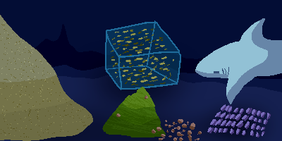

# Stuff

This page lists every item available in-game and the income gained (or lost) from those items. The availability of these resources vary [from world to world](worlds.md) and may be dependent on [research](laboratory.md). Cost increases by the base cost for each unit, so your first shark will cost 5 fish while your tenth will cost 50. This number is dependent only on how many units you currently possess, so you can buy and dispose of your tenth shark as many times as you want and it will always cost the same.

## **Basic**

| Unit               | Requirements                                         | Base Cost | Income per Unit              |
|--------------------|------------------------------------------------------|-----------|------------------------------|
| **Catch Fish**     | None                                                 | Free      | +1 Fish                      |
| **Pry Sponge**     | [Sponge Collection](laboratory.md#sponge-collection) | Free      | +1 [Sponge](stuff.md#sponge) |
| **Get Clam**       | [Clam Scooping](laboratory.md#clam-scooping)         | Free      | +1 Clam                      |
| **Grab Jellyfish** | [Jellyfish Hunting](laboratory.md#jellyfish-hunting) | Free      | +1 Jellyfish                 |

## **Frenzy**

| Unit                        | Requirements                                                                | Base Cost    | Income per Unit                           |
|-----------------------------|-----------------------------------------------------------------------------|--------------|-------------------------------------------|
| **[Shark](shark.md)**       | 5 Fish                                                                      | 5 Fish       | +1 Fish                                   |
| **[Ray](ray.md)**           | 15 Fish                                                                     | 15 Fish      | +0.2 Fish +1 Sand                      |
| **[Crab](crab.md)**         | 4 Sharks 4 Rays                                                             | 10 Fish      | +0.01 Crystals +0.02 Coral             |
| **[Shrimp](shrimp.md)**     | 5 Sponge [Seabed Geology](laboratory.md#seabed-geology)                     | 5 Sponge     | +0.5 Algae                                |
| **[Lobster](lobster.md)**   | 10 Clams [Seabed Geology](laboratory.md#seabed-geology)                     | 10 Clams     | +1 Clam +0.5 Sand                      |
| **[Dolphin](dolphin.md)**   | 10 Fish 50 Sharks [Cetacean Awareness](laboratory.md#cetacean-awareness) | 10 Fish      | +1 Fish +0.1 Sponge +0.05 Jellyfish |
| **[Whale](whale.md)**       | 100K Fish [Cetacean Awareness](laboratory.md#cetacean-awareness)         | 100K Fish    | +50 Fish                                  |
| **[Eel](eel.md)**           | 50 Fish [Seabed Geology](laboratory.md#seabed-geology)                   | 15 Fish      | +0.3 Fish +0.3 Sand                    |
| **[Chimaera](chimaera.md)** | 20 Jellyfish [Exploration](laboratory.md#exploration)                    | 20 Jellyfish | +1.5 Jellyfish +0.1 Fish               |
| **[Octopus](octopus.md)**   | 20 Clams [Exploration](laboratory.md#exploration)                        | 15 Clams     | +2 Clam                                   |

## **Jobs**

The number of Frenzy animals required does not increase for each unit.

| Unit                    | Requirements                                                          | Base Cost                                   | Income per Unit                          |
|-------------------------|-----------------------------------------------------------------------|---------------------------------------------|------------------------------------------|
| **Diver Shark**         | 1 Shark [Shrouded World](shrouded-world.md)                        | 1 Shark 30 Fish                          | +0.5 Crystals +0.5 Jellyfish          |
| **Science Shark**       | 1 Shark 20 Crystals                                                | 1 Shark 20 Crystals                      | +0.5 Science                             |
| **Laser Rays**          | 1 Ray [Laser Rays](laboratory.md#laser-rays)                       | 1 Ray 50 Crystals                        | -2 Sand +1 Crystals                   |
| **Planter Crab**        | 1 Crab [Kelp Horticulture](laboratory.md#kelp-horticulture)        | 1 Crab 200 Sand                          | +0.3 [Kelp](stuff.md#kelp)               |
| **Worker Shrimp**       | 1 Shrimp [Eusociality](laboratory.md#eusociality)                  | 1 Shrimp 20 Sponge                       | +0.1 Coral +1 Sponge                     |
| **Harvester Lobster**   | 1 Lobster [Crustacean Biology](laboratory.md#crustacean-biology)   | 1 Lobster 25 Clams 5 Sponge           | +0.3 Sponge +1 Kelp                   |
| **Dolphin Philosopher** | 1 Dolphin [Delphine Philosophy](laboratory.md#delphine-philosophy) | 1 Dolphin 30 Fish 10 Coral            | +1 Science                               |
| **Dolphin Treasurer**   | 1 Dolphin [Delphine Philosophy](laboratory.md#delphine-philosophy) | 1 Dolphin 20 Fish 20 Crystals         | +2 Crystals +2 Coral                  |
| **Eel Technician**      | 1 Eel [Eel Habitats](laboratory.md#eel-habitats)                   | 1 Eel 30 Fish 5 Crystals              | +0.8 Science                             |
| **Eel Sifter**          | 1 Eel [Eel Habitats](laboratory.md#eel-habitats)                   | 1 Eel 30 Fish                            | +0.2 Sand +0.9 Crystals +0.5 Kelp  |
| **Chimaera Transmuter** | 1 Chimaera [Chimaera Mysticism](laboratory.md#chimaera-mysticism)  | 1 Chimaera 10 Jellyfish 10 Sharkonium | +1 Sharkonium -5 Sand -15 Crystals |
| **Chimaera Explorer**   | 1 Chimaera [Chimaera Mysticism](laboratory.md#chimaera-mysticism)  | 1 Chimaera 30 Jellyfish 30 Crystals   | +5 Science +0.5 Jellyfish             |
| **Octopus Collector**   | 1 Octopus [Octopus Methodology](laboratory.md#octopus-methodology) | 1 Octopus 50 Clams                       | +1 Crystal +3 Coral                   |
| **Octopus Scavenger**   | 1 Octopus [Octopus Methodology](laboratory.md#octopus-methodology) | 1 Octopus 30 Clams                       | +2 Sand +2 Sponge                     |

## **Producers**

The number of Frenzy animals required does not increase for each unit.

| Unit                  | Requirements                                                        | Base Cost                          | Income per Unit        |
|-----------------------|---------------------------------------------------------------------|------------------------------------|------------------------|
| **Nurse Shark**       | [Biology](laboratory.md#biology)                                    | 1 Shark 100 Fish                | +0.01 Sharks           |
| **Ray Maker**         | 1 Ray [Ray Biology](laboratory.md#ray-biology)                   | 1 Ray 300 Fish 15 Kelp       | +0.05 Rays             |
| **Crab Brood**        | 1 Crab [Crab Biology](laboratory.md#crab-biology)                | 20 Crabs 200 Fish               | +0.2 Crabs             |
| **Lobster Berrier**   | 1 Lobster [Crustacean Biology](laboratory.md#crustacean-biology) | 1 Lobster 30 Clams              | +0.05 Lobsters         |
| **Shrimp Queen**      | 1 Shrimp [Eusociality](laboratory.md#eusociality)                | 1 Shrimp 50 Sponge              | +1 Shrimp -0.01 Sponge |
| **Dolphin Biologist** | 1 Dolphin [Dolphin Biology](laboratory.md#dolphin-biology)       | 1 Dolphin 10 Fish 20 Science | +0.005 Dolphins        |
| **Eel Pit**           | 1 Eel [Eel Habitats](laboratory.md#eel-habitats)                 | 3 Eel 50 Fish 20 Sand        | +0.01 Eels             |

## **Processing**

These items don't increase in cost.

| Unit                              | Requirements                                                     | Base Cost              | Income per Unit |
|-----------------------------------|------------------------------------------------------------------|------------------------|-----------------|
| **Study sea apples**              | 1 Sea Apple [Xenobiology](laboratory.md#xenobiology)          | 1 Sea apple            | 5 Science       |
| **Dissect sponge**                | 1 Sponge [Xenobiology](laboratory.md#xenobiology)             | 1 Sponge               | 5 Science       |
| **Dismantle jellyfish**           | 1 Jellyfish [Xenobiology](laboratory.md#xenobiology)          | 1 Jellyfish            | 5 Science       |
| **Convert clam pearls**           | 1 Clam [Pearl Conversion](laboratory.md#pearl-conversion)     | 1 Clam 5 Science    | 1 Crystal       |
| **Transmute stuff to sharkonium** | [Transmutation](laboratory.md#transmutation)                     | 5 Crystals 15 Sand  | 1 Sharkonium    |
| **Smelt stuff to coralglass**     | [Coralglass Smelting](laboratory.md#coralglass-smelting)         | 10 Coral 10 Sand    | 1 Coralglass    |
| **Fuse stuff into delphinium**    | [Aquamarine Fusion](laboratory.md#aquamarine-fusion)             | 15 Coral 5 Crystals | 1 Delphinium    |
| **Forge sponge into spronge**     | [Industrial-Grade Sponge](laboratory.md#industrial-grade-sponge) | 5 Sponge 15 Residue | 1 Spronge       |

## **Shark Machines**

| Unit                | Requirements                                                                          | Base Cost                                 | Income per Unit                             |
|---------------------|---------------------------------------------------------------------------------------|-------------------------------------------|---------------------------------------------|
| **Crystal Miner**   | [Automation](laboratory.md#automation)                                                | 100 Crystals 200 Sand 20 Sharkonium | +200 Crystals                               |
| **Sand Digger**     | 150 Sharkonium [Automation](laboratory.md#automation)                              | 500 Sand 150 Sharkonium                | +300 Sand                                   |
| **Fish Machine**    | [Automation](laboratory.md#automation)                                                | 100 Sharkonium                            | +1000 Fish                                  |
| **Auto-Transmuter** | [Engineering](laboratory.md#engineering)                                              | 100 Crystals 200 Sharkonium            | -50 Crystals -150 Sand +20 Sharkonium |
| **Skimmer**         | 100 Residue [Engineering](laboratory.md#engineering)                               | 300 Residue 200 Sharkonium             | +10 Residue -8 Sand -3 Fish           |
| **Purifier**        | 500 Sharkonium [Environmentalism](laboratory.md#environmentalism)                  | 500 Sharkonium                            | -1 [Tar](stuff.md#tar)                      |
| **Heater**          | 1 Ice 300 Sharkonium [Thermal Conditioning](laboratory.md#thermal-conditioning) | 300 Sharkonium                            | -10 [Ice](stuff.md#ice)                     |

## **Other machines**

These items are not separated by source. Machines purchased with coralglass are crustacean machines, available in worlds which have [lobsters](lobster.md). Those purchased with delphinium are cetacean machines, available in worlds which have [dolphins](dolphin.md). Those purchased with spronge are cephalopod machines, available in worlds which have [octopi](octopus.md).

| Unit                 | Requirements                                                         | Base Cost                                   | Income per Unit                             |
|----------------------|----------------------------------------------------------------------|---------------------------------------------|---------------------------------------------|
| **Sponge Farmer**    | [Coral Circuitry](laboratory.md#coral-circuitry)                     | 200 Coralglass                              | +10 Sponge +10 Algae                     |
| **Berry Sprayer**    | 2 Lobster [Coral Circuitry](laboratory.md#coral-circuitry)        | 500 Coralglass                              | +6 Lobster                                  |
| **Glass Maker**      | [Coral Circuitry](laboratory.md#coral-circuitry)                     | 400 Coralglass 200 Sand 200 Coral     | +10 Coralglass -150 Coral -150 Sand   |
| **Silent Archivist** | [Dolphin Technology](laboratory.md#dolphin-technology)               | 300 Delphinium 200 Science               | +10 Science                                 |
| **Tireless Crafter** | [Dolphin Technology](laboratory.md#dolphin-technology)               | 200 Delphinium 200 Crystals 200 Coral | +10 Delphinium -150 Coral -50 Crystal |
| **Clam Collector**   | 50 Spronge [Spronge Biomimicry](laboratory.md#spronge-biomimicry) | 50 Spronge                                  | +10 Clams                                   |
| **Egg Brooder**      | 10 Octopus [Spronge Biomimicry](laboratory.md#spronge-biomimicry) | 150 Spronge 1 Octopus                    | +1 Octopus                                  |
| **Spronge Smelter**  | [Spronge Biomimicry](laboratory.md#spronge-biomimicry)               | 100 Spronge                                 | +30 Spronge -50 Sponge -150 Residue   |
| **Sea Scourer**      | 1 Tar [Spronge Biomimicry](laboratory.md#spronge-biomimicry)      | 100 Spronge 50 Residue                      | -1 Tar +10 Residue                          |
| **Prosthetic Polyp** | 50 Coral [Spronge Biomimicry](laboratory.md#spronge-biomimicry)   | 100 Spronge 50 Coral                     | +30 Coral                                   |

## Unique

| Unit                         | Requirements                                          | Base Cost   | Income per Unit                                 |
|------------------------------|-------------------------------------------------------|-------------|-------------------------------------------------|
| **Whale Chorus (Maximum 1)** | 1 Whale [Eternal Song](laboratory.md#eternal-song) | 1000 Whales | +0.000001 essence (+1 essence every ~11.6 days) |

## Unbuyable

| Unit       | Source                                                                           | Income per Unit                                                                                                                      |
|------------|----------------------------------------------------------------------------------|--------------------------------------------------------------------------------------------------------------------------------------|
| **Kelp**   | Planter Crab Lobster Harvester Eel Sifter                                  | +0.001 Sea Apple                                                                                                                     |
| **Sponge** | Dolphin Shrimp Worker Lobster Harvester Octopus Scavenger Sponge Farmer | +0.0001 Sponge -0.001 Algae                                                                                                          |
| **Tar**    | [Abandoned World](abandoned-world.md)                                            | -0.0001 [Frenzy](stuff.md#frenzy) -0.0001 [Jobs](stuff.md#jobs) -0.0001 [Producers](stuff.md#producers)                        |
| **Ice**    | [Frigid World](frigid-world.md)                                                  | -0.001 Fish -0.001 Jellyfish -0.001 Clams -0.001 Kelp -0.001 Coral -0.001 Algae -0.001 Sea Apples -0.001 Sponge |

## Trivia

Sponges and algae have a significant symbiotic relationship. Algae provides oxygen and nutrients for the sponge, while sponges provide algae with lots of fertile spaces to grow in. Algae isn't the only organism that makes its home inside of sponges, though. Crustaceans, worms, brittle stars, mollusks and shrimp have all been known to use sponges as shelter. Some crabs will even attach living sponge fragments to their shell in order to discourage predators.[1]

[1] [Encyclopædia Britannica: Sponge](https://www.britannica.com/animal/sponge-animal)

---

*Originally from the [Shark Game Wiki on Fandom](https://shark-game.fandom.com/wiki/Stuff), licensed under [CC BY-SA 3.0](https://creativecommons.org/licenses/by-sa/3.0/).*
