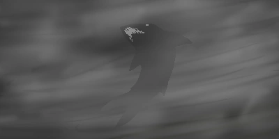

# Tempestuous World

*A swirling maelstrom of storms where nothing rests.* 

> **You are a shark in a stormy grey sea.**

> The storm never ends, and many are lost to its violent throes.

## Summary

Tempestuous worlds have plenty of resources, but they're all lost quickly at the start. It's not clear how anything could survive these circumstances, but it's not a nice way to start your journey through this particular world. Once resources are being produced at higher rates than they're lost, progress moves here as quickly as anywhere else.

## Resources

### Frenzy

|                            |                                    |                               |
|----------------------------|------------------------------------|-------------------------------|
| • Shark • Ray • Crab | • Shrimp • Lobster • Dolphin | • Whale • Eel • Octopus |

### Basic Materials

|                                |                                   |                               |
|--------------------------------|-----------------------------------|-------------------------------|
| • Fish • Sand • Crystals | • Coral • Sea Apples • Clam | • Kelp • Sponge • Algae |

### Advanced Materials

|                                              |                        |
|----------------------------------------------|------------------------|
| • Sharkonium • Delphinium • Coralglass | • Residue • Spronge |

### Multipliers

- Planetary Income - Materials (-0.02)
  - Basic materials (except crystals) are lost at a rate of Climate Level×0.02/s
- Planetary Income - Crystals (-0.002)
  - Crystals are lost at a rate of Climate Level×0.002/s
- Planetary Income - [Frenzy](stuff.md#frenzy) (-0.0001)
  - Animals obtainable in the Frenzy tab (see above) are lost at a rate of Climate Level×0.0001/s

## Ending messages

"You braved the maelstrom and came from it unscathed."  
"A surprising victory from a veteran of the seas."  
"Charge through the whirlpool. Give no quarter to the storm."  
"The turbulent seas were no match for your prowess."

## Trivia

Large, powerful currents undersea can kick up huge amounts of sediment and sweep away any living or non-living thing nearby. This phenomenon is called a benthic storm, or an abyssal storm, and has only been known to occur in deep ocean regions. These storms might make the water appear grey, especially to creatures who don't see color the same way humans do.[1]

[1] [ABC News: Scientists Find Seafloor Storms in Ocean](https://abcnews.go.com/Technology/story?id=119828)

---

*Originally from the [Shark Game Wiki on Fandom](https://shark-game.fandom.com/wiki/Tempestuous_World), licensed under [CC BY-SA 3.0](https://creativecommons.org/licenses/by-sa/3.0/).*
