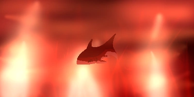

# Violent World

*An ocean boiling and choking under sulfuric fumes.* 

> **You are a shark in a searing red sea.**

> Bursts of plenty from the scorching vents, but so hot. No place for the young.

## Summary

Violent worlds produce plenty of resources, but few [Frenzy](stuff.md#frenzy) animals are able to survive the extreme environment. Sulfuric fumes and scorching vents suggest that this planet is covered in undersea volcanoes. It's understandable then that [breeders](stuff.md#producers) produce far less than in other worlds. Multiple mentions are made of the ocean boiling, but this must be considered a metaphor as the water doesn't boil even in erupting undersea volcanoes, and it would be impossible for a shark to survive in waters that hot.

## Resources

### Frenzy

|                            |                                    |
|----------------------------|------------------------------------|
| • Shark • Ray • Crab | • Shrimp • Lobster • Dolphin |

### Basic Materials

|                                |                                   |                                   |         |
|--------------------------------|-----------------------------------|-----------------------------------|---------|
| • Fish • Sand • Crystals | • Coral • Sea Apples • Clam | • Kelp • Jellyfish • Sponge | • Algae |

### Advanced Materials

|                                              |                        |
|----------------------------------------------|------------------------|
| • Sharkonium • Delphinium • Coralglass | • Residue • Spronge |

### Multipliers

- Planetary Income Reciprocal Multiplier - Breeders (1)
  - [Living breeders](stuff.md#producers) produce animals at their normal rate divided by the Climate Level
- Planetary Income - Sand (0.1)
  - Sand is gained at a base rate of Climate Level×0.1/s
- Planetary Income - [Kelp](stuff.md#kelp) (0.001)
  - Kelp is gained at a base rate of Climate Level×0.001/s
- Planetary Income - Coral (0.00001)
  - Coral is gained at a base rate of Climate Level×0.00001/s
- Planetary Income - Algae (0.0001)
  - Algae is gained at a base rate of Climate Level×0.0001/s

## Ending messages

"The boiling ocean only stirred you on."  
"So hard to survive, yet so lucrative. A deadly balance."  
"This is not the harshest world you will endure, surely."  
"You are forged from the geothermal vents."

## Trivia

Underwater volcanoes often form smoking stacks of mineral where magma meets sea water. These structures are called hydrothermal vents, and are host to their own thriving ecosystem. Among the creatures that live in these sunless regions are varieties of shrimp, mussels and tubeworms, all of which feed on specialized bacteria that use the chemicals the vents give off in order to survive.[1]

[1] [Smithsonian: Ocean](https://ocean.si.edu/ocean-life/invertebrates/hydrothermal-vent-creatures)

---

*Originally from the [Shark Game Wiki on Fandom](https://shark-game.fandom.com/wiki/Violent_World), licensed under [CC BY-SA 3.0](https://creativecommons.org/licenses/by-sa/3.0/).*
