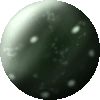
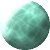
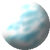
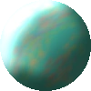
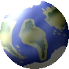
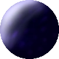
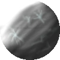
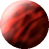

# Worlds

## Other worlds await.

|                                                                                          |                                                                                                      |                                                                                      |
|------------------------------------------------------------------------------------------|------------------------------------------------------------------------------------------------------|--------------------------------------------------------------------------------------|
|  [Starter World](starter-world.md)     |  [Abandoned World](abandoned-world.md)         |  [Chaotic World](chaotic-world.md) |
|  [Frigid World](frigid-world.md)         |  [Haven World](haven-world.md)                         |  [Marine World](marine-world.md)     |
|  [Shrouded World](shrouded-world.md) |  [Tempestuous World](tempestuous-world.md) |  [Violent World](violent-world.md) |

From the [Gateway](gateway.md) you are given 3 randomly selected worlds to choose from for your next destination. These will be at varying Climate Levels, but all will be close to the level of your last world. This Climate Level is important in calculating some of the multipliers listed below and the Essence gained from completing each world.

## Quick Reference Guide

Resources not listed are [Shark](shark.md), [Ray](ray.md), Fish, Sand, Crystal, [Kelp](stuff.md#kelp), Sharkonium and [Residue](recycler.md), which are available in every world. Resources dependent on other factors are also excluded: Delphinium is available in every world that has [dolphins](dolphin.md), Coralglass in every world that has [lobsters](lobster.md) and Spronge in every world that has [sponge](stuff.md#sponge).

|                                               | Multipliers\*                                                                                                                                                                                                                                                                                                                                                                                                              | Resources                                                                                          |
|-----------------------------------------------|----------------------------------------------------------------------------------------------------------------------------------------------------------------------------------------------------------------------------------------------------------------------------------------------------------------------------------------------------------------------------------------------------------------------------|----------------------------------------------------------------------------------------------------|
| **[Starter World](starter-world.md)**         | No multiplier, no problems, no picture.                                                                                                                                                                                                                                                                                                                                                                                    | Materials • [Sea Apples](stuff.md#kelp)                                                         |
| **[Abandoned World](abandoned-world.md)**     | A dying world filled with machinery. • Planetary Income - [Tar](stuff.md#tar) (0.1) • Planetary Starting Resources - [Crystal Miners](stuff.md#crystal-miner) (1) • Planetary Starting Resources - [Sand Diggers](stuff.md#sand-digger) (1) • Planetary Starting Resources - [Fish Machines](stuff.md#fish-machine) (1) • Planetary Starting Resources - [Silent Archivists](stuff.md#silent-archivist) (1) | Harmful • Tar Materials • Coral • Sea Apples • Clams • [Sponge](stuff.md#sponge) |
| **[Chaotic World](chaotic-world.md)**         | A frenetic world, torn by immaterial force. • Planetary Income - [Frenzy](stuff.md#frenzy) (0.0001) • Planetary Income - Animals (-0.0001) • Planetary Income - Materials (-0.001)                                                                                                                                                                                                                                | Materials • Coral • Sea Apples • Clams • Jellyfish • Sponge • Algae              |
| **[Frigid World](frigid-world.md)**           | A cold, chilling ocean freezing slowly to death. • Planetary Income Reciprocal Multiplier - [Breeders](stuff.md#producers) (1) • Planetary Income Multiplier - Machines (1) • Planetary Income - [Ice](stuff.md#ice) (0.001)                                                                                                                                                                                      | Harmful • Ice Materials • Clams • Jellyfish • Sponge                                |
| **[Haven World](haven-world.md)**             | An aquamarine world of plenty. So beautiful, yet so vulnerable. • Planetary Income Multiplier - Breeders (1) • Planetary Boost - Animals (1)                                                                                                                                                                                                                                                                         | Materials • Coral • Sea Apples • Clams • Jellyfish • Sponge • Algae              |
| **[Marine World](marine-world.md)**           | A serene blue world. Peaceful, beautiful, so close to home. • Planetary Boost - Fish (1.5)                                                                                                                                                                                                                                                                                                                              | Resources • Coral • Sea Apples • Clams • Jellyfish • Sponge • Algae              |
| **[Shrouded World](shrouded-world.md)**       | A dark, murky ocean of secrecy and danger • Planetary Income - Crystals (0.05) • Planetary Boost - Crystals (1) • Planetary Reciprocal Boost - Animals (1) • Planetary Reciprocal Boost - Kelp (1) • Planetary Reciprocal Boost - Coral (1) • Planetary Income Reciprocal Multiplier - [Specialists](stuff.md) (0.5)                                                                                     | Materials • Coral • Sea Apples • Clams • Jellyfish • Algae                          |
| **[Tempestuous World](tempestuous-world.md)** | A swirling maelstrom of storms where nothing rests • Planetary Income - Materials (-0.02) • Planetary Income - Crystals (-0.002) • Planetary Income - Frenzy (-0.0001)                                                                                                                                                                                                                                            | Materials • Coral • Sea Apples • Clams • Sponge • Algae                             |
| **[Violent World](violent-world.md)**         | An ocean boiling and choking under sulfuric fumes • Planetary Income Reciprocal Multiplier - Breeders (1) • Planetary Income - Sand (0.1) • Planetary Income - Kelp (0.001) • Planetary Income - Coral (0.00001) • Planetary Income - Algae (0.0001)                                                                                                                                                        | Materials • Coral • Sea Apples • Clams • Jellyfish • Sponge • Algae              |

\*See the world pages for more information on specific multipliers

## Trivia

The Starter World is the only world unable to show back up in the world select menu and has no picture for it.

---

*Originally from the [Shark Game Wiki on Fandom](https://shark-game.fandom.com/wiki/Worlds), licensed under [CC BY-SA 3.0](https://creativecommons.org/licenses/by-sa/3.0/).*
